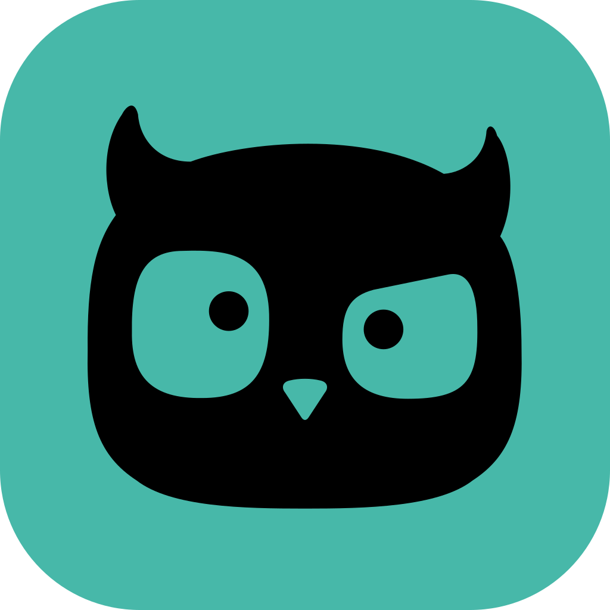
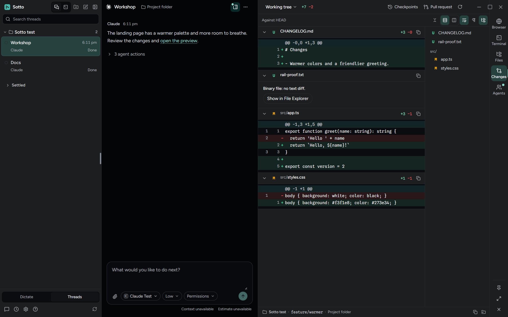

<div align="center">



# Sotto

**Your coding agents in one desktop window, with dictation built in.**

[](https://github.com/millZach/Sotto-releases/releases/latest)
[](#install)
[](LICENSE.md)

**[Download the latest release](https://github.com/millZach/Sotto-releases/releases/latest)**



</div>

Sotto runs the Claude Code, Codex, Grok Build, Devin, Muse and OpenCode clients you already have, and in Sotto Owl Cursor's CLI and DeepSeek Harness too, and keeps every thread in one sidebar. It is free, open source and in beta.

Saved Codex conversations keep both sides after a restart. Opening a thread also repairs repeated prompts saved by earlier versions.

Voice control and per-thread management have been removed. Dictation and manual threads remain available.

When a failed creation keeps your prompt or screenshots, the error names the project where you can recover them. The prompt returns in the next new thread opened in that project, while this window stays open. Staged screenshots come with it while available; unused screenshots are kept for an hour. Prompts that cannot fit together stay as **Not sent** messages with **Restore prompt**.

## What it does

An unconfirmed prompt can be checked again. For a prompt sent at once, **Continue with a new message**, on the desktop that owns the thread, sets it aside without resending it and keeps your next draft. Normal automatic updates resume once the provider confirms a new message in that thread.

- **One sidebar for every agent.** Each provider keeps its own sign-in and models. Sotto keeps the threads. Stop still reaches running work when its last prompt is unconfirmed. When Sotto starts, a starting screen shows each provider and host as it connects and opens the app once they have; after ten seconds you can open it without the ones that have not answered. Sotto starts as many threads as you or your agents ask for; while more than ten are working on this computer, a line under the sidebar's search says it may slow down or use its battery faster.
- **Muse and OpenCode too.** Connect Muse (`muse` on this computer, signed in with `muse login`) or OpenCode 2 (`opencode`) in Settings → Providers like the other clients. Muse threads run on your Muse account. On a computer where Muse's own shell sandbox cannot be set up, **Shell sandbox** on its page turns the sandbox off for that computer: Muse's shell commands and file tools then run with your own access, and approvals still ask wherever they asked before: a thread on Ask for approval still asks. Muse side drafting is unavailable until its client can disable every tool: thread names keep the opening words, and empty commit messages use the existing stand-in subject. Sotto runs OpenCode in a folder of its own, apart from your own OpenCode's, so it starts with no sign-ins and offers OpenCode Zen's free models until you sign in to a model source in it, under Model sources on its tile in Settings → Providers. Sotto finds OpenCode 2 however it was installed, and passes over an OpenCode 1 for it; with only OpenCode 1 installed, it says how to install OpenCode 2. Sotto checks both for updates like the other clients.
- **Cursor, in Owl.** Connect Cursor's CLI (`agent`, signed in from its row in Settings → Providers or with `agent login`) like the other clients. Its threads run on your Cursor plan, and its model menu offers every model Cursor lists, grouped by the company that made it. Sotto runs Cursor with a Cursor folder of its own, so a thread never changes the model or settings of the Cursor you use yourself, and your own `agent ls` does not list Sotto's chats; your Cursor sign-in, skills and rules still reach them. On Ask for approval Cursor still makes edits inside the project folder without asking, since it gives no client a way to be asked about them; it asks before every command, web request and tool. Auto uses Cursor's own auto-review, which judges on Cursor's servers what is safe to run. Cursor reports no token counts, so it is not in Usage. Watcher runs on Cursor too, a paired host runs Cursor where its own Cursor CLI is installed and signed in, and the iPhone and Android apps open Cursor threads.
- **DeepSeek Harness, in Owl.** Connect DeepSeek's own harness (`dsh`) like the other clients. Its threads run only on your own model servers (the ones that need no key for now), so the model on your own cluster can be driven by DeepSeek's harness as well as by OpenCode; its model menu groups each server's models under its name. Sotto runs it with a harness folder of its own, so the DeepSeek Harness you run yourself stays as it is. Ask for approval denies a first write and the model asks to retry it past you; Allow edits also runs commands and network inside the workspace sandbox without asking, and asks before anything crosses it. Replies arrive whole rather than word by word, and it is not in Usage.
- **Visuals in the thread.** An agent in a project thread can draw a diagram, or a small interactive page it wrote, where you read its replies, to show how something works. A visual with steps walks you through it one step at a time, lighting the part each step is about; **Read all** shows every step at once. Drawing one asks you nothing; turn it off in Settings.
- **You answer every request.** Anything a thread's permissions don't already allow waits for you. A desktop set up over your SSH account can answer requests and change thread permissions as soon as setup finishes, and can do so over your tailnet as well once it connects that way. A phone or another device paired by code needs your separate permission to do those things.

If Codex asks for an approval Sotto cannot show, Sotto refuses it and tells you. This includes an unknown child thread on a thread's own Codex process. Nothing is approved; answer in Codex meanwhile.
- **Tools beside each thread.** A browser, a test iPhone, a terminal, the thread's files and its changes. The test iPhone is a phone-sized page in that browser where an agent checks a web or Expo-web build by tapping, swiping and typing, while you watch it float over the thread. It is not iOS. For a native build, add a run.cloud key and an agent can ask to start a **cloud iPhone**, an iOS simulator you watch the same way. Terminal input stays in order; if input is refused, Sotto says so before you try again. Every terminal can search its output, open web links on Ctrl+click (Cmd+click on a Mac) or from the keyboard with **Open terminal link**, remember its text size and take a pasted image. Search keeps the query and current match when a terminal returns or repaints, while the matching text remains.
- **A terminal under each thread.** Each thread pane opens its own terminal in the project folder, across the bottom of the pane, with its button or Ctrl+J (Cmd+J on a Mac). Its shells keep running while it is hidden.
- **Thread shortcuts you can change.** Start, settle and restore threads, move between them, zoom or close a pane, focus the prompt, stop a turn and open Changes, the Terminal drawer or the branch bar from the keyboard. **Settings → Keyboard** lists every shortcut, records new keys when you press them, and can remove one or restore them all. Dictation stays global in **Settings → Dictation** and wins if the keys collide.
- **Codex's Computer Use.** In a Codex thread set to Full access, with the Codex app open, Codex can operate the apps on your computer. When the app changes its connection, Sotto refreshes the thread's tools before the next prompt; a refresh failure leaves that prompt unsent so you can try again. If its connection is still unavailable, open Codex if it is closed. Keep it open and try again. If that continues, restart Sotto when your other threads are idle.
- **Git in one press.** Commit, push and open a pull request. Leave the message empty and the agent writes it. Selected files keep staged hunks; files left out keep their staging. While a Git action runs, sends from threads sharing that checkout are refused. Your text is kept so you can send it again when the action finishes. A refused Git action names the thread holding the folder and says whether to wait, answer it or review its pending work.
- **Babysitting a pull request.** A thread can babysit its pull request instead of polling GitHub: the agent starts it with Sotto's tool, or you choose **Babysit pull request** in the Pull request surface's ··· menu. Sotto checks GitHub every two minutes and sends the thread a wake-up when a check fails, the checks pass, someone reviews, the branch conflicts or the pull request merges. While the thread rests, its sidebar row says **Babysitting #74**, and a wake-up shows in the thread as Sotto's, every word of it. Stop it from the line above Merge; turn the agent's tool off in Settings.
- **Worktrees for parallel work.** Choose the current checkout, a new worktree, or one of five recent worktrees under the composer. Search finds older worktrees. Remove a thread's own folder when you're done, after reviewing any ignored files and their file counts. Nested repositories and worktrees are listed too, including uncommitted work and repository commits not on any remote, including history in clean or deinitialized submodules. They are removed only after your acknowledgement.
- **Watcher.** A third room, the owl between Dictate and Threads: Watcher, a thread on your own Codex, Claude Code, Grok Build or Muse account, or in Owl your Cursor plan, that starts and briefs your other threads, in a room of its own with no sidebar: a line names each thread that needs you, All threads lists every other thread, and a thread opens beside Watcher in its own pane. **Visualize** draws the threads Watcher watches as owls on a tree for each computer, a branch for each project, with the merge turns along the top and Watcher's messages flying between them as they happen. Cards under each reply show what Watcher did; their thread names open the thread beside it. A watched thread's question or permission shows its own card under the reply that tells you of it, so you can answer it there. Sending in a thread Watcher drove adds a takeover line, and **Stop all** asks first and stops only threads Watcher started. **Watch**, on a thread's pane, its row or a new thread's composer, gives that thread to Watcher until you stop it, even after a request closes or Sotto restarts, and a watched thread shows the owl after its provider logo. You choose what Watcher may do without asking, Sotto marks any reply in which it changed files itself, and Watcher never answers a thread's questions or permissions; see [Watcher](#watcher).
- **Where new workers start, in Sotto Owl.** Watcher can start workers on any machine you connected, not only this one. Say where in a request, such as "spawn these on forge" or "run the Linux checks", and Watcher starts them there, in that machine's copy of the same project, and tells you where. Sotto never clones a project for you. A worker whose request names no machine starts on This computer until a later Owl build adds a setting for it, unless Watcher starts it in a project on another machine, where it stays.
- **Usage.** The sidebar's Usage link shows your subscription limits and all the work Claude Code and Codex did on each of your computers, in Sotto and outside it, and what Grok Build, Devin, Muse and OpenCode did in Sotto's threads: prompts, models, tokens, subagents, daily trends and busiest hours, with Sotto's share told apart. Pick a headline for its focused view, or open Subscriptions and Models.
- **Continue on another provider.** When Claude Code stops a turn at your plan's usage limit, or from a started thread's model chip, carry the thread on in a new thread on another provider, in the same folder. Your first message there goes with a handover of the thread so far, the old thread stays readable and sendable, and each links to the other.
- **Update all and resuming after a restart.** One card in the corner lists what is out of date on this computer and every connected host, updates it all with one press through the same GitHub releases and npm registry checks Sotto already makes, and then asks to restart. Threads that were working when Sotto closed, for any reason, carry on when it opens again, with a note from Sotto saying they were stopped; your own message is never sent twice. Turn **Resume threads after a restart** off in Settings → Threads to stop that. See the [guide](docs/guide.md#update-all).
- **Dictation off.** If you dictate with another app, turn off **Dictate with Sotto** at the top of Settings → Dictation. Sotto frees the hotkey, unloads the speech model and hides the widget and the Dictate room; your transcripts and settings are kept.
- **Notifications on the Mac.** Sotto tells you in a macOS notification when a thread needs you, and when a thread has finished everything: no reviewer, babysat pull request or background work left, and nothing on its way to send. Turn either off in Settings → Application → Notifications. Press one to open its thread.
- **Dictation anywhere.** Press `Ctrl+Shift+Space` (`⌃⇧Space` on a Mac), speak, and press it again. On Omarchy, press **Set up all three** in first-run setup or **Settings → Dictation**, then hold F9 to talk or press Super+Ctrl+X to toggle. Change those keys in **Settings → Dictation** by pressing them, as on Windows and macOS; Sotto rewrites its Hyprland bindings. Keep Sotto running; if it is closed, the key shows a notification asking you to open it. Sotto copies your text, then pastes at your cursor. Automatic paste works on Hyprland, terminals included. If it does not get through, use Super+V, Omarchy’s universal paste for apps and terminals. Setup checks again when you return to its step or Settings → Dictation, and when Sotto regains focus.
- **A Journal of what you dictated.** The Dictate room lists every transcript by day under a small dictate bar, with search, a chip for each app you dictate into most, and Ctrl+K (Cmd+K on a Mac) to search from any page. A row opens in place with its full text, Copy and Delete. Beside it, a column counts today against your usual pace, your speed over 30 days, your streak, where your words went and the time dictation saved this month against your typing speed (**Settings → Dictation**). The numbers come from each dictation's record, so they keep counting with **Keep local history** off. There is no separate History page.

Thread drafts save automatically while you type, including while other threads are working.
For a remote thread, the laptop also keeps the latest text and image selections during remote saves. A disconnect or busy host does not replace those edits with an older host draft. Recovery saves the original draft; it never sends an answer automatically.

Standalone Chats, including Talk and Generate prompt, has been removed. With **Keep local history** on, existing `personal-chat/` files and personal records in `request-drafts.json` are preserved without reopening conversations, reconnecting providers or showing old drafts. Turning history off clears Sotto's retained personal transcripts and submitted answers; startup applies the same cleanup when history is already off. Provider-owned history is untouched; nothing is migrated into Threads.

After you type in the Claude CLI, the next send from Sotto resumes the updated native history, even if the restart stops background work.

If a Claude Code answer is unconfirmed, **Check again** checks the request without sending anything. A delayed write keeps your original choice; another answer is allowed only after the write fails outright or the client is gone.

Codex, Claude Code and new Grok Build threads are asked to put a question for you through their own question tool. When a model writes a question into a reply instead and keeps working, the finished turn quotes it under its **Worked for** line, with **Show where it asked**.
Pressing the dictation shortcut again while the microphone is connecting cancels the session as soon as it is ready. No audio is kept or transcribed.

Settings → Threads sets the working-copy default for new threads. Expand **Project defaults** to choose a different default for one project. Previously saved project choices are kept when Sotto updates.

Saved question answers clear when the computer running the thread confirms receiving them. If **Check again** confirms acceptance, the answer stays sent; it does not become an editable draft again. An unconfirmed answer stays available for recovery and is never sent again automatically. Remote confirmation requires an updated desktop and host. The composer sends its draft in one action. If the host needs an update to save or send that draft, its text stays only in the current window. Update the host before closing the window.

If a provider asks the same question again after restarting, its earlier receipt does not answer the new request. **Check again** reads the provider before allowing a fresh answer. It sends nothing; you choose and send again yourself. An older remote host may need an update to support this check.

New threads open in Unsettled with the defaults saved in Settings → Threads. An existing empty thread is reused only while it is unsettled, its known model, effort and permission choices match those defaults, and no setting change is pending. On Owl, settled threads can be cleared for good, one from its menu or all past an age from Settings → Threads, and on their own once quiet 30 days unless you choose otherwise; clearing keeps branches, Usage's numbers and the provider's own session files, and never takes a thread with uncommitted work or an open pull request.

In Settings, **Test microphone** checks the same input selected for dictation. **Stop test**, hiding the window, or leaving Dictation closes the microphone. Changing the input clears the previous test. A quiet test asks you to check that the microphone is not muted.

The personal dictionary holds up to 4,000 characters. It saves when you leave the field or Settings. A paste cut to fit the limit is announced, and a failed save after leaving Settings says where to enter the unsaved edits again.

A failed save under Phones or for **Run the local host** shows beside the control and keeps the previous setting.

Escape dismisses a saved host's SSH question. While SSH is still waiting, **Answer** on its row in Settings → Hosts & phones reopens it.

The Tools terminal and the terminal drawer prefer PowerShell 7 on Windows when it is on PATH, and use the login shell on macOS and Linux. Tools and drawer shells share 32 slots across all threads, ended shells included. After quitting, those shells return with no saved output.

## Install

You need Windows 10 or 11 (x64), an Apple silicon Mac with macOS 12 or newer, or Omarchy on x64 Linux (Arch and Hyprland).

**Windows.** Run `Sotto Setup <version>.exe`. Connecting an SSH host uses Windows' .NET Framework 4, which Windows 10 and 11 include. At least 1 GB of free space during installation is needed. The desktop shortcut is optional and unchecked by default. The installer isn't code-signed, so Windows may show a SmartScreen warning.

**macOS.** Drag Sotto into Applications. The app isn't notarized, so the first launch is blocked: open **System Settings → Privacy & Security** and press **Open Anyway**, or run:

```bash
xattr -dr com.apple.quarantine /Applications/Sotto.app
```

While Sotto runs, its Dock icon takes the colours of the theme you saved. Its menu bar icon is the menu bar owl: the owl in colour on a branch, flapping its wings every few seconds, glancing around and blinking. It sits still with reduced motion. Choose its body (Slate, Ink or Light) and eyes (Sotto teal, Ice blue or Amber) in Settings → Appearance.

**Linux (Omarchy).** Build `sotto-bin` from the [package recipe](apps/omarchy/README.md), then install it with `sudo pacman -U ./sotto-bin-*.pkg.tar.zst`. Open Sotto from the application menu. The package includes its own Electron, the `sotto` command and icons. Press **Set up all three** to add the keys, the owl in the bar and the Omarchy theme. Each can be removed in **Settings → Dictation**; files installed by hand stay yours. Press **Remove all** before `pacman -R` to undo Sotto’s setup. In Settings → Application, **Launch when you sign in** starts the installed app through XDG autostart. Updates come from the next package; the AUR follows once packaging is proven. Linux downloads will join [Sotto releases](https://github.com/millZach/Sotto-releases/releases); the first Linux release has not been published yet. Release owners use `package:linux:stable` and `scripts/release-linux.mjs` from a clean, CI-green main commit; see the [Linux release procedure](docs/release/releasing.md#linux-desktop-package).

First-run setup takes a few minutes, and every step after the welcome can be skipped: the look, the microphone, choosing a speech model, the shortcut, your coding agents, a first project, other computers to run agents on, and the iPhone beta. The coding agents step connects the first agent client it finds installed on this computer, offers Connect for the others, and says what each one needs. Sotto signs in to none of them itself, so install and sign in to at least one client first. When setup finishes, the Threads page opens with a short tour of where things are. Anything you skipped is in Settings: the microphone and the speech model under **Dictation**, the OpenRouter key for AI cleanup under **Cleanup**, agents under **Settings → Providers**, and other computers and the iPhone under **Settings → Hosts & phones**. **Find a setting**, at the top of Settings' sidebar, finds any setting by name.

## Privacy and cost

Sotto has no account of its own and collects nothing about you: no analytics, no crash reports.

Usage reads Claude Code's and Codex's own local records on each computer, the session files they keep for work in Sotto and in any other app, and keeps only the counts, dates, model names and app names. It keeps no prompt, reply, title or file path, logs none of them, and sends nothing anywhere. These figures stay when threads or transcripts are removed and when **Keep local history** is off; **Clear usage** removes them separately, and records from before a clear never return. Queries travel only over your existing paired host connections. Opening Usage and **Read again** ask Codex, Grok Build, Claude Code and Muse for their account limits as metadata and send no model prompt; Claude Code answers through its own connection to its provider, Muse answers from what its running threads last heard from its provider, and Sotto reads no credentials. Muse and OpenCode are counted from the token counts their clients report to Sotto's threads, and nothing is read from their own folders. Grok Build, Devin, Muse and OpenCode work outside Sotto is not counted, Devin's limits remain unavailable, and OpenCode reports no account limits, so it is not on Subscriptions. The dashboard's totals are not a subscription bill.

**Reset settings** restores defaults and reopens setup. It keeps your saved OpenRouter key, including when the reset fails.

Setup and Settings show connection status where you connect. **Connect providers** or Reconnect in Threads reports success in that room.

If a key saved by an older version of Sotto cannot be moved into the credential store, Sotto removes the plaintext key from settings anyway. Settings says it could not be stored securely and asks you to enter it again.

Your data leaves your computer only when a feature you use needs it, and only to that feature's service:

- **Dictation** is transcribed on this computer by the speech model you choose: Moondream's Parakeet Ultra, which setup suggests, or NVIDIA's Parakeet v3, both of which understand 25 European languages, or NVIDIA's English-only Parakeet v2 (all CC-BY-4.0), or on an Apple silicon Mac a Parakeet model already on it. Audio never leaves the computer and is never saved to disk. When transcription fails, the recording stays in memory until you try again or discard it. Nothing downloads until you choose one of these in setup or in Settings → Dictation; then Sotto downloads that one once, about 670 MB, from its own releases on GitHub (`github.com`, which serves the files from `release-assets.githubusercontent.com`), and checks every file against the size and checksum it was built with. On an Apple silicon Mac, Sotto also reads FluidAudio's model folder (`~/Library/Application Support/FluidAudio/Models`), where apps such as Willow Voice keep Core ML Parakeet models, and offers the ones it can run, Parakeet Ultra among them. It only reads that folder, never changes it, and contacts no new host for it.
- **The key listener**, on Windows and macOS, sees only modifier keys and the keys of your dictation shortcuts, keeps and sends nothing, runs only while a hold shortcut, Fn or a modifier-only shortcut is in use or Settings records new keys with Sotto's window in front, and needs Input Monitoring on macOS. It contacts no host.
- **Optional AI cleanup** sends the finished text, never audio, to OpenRouter (`openrouter.ai`) on your [API key](https://openrouter.ai/keys), where Anthropic's Claude Haiku 5.5 cleans it up, or Inception's Mercury 2 when Haiku fails or runs long. It is off until you turn it on, and the key is only for it. OpenRouter charges about $0.20 per thousand cleanups. On Owl you can choose another OpenRouter model and a mode in Settings → Cleanup; the text then goes to whichever host serves that model, under its terms and at its price. Opening the model list asks OpenRouter for its models, without your key. On Owl the list can also hold the models of your own model servers added without a key (see below): with one chosen, the text goes to that server instead, so whoever runs it can read it, and to Mercury 2 on OpenRouter when the server fails or runs long. Choosing one, or pressing **Measure again**, sends the server a built-in sample a few times to find its fastest setting, never your dictation.
- **Your threads** go to the agent's own provider, under that provider's account and data policy. A Sotto host on another machine starts every client signed in there when the host starts, and each talks to its own provider under the account signed in on that machine. On this computer, **Connect providers** and first-run setup start every client installed here, Devin included, except one you turned off. When a Claude Code thread with a large context has been quiet for 54 minutes, Sotto asks Claude Code to compact it while Claude's cache still holds it, which costs a little of your plan's usage now to save re-sending the whole conversation later. **Compact idle threads** on Claude Code's page in Settings → Providers turns it off. In Owl, when a turn ends with an answer, Sotto asks the thread's own provider for a suggested next prompt, one short request from the last three exchanges, the way it asks for a title; **Suggest a next prompt after each turn** in Settings → Threads turns it off.
- **Screenshots** you attach to a thread, or add from Sotto's browser as feedback, are scaled down, in the same format, to 2576 pixels on their longer side before they go anywhere, because that is the most any model Sotto sends them to reads: Claude 4.7 and later read up to 2576 and Codex up to 2048. The pixels past it would cost transfer and storage and change nothing the model reads. Smaller images, animated ones, GIFs, and any the smaller copy would not make smaller in bytes, go as you attached them; nothing is scaled up. **Photos** from the iPhone app are scaled to the same bound on the phone and drawn again without their location or camera details before they go, to the computer that runs the thread only.
- **Attached files**, on Owl, are any files you attach to a thread that are not screenshots: a PDF, a log, an archive. They are kept like screenshots on the computer that runs the thread, and when you send one it is also copied into the thread's working folder, under `.sotto/attachments/`, so the agent can read it there. That folder is ignored by Git, and the copies stay until you remove them. The agent's provider is told each file's name, type, size and where it is saved, beside your words. A PDF is also sent to Claude, and to OpenCode when the thread's model reads PDFs, as part of the prompt, unless Sotto cannot count its pages, it has more than 100, or it would take the message past 20 MB. It goes to the thread's own provider, so no new host is contacted. Files you attach from the iPhone app are read where they are, held in the phone's memory until they go, and go to the computer that runs the thread only. A sent file you open on the iPhone comes back from that computer and sits in the app's temporary folder, protected while the phone is locked and kept out of backups, until its preview closes.
- **Sotto's browser** is used by agents without asking, by default: they can open pages, click and type there, and see every page in that thread's browser, including pages you open and sites you are signed in to in it. The same goes for its test iPhone, where a tap counts as a click. Turn that off in Settings → Threads, or stop it for one thread in Tools → Browser or Tools → iPhone. The test iPhone runs on this computer and contacts nothing but the pages you or an agent open on it.
- **The cloud iPhone**, only once you add a run.cloud key in Settings → Cloud iPhone, sends the simulator build an agent names to the upload address run.cloud's own API gives for it (`api.run.cloud` and run.cloud's own viewer page), in the EU, when you press **Start cloud iPhone** in the thread. Each session asks first; nothing is uploaded before you answer, and Sotto deletes the upload when the session ends. If a release or a deletion does not finish, Sotto keeps trying while Sotto is open rather than call it done. The session's screen streams back to the phone over the thread, from run.cloud's own viewer. run.cloud bills about $0.02 a minute on your key, after its first $15 each month; Sotto stops starting sessions at your monthly cap, 750 minutes unless you change it, and ends a session after 5 idle minutes. The key stays in your operating system's credential store and is never logged.
- **Visuals** an agent draws in a thread are made on this computer from what the agent sent, and contact no one. An interactive one, a page the agent wrote, runs locked down: Sotto cancels every request it makes and sends its traffic to a proxy that answers nothing. The three known gaps are closed ([#819](https://github.com/millZach/Sotto/issues/819)): address (DNS) prefetching is off for the app, WebRTC is removed from the page and its frames, and copy and cut commands the page starts write nothing. You can still copy selected text yourself. [ADR-0060](docs/adr/0060-an-interactive-visual-runs-in-a-sealed-page.md) says what its tests prove and what they leave untested.
- **Notifications**, on a Mac, are made on this computer and contact no host. Each shows a thread's title and one plain line, never a question, a reply or a path, and macOS keeps them in Notification Center under its own settings.
- **Record a minute** saves one minute of what Sotto's main process and window spend their time on: function names, places in Sotto's own code and timings, never sound, anything you dictated or typed, or a folder of your computer. It stays in Sotto's data folder, the newest five kept, and goes nowhere unless you send a thread the draft that names it.
- **Setup's links**, an agent's **Install guide** and **Get the iPhone beta**, open the maker's install page or Apple's TestFlight page in your browser when you press them. Sotto itself sends nothing there.
- **Git** talks to your own remotes, including a background fetch every 30 seconds while the window is in front (you can change or turn it off in Settings → Git & worktrees), and to GitHub through `gh` on your own sign-in for pull requests.
- **Moving a branch between your machines**, once Owl offers it ([ADR-0082](docs/adr/0082-work-moves-between-a-desktops-machines-over-its-own-ssh-link.md)), travels only over SSH to a host you added, with the same target, key and host-key checks as Sotto's own SSH connection to it, in a session of its own, from Git on one machine to Git on the other. It contacts no new host and never goes through GitHub.
- **Babysitting a pull request**, once an agent or you start it for a thread, has the computer that runs the thread ask GitHub through `gh` on your own sign-in every two minutes about that pull request, also while the window is not in front. When it needs the thread, the wake-up Sotto sends the thread's own provider carries the pull request's title and link, the names and links of failed checks, and the GitHub logins of who commented or reviewed, with links. It never carries what anyone wrote. To skip a review bot's notice that it could not run, that computer reads the words of comments bot accounts leave, and passes them to nobody.
- **Phone access**, once you turn it on in Settings → Hosts & phones, sends your threads, and the replies you send from a phone, to the phones you pair (iPhone, or Android with the proposed client in `apps/android`), over your own tailnet. Sotto runs the `tailscale` command on this computer to set up Tailscale Serve on port 8443, or 10000 when another app already uses 8443; that command talks to the Tailscale app already running here, so no new service is contacted. If your tailnet has not turned Serve on, Settings → Hosts & phones offers to open the `login.tailscale.com` page Tailscale gives for it, in your browser, only when you press it. Only phones you pair can connect. A paired phone, like a paired computer, can also ask for what Tools shows of a thread: the files in its working folder and their contents, its Git changes, and its agents. A phone answers questions and permissions only after you turn on Can answer for it. Turning it off, or quitting Sotto, asks Tailscale to remove the Serve setting. If that fails, Phones cannot connect while Sotto finishes cleanup and retries while it is open. A host you added in Settings → Hosts & phones can do the same for its own threads, once you turn it on with **Phones…** on its row: the host runs `tailscale` on its own machine, and your threads there go to your paired phones over your tailnet. No new service is contacted for it. The host's Tailscale Serve setting can also carry this computer's own connection to it over your tailnet, so Sotto reaches it without signing in over SSH each time. Adding a host whose Tailscale is running turns that setting on by default. Add host says so before you press it, and the press is your consent. So are choosing the tailnet in **Edit connection**, which says so too, and **Try the tailnet again** on Add host's last step. This computer's pairing then works from anywhere on your tailnet, with the permission to answer that your SSH account gave it.
- **A question's pages.** When an agent asks a question, the computer that runs the thread looks in it, and in the agent's message just before it, for the prototype pages the agent made: an HTML file in the thread's folder, or a page the agent serves on that computer's `localhost`. Each one gets an **Open the prototype** row on the question, on the computer and on your phone, under a long random link that works while the question waits and for an hour after. That link opens the page's folder of web files (pages, styles, scripts, images, fonts and media), read-only, and nothing else: no hidden files, no data or text files, nothing outside the folder. A `localhost` page is passed through for reading only, without cookies, and only when it answers with a web page. Phone access serves these links over your own tailnet, so anyone on it who has a link can open that page; only the phones and computers you paired are sent them. No new service is contacted.
- **A prototype to review.** When a thread's turn ends with a reply that names a prototype page, the computer that runs the thread looks for it the same way, and asks a `localhost` page once whether it answers, with one request to that address on the same computer. A page that opens marks the thread **Prototype ready** until you open it or reply, and gets the same kind of link while the thread shows it and for an hour after. On this computer, **Open the prototype** opens in the browser **Web links in threads** chooses; Sotto's browser reaches a file page through phone access on this computer's own loopback address. No new service is contacted.
- **Tailscale on this computer.** Settings → Hosts & phones and Add host run the `tailscale` command here to see whether Tailscale is connected and which devices are on your tailnet. That command talks to the Tailscale app already running here, so no new service is contacted, and what it lists stays on this computer. **Connect to Tailscale** runs `tailscale up`; if Tailscale asks you to sign in, its `login.tailscale.com` page opens in your browser, because you pressed the button. **Get Tailscale** opens `tailscale.com/download`.
- **Signing in a host's provider from this computer**, with **Sign in** on its tile in Settings → Hosts & phones, runs that provider's own sign-in on the host, and you finish it in this computer's browser. Sotto opens the provider's own page only when you press **Open sign-in page**, and only `auth.openai.com` for Codex, `accounts.x.ai` for Grok Build, `claude.com` or `claude.ai` for Claude Code, and `cursor.com` for Cursor. The page's address, the code it asks for and the code you paste back pass between this computer and the host only while you sign in; they are never logged or written down by Sotto, and the host drops them when the sign-in ends or after 15 minutes. The provider's own client keeps its sign-in on the host, as it would from a terminal there. Claude Code signs in to your Claude subscription only; Sotto never switches a host to API billing.
- **Setting up a host with an agent**, when you press Start setup in Add host, runs a thread on the model you pick. Its provider receives the setup's brief (the machine's name, its SSH address and the folders the host uses, never a key) and the output of every command the agent runs on that machine over SSH, such as file listings, versions and error messages, the way any thread's provider receives what its commands print. You answer each command that changes something first; the provider may still run read-only commands on this computer, such as listing or reading files, without asking. The machine may download the Sotto host from the releases page on GitHub. When it cannot, the agent may download it on this computer, after you approve the command, and copy it to the machine over SSH.
- **Installing, updating or fixing a host's provider with an agent**, when you press Start install (update, fix) on its tile in Settings → Hosts & phones, runs a thread on the model you pick, the same way. Its provider receives that job's brief (the host's name and SSH address, which provider, what the host reported about it, where the host looks for it and how its maker installs it, never a key or a sign-in code) and the output of every command the agent runs on the host. The host may download the provider from its maker, such as `claude.ai`, npm, `chatgpt.com`, `x.ai`, `cli.devin.ai`, `api.meta.ai` or `opencode.ai`, as its own install would. The agent never signs the provider in; you do, from its tile.
- **Updating a host**, when you press **Update** on the Threads page, has the host download this computer's version of the Sotto host, and its checksum, from the releases page on GitHub (`github.com`, which serves the files from `release-assets.githubusercontent.com`). When the host cannot reach GitHub, this computer downloads the same files from the same places and copies them to the host over SSH. Update all aims a host at the Sotto this computer is downloading, so when Sotto finds a new version of itself it first asks `github.com` whether that version's host archive and checksum are published, with a request that downloads nothing. Nothing about you, the host or its threads is sent.
- **OpenCode threads** go from OpenCode on the computer that runs them, this one or a host, to the model source the thread's model runs on, under the sign-in OpenCode keeps in Sotto's own OpenCode folder there: OpenCode Zen's free models run on `opencode.ai`, and a model from a company you signed in to there goes to that company. Its thread titles, branch names and Git drafts go the same way, to the thread's own model source in one request of their own; OpenCode Zen's free models refuse them, and those threads keep their stand-ins. Sotto itself contacts no new host for it, and the OpenCode servers it starts publish no share links and make no update checks of their own. Like OpenCode run by hand, Sotto's OpenCode also reads the `opencode.json` files and the `.opencode`, `.claude` and `.agents` folders in a thread's project and in every folder above it (your own `~/.opencode` among them, for a project under your home folder), `~/.claude` and `~/.agents` in your home folder, and OpenCode's system folder, so the model sources, MCP servers, plugins and instructions they name apply to its threads too; a thread's permission mode still decides what it may do without asking. Sotto writes none of those files, and never reads the sign-ins, or the settings in `~/.config/opencode`, of the OpenCode you run yourself.
- **Cursor threads**, in Owl, go from Cursor's CLI on the computer that runs them, this one or a host, to Cursor's own servers (`api2.cursor.sh` and `cursor.com`), under the sign-in Cursor keeps for you, as every provider's client talks to its provider. Their thread titles, branch names and Git drafts go the same way, in a Cursor session of their own that edits nothing and runs nothing. On Auto, Cursor's own auto-review runs on those servers. Sotto itself contacts `cursor.com` for two things only: Cursor's install script, which names Cursor's newest version, for update checks, and Cursor's sign-in page, which it opens in your browser when you press **Sign in** on Cursor's tile. Sotto never passes a Cursor key or token to Cursor, and keeps none.
- **Signing Cursor in**, with **Sign in** in its row in Settings → Providers, runs Cursor's own `agent login` on this computer and opens the `cursor.com` page it prints in your browser; Cursor finishes by itself once you sign in there. The page's address is never logged or shown to the window. On a host, its tile signs in the host's own Cursor the same way, and the page opens in this computer's browser. **Sign out** runs `agent logout`, which signs out every Cursor on that computer, yours included.
- **Updating Cursor**, when you press Update in Providers or on a host's tile, runs `agent update` for a copy Cursor's installer put in its own folder, with Sotto's Cursor folder, never yours. It downloads the new version from Cursor at `downloads.cursor.com`. A copy installed any other way shows the command for you to run. No thread material is sent.
- **DeepSeek Harness threads**, in Owl, go from `dsh` on this computer to your own model server, at the address you gave it under Your own model servers, and nowhere else: Sotto's processes have DeepSeek's own cloud adapters turned off, and Sotto keeps no DeepSeek key or sign-in. Whoever runs that server can read what a thread sends it, as with OpenCode on the same server.
- **Update checks** ask GitHub for new Sotto versions (Windows, and Sotto Owl on a Mac), `registry.npmjs.org` for new agent client versions, `api.meta.ai` for the installed Muse channel, and, in Owl, `cursor.com/install` for Cursor's newest version, on this computer and on each host. Each machine checks its clients when one connects, every five minutes while Sotto runs, and when Sotto finds a new version of itself. Both Sotto and client checks can be turned off. Muse checks send only the channel name.
- **Updating Muse**, when you press Update in Providers or on a host's tile, reruns its maker installer into the existing maker-owned directory. It reaches `dev.meta.ai` for the installer, `api.meta.ai` for the launcher and release information, and `lookaside.facebook.com` for the verified binary. No thread material is sent. The installer changes neither PATH nor your sign-in; you sign in separately with `muse login`. A manager-owned copy uses its manager, and an unidentified copy must be updated by hand.
- **Updating OpenCode**, when you press Update in Providers or on a host's tile, uses the channel that installed it on that computer. An npm install of `@opencode/cli`, even one under Homebrew's Node, is updated by npm from `registry.npmjs.org`. A copy OpenCode 2's install script put in `~/.opencode/bin` runs `opencode upgrade`, OpenCode's own updater, which fetches the new version from its maker at `opencode.ai`; it runs on Sotto's own OpenCode folder, never yours. A copy Homebrew, scoop or pacman owns shows that manager's command for you to run, and one bun, pnpm, yarn, Volta or asdf installed is left to that tool. No thread material is sent.
- **Signing Sotto's OpenCode in to a model source**, in Settings → Providers → OpenCode → Add a model source. A browser sign-in opens that model source's own page in your browser, and the sign-in goes from your browser to that model source. A key you paste goes from Sotto to Sotto's OpenCode on this computer, once, and from there only to its model source when a thread uses it. Sotto keeps no copy of either, never logs one, and never reads or writes the sign-ins of the OpenCode you run yourself. On a host, **Add a model source** under its tiles in Settings → Hosts & phones signs in the host's own Sotto OpenCode the same way. A key you paste there goes from this computer to the host once, over Sotto's connection to it, to Sotto's OpenCode on the host, which keeps it in its own folder there; neither computer's Sotto keeps a copy or logs it. A browser sign-in opens the model source's page in this computer's browser, and the sign-in goes from your browser to that model source and from it to OpenCode on the host. A sign-in whose page would send your browser back to OpenCode's own machine cannot reach the host from here, so Sotto stops it on the host as it starts, sends nothing to that page, and does not offer it again.
- **Your own model servers**, in Owl, in Settings → Providers → Your own model servers or from **Your own server…** in OpenCode's model sources. A server you add is an address you typed, such as a model server on this computer, your network or your tailnet. Sotto contacts it only when you press **Check this server**, **Add server** or **Check again**: it asks the server for its models and what it says about each one, sends the key you gave if any, and sends no prompt. After that only OpenCode on this computer talks to it, during threads on its models, except when you choose one of its models as the cleanup model in Settings → Cleanup: Sotto then sends it a built-in sample when you choose it or press **Measure again**, and the finished text of each dictation AI cleanup runs on, with no key, since Sotto keeps none. Threads on its models send your code and messages to the server, so whoever runs it can read them. Plain http goes only to an address on this computer, your network or your tailnet; anything else needs https. A key you paste goes from Sotto to Sotto's OpenCode on this computer once, which keeps it in its own folder; Sotto keeps the server's name, address and models, never the key, and logs none of them.
- **Updating a host's clients**, when you press **Update** or **Update all** on a host's tiles in Settings → Hosts & phones, runs the client's own installer on that host. For a client mise installed, Sotto clears mise's cache of that tool's version list, checks the list has the published version, and runs `mise install <tool>@<version>` with `MISE_MINIMUM_RELEASE_AGE=0s` for that process: an explicit Update press skips mise's release-age delay and never waits on a stale list. If mise's list does not have that version yet, nothing is installed and the tile says so. It reaches whatever mise is set up to use for that tool: its version lookups and the tool's own downloads, such as GitHub releases or `registry.npmjs.org`. Nothing about you or your threads is sent. Installer details hide absolute file paths and keep the error text.
- **Only if you use them:** `open-vsx.org` (with `openvsxorg.blob.core.windows.net` and `openvsx.eclipsecontent.org`) for themes, SSH hosts you add, and those hosts' own tailnet addresses, and pages you open in Sotto's browser. When an SSH host you add uses Tailscale SSH and Tailscale asks you to approve the connection, Add host offers to open the `login.tailscale.com` page Tailscale gives for it, in your browser, only when you press it.

Thread history keeps long replies in full. An event that cannot be saved raises a notice on its thread while other valid events continue to save. Storage failures retry. Dictation history stays on your computer, and you can turn it off. With **Keep local history** on, Sotto saves each transcript. With it off, it saves no text. Either way it keeps a dictation record of each dictation on this computer: when it finished, how long you talked, how many words came out, and the name of the app it went into. It keeps no window title, nothing read from that app, and no audio. Transcripts saved before you turned history off stay listed in the Dictate room's Journal and can be copied or deleted while it is off. Deleting a transcript deletes its record, and **Clear history** deletes every transcript and record. If completed dictation cannot reach the clipboard, Dictate keeps selectable text with **Copy text** until you dismiss it or close Sotto. With history off, that recovery stays in memory. Screenshots you attach to a thread, and photos from the iPhone app, are kept as files on the computer that runs the thread, only while an unsent draft, a queued message or a recent message's preview needs them and for an hour after; with history off, new ones stay in memory and are not written to disk. Keys are kept in your operating system's credential store. If Sotto cannot read its saved keys, it preserves the encrypted file and shows a notice. Add your keys again in Settings. Turn checkpoints follow Keep local history. Turning it off or forgetting a thread deletes its saved checkpoints at once, along with file backups that no other checkpoint needs. Turning history off, forgetting a thread and the age and size limits keep unfinished revert records and their file backups until recovery finishes. Completed checkpoints expire after 30 days; checkpoint storage is capped at 500 MB, removing the oldest checkpoints and recovery backups first. Turning history back on starts fresh checkpoints.

While **Keep local history** is on, the desktop keeps a startup copy of your threads so Threads can show them before providers reconnect. The copy is not encrypted. For each thread it holds your last message and the last reply, up to 2,000 characters each, and any request waiting for your answer, including the command a permission request would run. Turning history off deletes ordinary cached rows and stops new ones. Stable 0.1.39 and earlier, which hide Watcher, keep its rows there.

The same setting controls the laptop's recovery copy of unsent remote drafts in `remote-drafts.json`. It contains text, image handles and the original question binding, not image bytes. With history off, that copy stays in memory and does not survive quitting. Turning history off clears its disk copies. If a remote image is no longer available, Sotto keeps the text and asks you to attach the image again before sending.

Recovery keeps a conflicting laptop edit for review instead of replacing newer host text. A Send whose result is unknown stays held until exact confirmation; reconnecting never sends it again. Unreadable local draft storage leaves remote connections available and preserves the original file while history is on. Forget still revokes and removes a host if optional draft cleanup fails; adding it again does not recover its forgotten drafts.

Diagnostic turn records keep event names, IDs, outcomes, fixed failure codes and timings only. They never keep prompt, answer or error text. On upgrade, Sotto removes text from existing turn records before starting the coordinator. If that rewrite cannot finish, Sotto deletes the diagnostic file; if deletion also fails, it asks you to close apps using the file and restart.

If thread messages cannot be saved, Sotto keeps them in memory and retries while it is open. The warning stays until they are saved. Restore storage access before quitting; unsaved messages cannot survive a restart.

The iPhone app opens on **Threads**: questions and permissions first, working threads next, then recent threads. The page scrolls as one with its search field, and a computer selector narrows the list. Confirmed background work and running compaction count as ongoing work, matching desktop. A thread that finished while you were looking elsewhere reads **Just finished** on both the iPhone and the desktop until you open it on either, and the Threads tab counts it with the waiting requests. Unsettled threads stay visible; **Settled** expands work put aside on desktop. A thread shows the agent's steps between its messages in the order they happened, each run of them folded into one line that carries the wait in a few words with a slow light crossing them while it works, and opens to list them. **Computers** manages pairings, and **Settings** keeps this iPhone's theme, appearance, text size, density, notifications and new-thread defaults. Notifications are local: they arrive only while Sotto is open on the iPhone, and nothing is sent anywhere to deliver them. The app is in development and talks only to your own Sotto host, through your private Tailscale address. It looks the host's name up through Tailscale's own name service on the phone, pairs with a code the host prints, and never answers a permission unless you have allowed it on the host. Changes to Can answer reach a connected iPhone without reconnecting; older hosts keep their reconnect behavior. A damaged saved-computers list is recovered from readable pairings; the app reports how many computers need pairing again, once for each unreadable saved item and warns when saved unconfirmed actions cannot be read. "Answer sent." requires that command's own completed receipt confirming its successful outcome; a vanished request alone says it is no longer waiting. An unconfirmed phone answer is reported to that phone without a desktop notice. A reply can carry photos from the library or the camera, scaled and stripped of location and camera details on the phone; they go to the computer that runs the thread, and only to a model that reads images. A message to Watcher can carry them the same way. A reply reads **Sending…** while its computer is still working on it, and is marked unconfirmed only when the computer can't say.

With a desktop that runs Watcher, the iPhone gets a **Watcher** tab between Threads and Computers. It shows Watcher's conversation, where you ask it things by typing or with the keyboard's own microphone key, and under each reply what Watcher did, a row for each thread. **Watched** lists the threads Watcher works with, each with **Stop watching**, and **Stop all** asks first and stops only the threads Watcher started. A thread's page has **Watch**, and Watcher's permissions sit over its box, where the wider modes need **Can answer**. A reply in which Watcher changed files itself says so under it. A thread's own question or permission waits there too, and you answer it as on Threads, under **Can answer** on that thread's computer; Watcher answers nothing for you. Older computers and hosts without a screen show no Watcher tab. The [guide](docs/guide.md#iphone-app) has the details.

**New thread** on iPhone lets you choose a connected computer, one of its projects or another folder on it, and that computer's model, effort and permissions, starting on your defaults from Settings where that computer offers them. The thread uses the shared project folder, or a new worktree when you choose one, and starts work when you send its first message. Permissions start by asking; a mode that allows actions without asking needs **Can answer** on that computer. Folder names and paths travel over the same private connection, and a creation the computer did not confirm is shown without being sent again.

Remote navigation belongs to each client. Compose, send and draft controls act on the thread that client picked, preserving drafts on other threads. Answers still require Can answer.

The iPhone checks each connection while Sotto is open. Pending reads keep slow thread downloads connected for up to two minutes. After a drop it retries with increasing waits and a small random variation, up to thirty seconds; a successful liveness check resets the wait. It refreshes threads and checks unconfirmed actions without sending them again. Returning from the background opens a fresh connection.

The iPhone distinguishes connection and read waits from unconfirmed sends, and says when to wait before trying again.

Older phones and desktop connections allow two missed keep-alive rounds. Sending frames and receiving partial frames keep slow transfers from counting as silence.

## Watcher

Watcher's thread tools can start, read, brief, queue, steer, stop and settle workers on this computer and supported paired hosts. Older hosts keep their readable summaries and require Update before automated work. Only the current Watcher gets these tools. When Claude history is read again, an observed reply stays with the turn it answered. Your direct instruction to a worker pauses Watcher's automatic sends until your turn finishes, including native or phone instructions on its host; its standing watch remains. Opening or answering the worker does not pause it. Worker questions and permissions stay yours to answer on their own cards. When a watched thread's work is done, with nothing running or waiting on you and every pull request merged or closed, and Watcher has heard so, Watcher settles it and stops watching it; turn **Settle finished threads** off in **Settings → Watcher** to keep them. Watcher reads project files with its provider's native tools. Bounded thread history and project information used by Watcher go to that chosen native provider. This adds no account, key or external host. Watcher can also list the machines it may start workers on, with each one's operating system, architecture, memory, CPU count and running threads; a paired host sends these numbers and its system's own name over the connection Sotto already keeps, and they go to Watcher's provider like the rest. A user name, path or address is never among them. Watcher starts any number of workers; when a start leaves more than ten threads working on this computer, it tells you the computer may slow down or use its battery faster.

Watcher receives batched news when its watched threads finish, need your answer, fail or go quiet, and when their pull requests change. Quiet includes a finished parent whose sub-agents are still confirmed working: twenty connected minutes without observed progress produces news. A turn that finished with background work still running is done only when Watcher hears that work has ended. A thread's working-copy changes come with the news that its turn finished, or that its work ended. News uses the existing queue after your prompts, grants no permission and is never shown as a message; you read Watcher's reply. Pull request, checkpoint, working-copy and failure facts name their source; worker replies remain separate. Watcher adds no GitHub poll.

Your Watcher messages show what you wrote; Sotto's added routing text still reaches the provider. Older desktop messages without a saved boundary can still show it. User-authored text and later native edits stay whole.

## Build from source

With Node.js 24.22.1 or a later Node 24:

```sh
npm ci
npm run assets:verify
npm run dev
```

`npm run package:win` and `npm run package:mac` build the installers. Each packaging command automatically verifies the source release assets before packaging.

The Linux desktop app can start on Omarchy and save the OpenRouter key through an unlocked keyring. Sotto selects the libsecret password store unless you pass another one or use KDE, where Chromium chooses the store. Transcripts reach the desktop clipboard through wl-clipboard, even while Sotto is unfocused. With automatic paste on, Sotto uses wtype to paste into the focused app or terminal on Hyprland, including after an on-screen or remote keyboard. Install wtype if it is missing; without it, the text stays copied. If paste does not get through, use Super+V, Omarchy’s universal paste for both. If the desktop clipboard cannot be updated, the widget says **Text kept in Sotto**. Open Sotto, then Dictate, and use **Copy text** or select the text there. Copy buttons still work through Electron while Sotto has focus. Install wl-clipboard if it is missing to restore automatic delivery. Hyprland compositor bindings run `sotto dictation start|stop|toggle|cancel`: hold F9 to talk, or press Super+Ctrl+X to start and stop, after installing [Sotto’s snippet](apps/omarchy/README.md). Settings → Dictation records new keys and rewrites that snippet, never `bindings.lua` itself. The floating widget names F9 rather than the saved shortcuts. The dictation button still works. Linux keeps the title area without window controls. The main window resizes down to 820×560. On Omarchy, Super+W closes Sotto to the tray; it keeps running. Linux installs through pacman. It has no in-app updater. Starting at sign-in uses the installed package; the setting is disabled in development builds. See the [Linux development notes](docs/guide.md#linux-development-builds).

Omarchy setup installs [the theme template](apps/omarchy/README.md#follow-the-omarchy-theme), renders it and chooses **Omarchy** in both Appearance columns with **Match Linux**. A first start with the rendered file chooses **Omarchy** and **Match Linux**; an existing install keeps its choices. Choose Omarchy in either Appearance column to follow live theme switches in Sotto and its floating widget. The other mode waits on Sotto. A readability check keeps text legible, including timestamps and selected lines in Changes, and errors red; a missing or malformed file falls back to Sotto. Windows and macOS keep their themes.

Omarchy’s `sotto.dictation` plugin draws a bar indicator and a shell pill with Stop, Cancel, Try again and Discard. Install it at `$HOME/.config/omarchy/plugins/sotto.dictation/`; Omarchy and Sotto use this folder even when `XDG_CONFIG_HOME` points elsewhere. Sotto hides its Electron widget while that folder exists and the dictation socket has started with a live state file. If commands cannot start or publication is lost, the Electron widget stays available; it steps aside when publication recovers. The pill defaults to the top; `sotto dictation place top|bottom|left|right` saves its edge. `sotto dictation retry` tries a kept recording again; `sotto dictation discard` lets it go. A failed transcription says what happened and “Recording kept.” The plugin reads `$XDG_RUNTIME_DIR/sotto/dictation-state.json`, a private, atomic status file that never contains transcript text or audio and is removed on quit. See the [Linux development notes](docs/guide.md#linux-development-builds) for its format.


## More

- [Guide](docs/guide.md): every feature, settings, remote hosts and troubleshooting
- [Agent control](docs/agent-control.md): providers and threads in depth
- [iPhone app](apps/ios/README.md): building, pairing and installing the iPhone client (in development)
- [Contributing](AGENTS.md)

## License

[MIT](LICENSE.md). Third-party licenses are in [THIRD_PARTY_NOTICES.md](THIRD_PARTY_NOTICES.md).

## Sotto Owl preview builds

Sotto Owl is the preview track, for Windows, Apple silicon Macs and Linux on Omarchy. It has everything stable has, and also turns on the features Zach has not yet sent to stable. On October 23, 2026, Zach sent everything Owl had previewed to stable: Watcher, Usage, the Muse and OpenCode providers, Update all and the rest go to stable from 0.1.40. Features added after that stay in Owl for now, among them the Cursor and DeepSeek Harness providers; for example, in Owl a link in a thread's reply that names a file on this computer shows that file in File Explorer (Finder on a Mac, the file manager on Linux) and never opens it, where stable leaves such a link as plain text. Owl can also show Sotto in another language: Settings → Appearance → Language follows the computer's language or a choice of thirty, with the translations built into the app, so choosing one contacts nothing. Stable 0.1.39 and earlier hide those features and keep their saved records; from 0.1.40 both tracks run them. Stable 0.1.35 and 0.1.36 drop Watcher metadata on save; back up the closed profile before returning to one.

The Owl installer replaces Sotto and keeps the same local data. On a Mac, drag Sotto from the Owl disk image into Applications over Sotto. The Mac Owl is signed and notarized, so it opens like any other app, and it updates itself the way Owl does on Windows. If your Mac has an Owl from before signing, install the first signed one by hand once. On Linux, install the Owl's `sotto-bin` package with `sudo pacman -U` over Sotto; it does not update itself, so install each new Owl the same way, and install a stable package to return. An Owl build shows the Sotto mark alone, as a larger tile, at the top of the sidebar, under a faint night sky with a few tiny stars, and calls itself Sotto Owl in its window title, tray tooltip and version. On a Mac neither build shows a mark beside the traffic lights; the night sky and the name carry it there. Owl receives only newer Owl builds; stable remains on its stable feed. [The release procedure](docs/release/releasing.md#cutting-a-sotto-owl-build) explains switching tracks.
