# Dictation transcribes on this computer: the speech model in the running app

October 10, 2026, Windows 11, the built app from `feat/local-parakeet` ([ADR-0071](../adr/0071-dictation-transcribes-on-this-computer-with-parakeet.md)).
Each run used the built app outside its test mode, in a fresh isolated profile (`--user-data-dir`, with `APPDATA`
and `LOCALAPPDATA` pointed into it), the 17-second English clip `scripts/asr-bench/fixtures/speech-long.wav` as the
microphone through Chromium's fake capture device, auto-paste off, and the user's clipboard put back afterwards, so
nothing reached another window or the user's own profile.

## With the model on disk

The model's four files, as sherpa-onnx publishes them, were linked into the profile's `speech-models` folder before
the first start, with no `verified.json`. Sotto checked every file against its pinned size and SHA-256, wrote the
marker, loaded the model and reported ready 10.4 s after start, without a request to the network. A second start
went straight to loading and was ready in 2.4 s.

Start dictation, 17.5 s of the clip, Stop. The text was there 0.25 s after Stop on the first run and 0.22 s on the
second, word for word against the clip's ground truth:

> Dictation software converts spoken words into written text in real time. People use it to write emails,
> documents, and messages without touching the keyboard. The best systems feel instant, accurate, and completely
> effortless to use every single day.

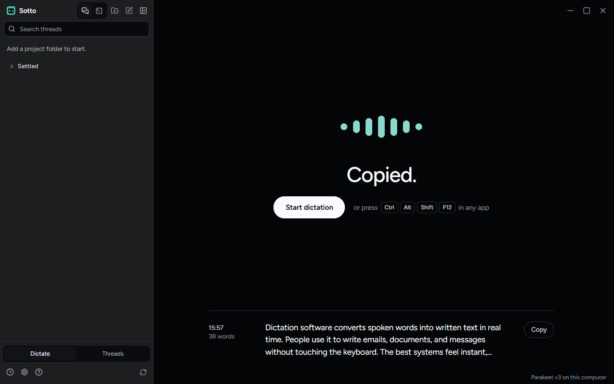

The footer reads "Parakeet v3 on this computer". History recorded the entry as the `parakeet` model with language
`auto`. `transcription-diagnostics.jsonl` was not written, since nothing failed. Main held 177 MB in a profile
without the model, 902 to 904 MB with it loaded, and 1,000 to 1,001 MB after the dictation.

Settings → Transcription names the model and its state; Settings → Cleanup has the AI formatting switch first and
the OpenRouter key under it. Both were captured at 1600x1000, 1280x800 and 820x560, light and dark, with reduced
motion on, and neither scrolled sideways at any size.

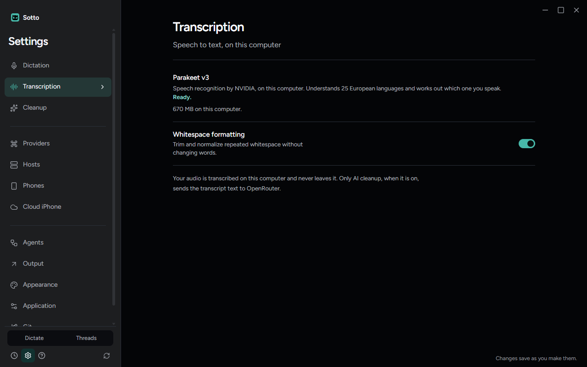
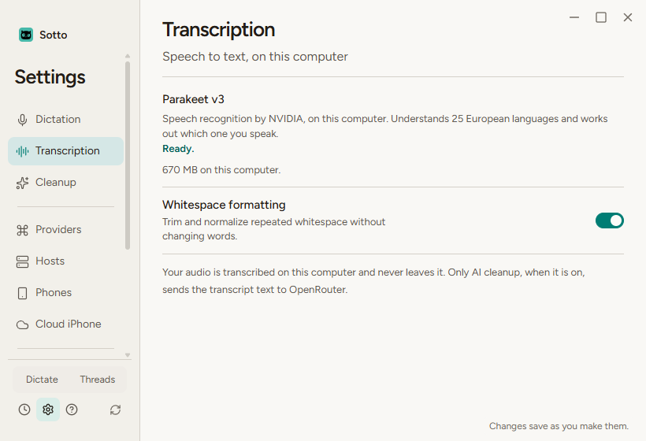
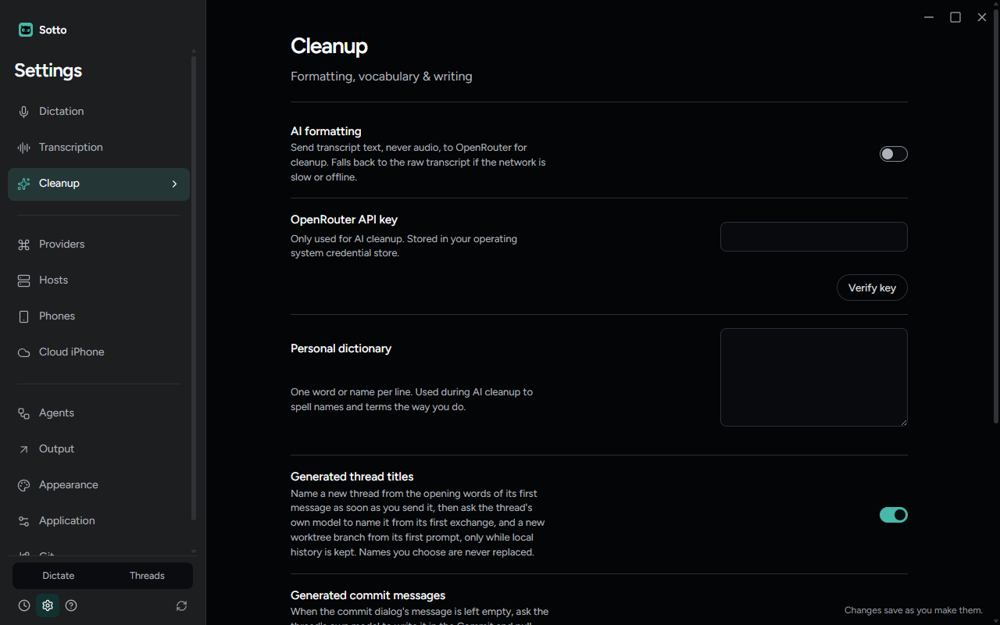
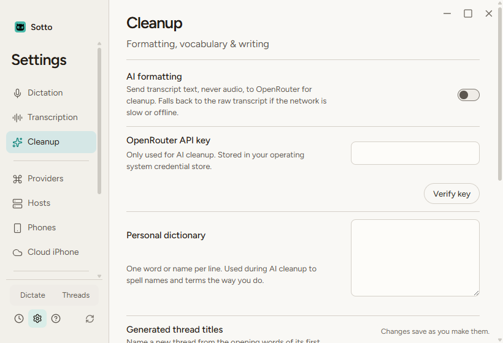

## In the packaged app

`npm run package:dir` built `release/win-unpacked`, and `scripts/verify-packaged-resources.mjs` passed: it
loaded `sherpa-onnx-node` from the installed app, which reported ONNX Runtime 1.28.2, and the normal launch read
the speech model's status over its channel. The same dictation, run in the packaged `Sotto.exe` with the model
linked into a fresh profile, came back word for word 0.22 s after Stop. That run loads the module with `import()`
from inside `app.asar`, the way installed users will, where the check above uses `require`.

## Without the model

A fresh profile with no model files, before the release assets are published. Sotto asked GitHub for the first
file, GitHub answered that it does not exist, and the status went to failed with the network reason, 0.9 s after
start. Nothing was written to the model folder.

First-run setup's speech model step shows the failure with Try again, and its button reads Skip for now, since
the step's task is not done:

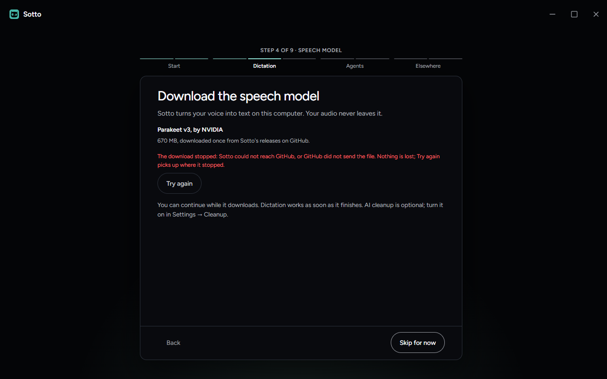
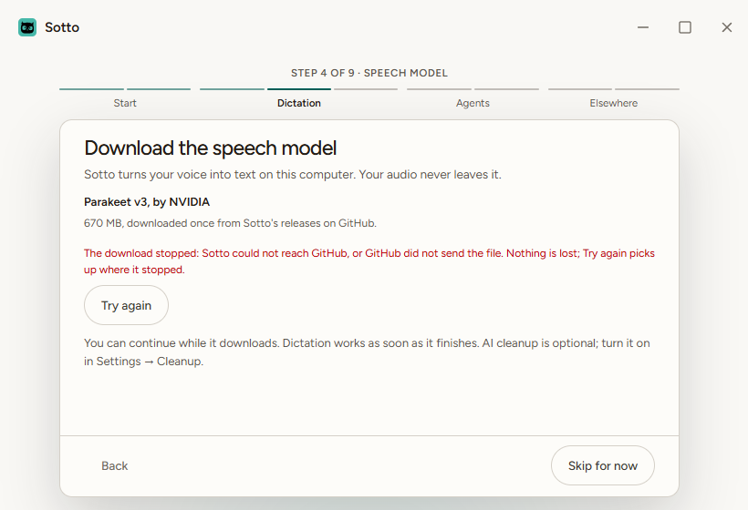

After setup, the Dictate room says the speech model is not ready, the pill reads Speech model needed and cannot be
pressed, and Open Settings sits beside it:

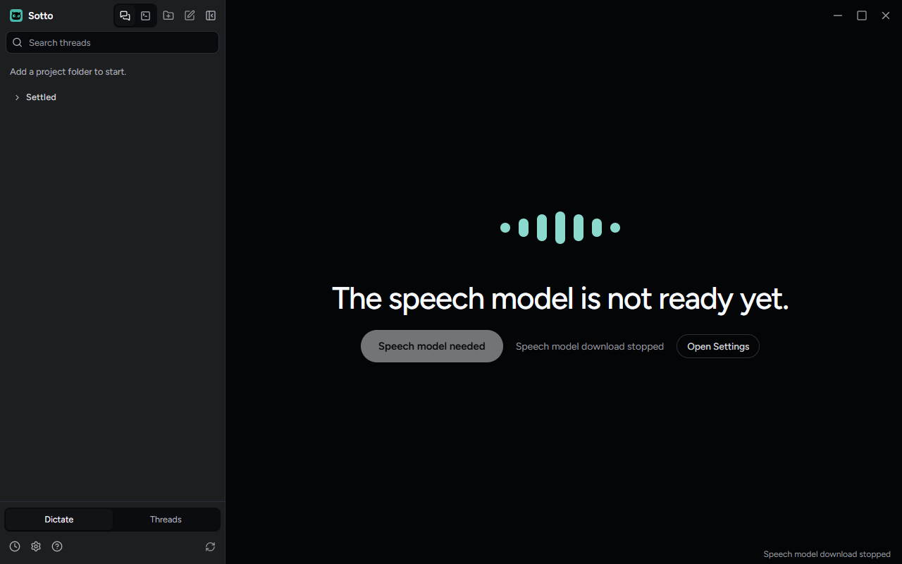

A dictation asked for anyway, the way the shortcut asks, records nothing. The widget and the Dictate room say so:

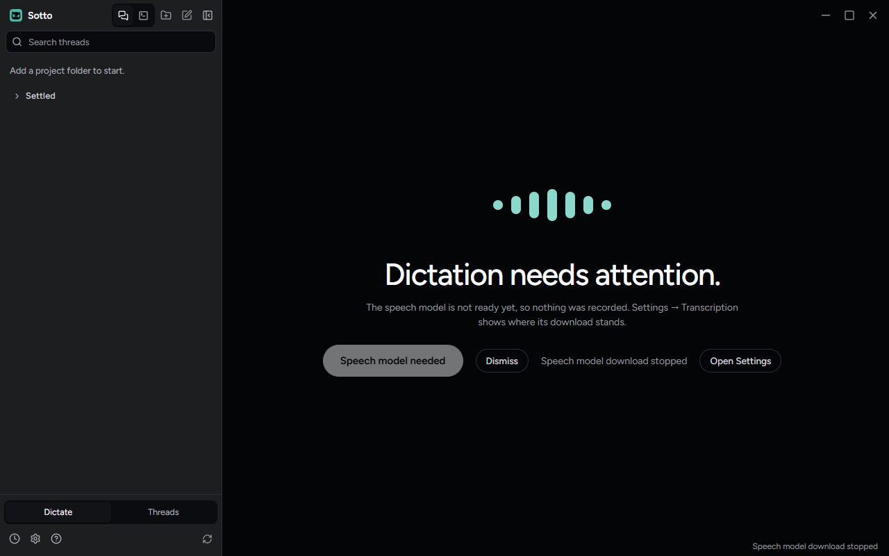

## The first-run download

Once the release `speech-model-parakeet-tdt-0.6b-v3-int8-1` was published on `millZach/Sotto-releases` as a
pre-release (v0.1.36 stays the release marked Latest, and `/releases/latest` still leads to it), a fresh profile
with no model downloaded it for real. `github.com` sent each file on to `release-assets.githubusercontent.com`,
the one asset host Sotto follows. First-run setup's speech model step showed the bar and the count as they grew,
and its button read Continue while the download ran:

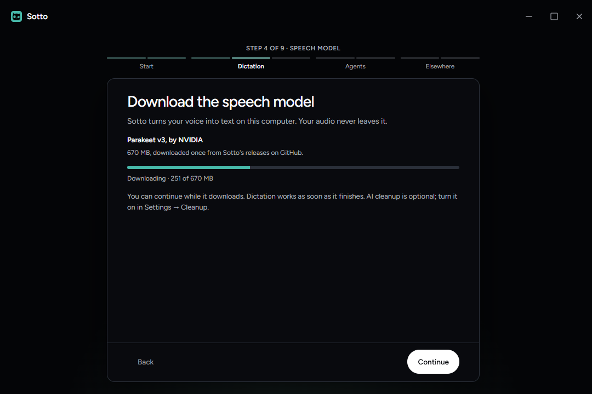
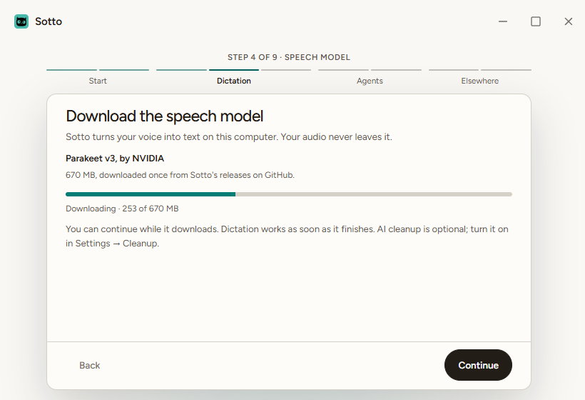

Sampled once a second from inside the page, the step's count followed main's to the megabyte, four status updates
a second, and a settings read took 3 to 8 ms while the download ran. The 670 MB took 150 s on one run and 218 s on
another. Each file was checked, the marker written, the model loaded and ready, and the same 17-second dictation
came back word for word 0.25 s after Stop (`run-download.json`).

## What the runs found, and what changed because of them

- **The model would not load in the app.** The first run ended with the model failed for the engine reason. Main
  loads `sherpa-onnx-node` with `import()`, and Node lists only the CommonJS exports it can find by reading the
  file: `OnlineRecognizer`, not `OfflineRecognizer`. The benchmark used `require`, and the packaged check does too,
  so neither saw it. The loader now reads the default export, which is all of `module.exports`, and
  `tests/integration/speechEngineImport.test.ts` asks a plain Node child the same question.
- **A download refused by GitHub said the connection dropped.** It now says Sotto could not reach GitHub, or
  GitHub did not send the file.
- **The widget title was cut off.** "Speech model not ready" did not fit the 212 px capsule; it is now "Model not
  ready".
- **The packaged check refused the build twice.** The model download streams through `node:stream` and
  `node:stream/promises`, which the reviewed list of what the main bundle may import did not name, and the
  normal launch still asked for the retired key check and language setting. Both are fixed; the unit tests did not
  reach either, and Package (Windows) would have failed on the pull request.
- **The Dictate room told the wrong story.** A dictation asked for before the model was ready showed the sentence
  for a recording the model could not transcribe, and the resting room said "Ready when you are." above a pill that
  could not be pressed. The room now says that the model is not ready and that nothing was recorded.

## Not covered here

- Resume after a dropped connection, and a checksum refusal, on a real download. Both are covered by
  `tests/unit/main/speechModelStore.test.ts` against a GitHub stand-in.
- macOS and Linux. The packaged-resources check loads the module on each; transcribing there still needs a run
  like this one.

The run summaries, without the profile path, are in `artifacts/local-parakeet-transcription/run-*.json`.
