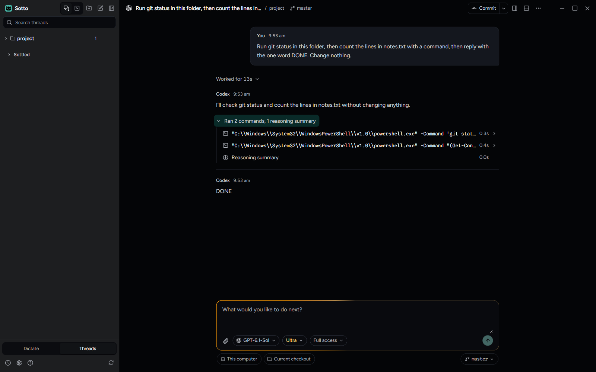
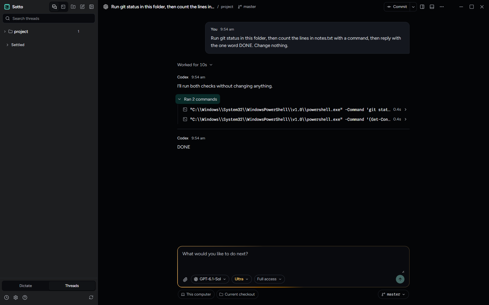

# Codex reasoning without a summary shows no row

October 13, 2026. Branch `fix/codex-empty-reasoning`.

## What was wrong

A Codex thread on GPT-6.1-Sol filled with rows reading **Reasoning summary** and **0.0s**, with nothing inside them. Codex reports a reasoning item for every step a model takes, and this model writes no summary for any of them: the session file of the owner's thread that morning held 489 reasoning items, all 489 with an empty `summary`. Sotto made a row for each. Every one also took a place in the thread's bounded activity list, ahead of the commands and edits that had something to show.

## What changed

`CodexActivityProjection.item()` makes no record for a reasoning item without summary words. `wordlessReasoningSummary()` in `src/shared/agentActivity.ts` names such a record, and the workspace drops any an earlier Sotto saved when it next merges the thread's activity, so the saved copy and phones lose them too. A row starts with the first streamed summary words (`delta()`, which now stamps its start time), and a finished item with no summary leaves the streamed words in place.

## Proved in the built app

`tools/verify-codex-reasoning-rows.mjs` sends one real Codex turn on a throwaway profile (GPT-6.1-Sol at the slider's top effort, Full access): run `git status`, count a file's lines, reply DONE. It opens the turn's folds, then records what the thread draws beside what Codex wrote to its own session file for that folder.

| Build | Codex reasoning items (wordless) | Thread records | Fold |
| --- | --- | --- | --- |
| `main` | 1 (1) | 2 commands, 1 reasoning with no words | "Ran 2 commands, 1 reasoning summary", with a **Reasoning summary 0.0s** row |
| this branch | 1 (1) | 2 commands | "Ran 2 commands" |

The JSON beside each image (`before.json`, `after.json`) is the script's record: counts, kinds and statuses only, no text.

Dropping a row an earlier Sotto saved is covered by `tests/unit/main/workspaceActivityPersistence.test.ts` and `tests/unit/main/codexActivity.test.ts`, not driven here. It happens the next time Sotto reads the thread's Codex history.
