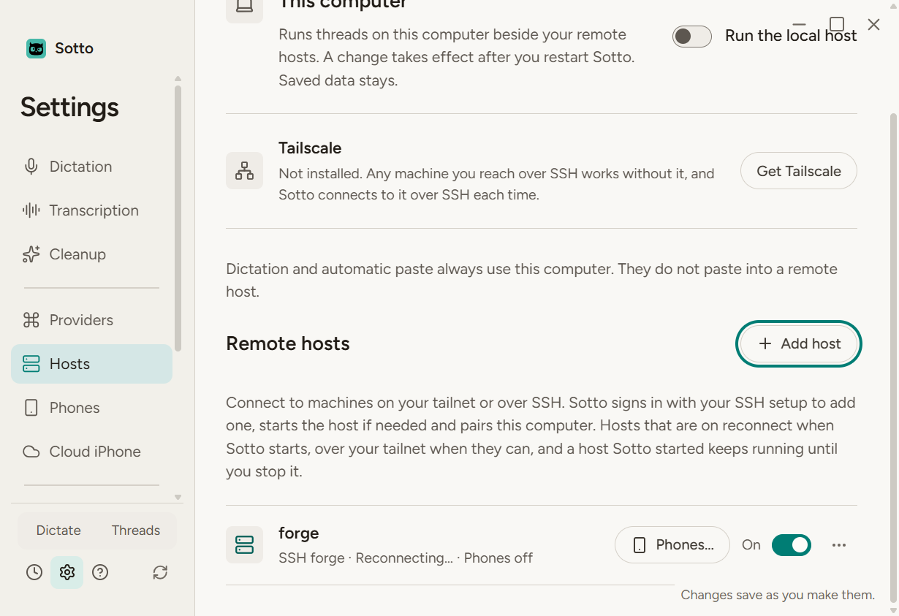
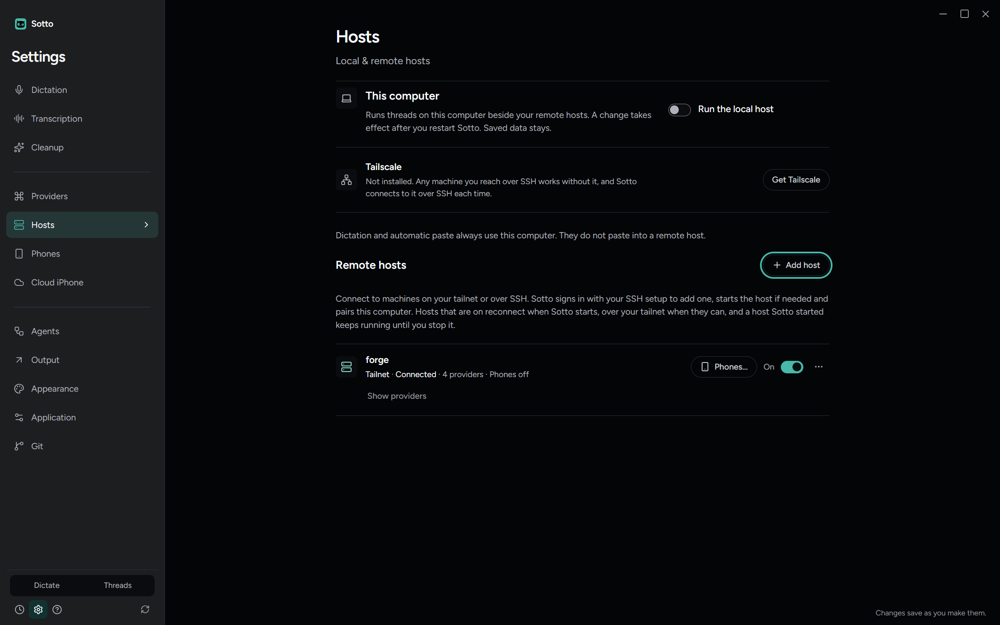

# A dropped tailnet host keeps reconnecting

October 13, 2026. Branch `fix/host-tailnet-reconnect`. ADR-0053, October 13 amendment.

## What was wrong

forge read **Needs attention** with "Tailscale SSH asked you to approve this connection, and no approval came within 5 minutes" about every 12 hours, and **Connect again** brought it straight back. forge prefers the tailnet (`remote-host-tailnet.json` holds `"prefer": "tailnet"`) and was started by the launch script, not at boot.

The order of events: this computer's network dropped for a moment and the tailnet connection went with it. The first retry, 3 seconds later, found the tailnet not answering yet and went to SSH. Within Tailscale's 12-hour check period that sign-in passes silently and the host moves back to the tailnet, which is why most drops went unnoticed. Once the period had run out, Tailscale SSH held the sign-in for an approval nobody was there to give. After 5 minutes `tailscale-unapproved` was final, the retries stopped, and the threads left the page. Connect again tries the tailnet first, which answered, so it needed no approval.

## What changed

- The tailnet-only first minute of retries, which only a host that starts at boot had, is every host's whose last connection was the tailnet (`connectOrder`, `TAILNET_ONLY_MS`). The unused `startedBy` map went with it.
- A Tailscale approval nobody gave is not final for Sotto's own retry when that connect tried the tailnet first (`DesktopHosts.final`). The retries go on, tailnet first. After a press it is still final, and so is a host that prefers SSH.

## Proved in the built app

`tests/e2e/host-tailnet.spec.ts`, "forge keeps reconnecting after a drop from its tailnet…", in the built app against a real headless host behind a Serve stand-in, with the scripted ssh in `run+tailscale-timeout` mode, which holds every launch the way Tailscale's `check` mode does and then times out:

1. forge is added and reads **Tailnet · Connected**.
2. The tailnet drops and Serve answers 502. For the first 20 seconds the row reads Reconnecting… and no ssh ran at all.
3. After the first minute SSH is tried, held and timed out at least twice. The row never reads **Needs attention**; it reads **SSH forge · Reconnecting…**.
4. Serve answers again, and forge is back on **Tailnet · Connected** with nothing pressed.

The journey captures the row at 1600x1000, 1280x800 and 820x560 in dark and light, and checks nothing overflows.

## Not driven

The real forge on the real tailnet. That would mean waiting out the 12-hour check period and dropping this computer's network at the right moment. `tests/integration/desktopHostsTailnet.test.ts` covers the same order against a real headless host, and goes red without the change.
