# Sotto desktop: UI hillclimb findings

Reviewed on 2026-10-29 in worktree `ea3833a9-ce6e-402b-8e60-afde99d707a0`, against main `e1f838016`, judged by [the UI good-practice rubric](ui-good-practice.md). Review only: no app code changed.

## Basis and limits

- **The app.** The built Owl build of main, launched with the design-capture fixtures (seeded threads, a seeded Journal, an empty profile and first-run setup) in an owned nested Hyprland desktop on forge through `scripts/verify-linux-window-minimum.mjs --exec`, at 1600x1000, 1280x800 and 820x560, dark and light, with and without reduced motion.
- **Who drove it.** GPT-6.1 Terra, by computer use through a small driver for that nested desktop. It took 141 captures over two passes, with notes on how each interaction felt. The lead reviewed the captures, measured contrast on them, and read the code behind each finding.
- **Left out as fixture artifacts.** The model picker showing one model with letter tiles (the fixture providers have no marks), the native file picker opening behind the window, and the widget clipped at the nested desktop's edge.
- **Not reproduced.** A blank Journal after searching. Terra reported it twice, and both of its own captures show the results.
- **Not covered.** The stable build side by side, every Settings scroll position, and the widget while processing (the fixture finishes too fast).
- **Code, not exercised.** Finding 7's browser keys on Windows and Linux are read from `applicationMenu.ts`.
- **The iPhone.** A parallel review of the iPhone client shared notes with this one; "Desktop and iPhone" marks findings it found in its app too.

## Rules for both apps

- A card is a flat fill with no outline and no stripe.
- Counts count threads.
- An error that names an action gives that action a control.
- Reversible actions act at once and offer Undo.
- Content scrolls clear of a floating composer.
- Labels are in sentence case.
- One type ramp and one radius scale, as tokens.

## Already good

- **Words.** Errors say what happened, whether anything was lost and what to do: "Codex reported an error on this thread. Nothing in the transcript was lost. Send a message to try again." That is the NN/g rule almost word for word.
- **Requests lead with the ask.** The card's heading is "Run a command in workshop", the command is in code, the choices are Deny and Allow, and the composer says typing will queue. The iPhone review recommends the same order for its sheets.
- **Confirmations name their outcome.** Delete transcript asks "Keep transcript" or "Delete transcript", not Yes or No, and Clear history says exactly what stays.
- **Focus is solid.** Every Tab stop in the walk showed a clear ring, and Escape closed the model menu, the pane menu, New thread, the Journal's More menu and the Add a server dialog, returning focus to the control that opened each one.
- **Colour has a job.** One accent from the app icon, a white primary plate, and status colours only for status. Gradients are kept to the effort colourways and the night sky, and there is no glassmorphism outside the opt-in Glass theme. Contrast passes everywhere measured except the composer placeholder.
- **The minimum size mostly holds.** At 820x560 a split becomes tabs, Settings and Watcher fit, and nothing overflows sideways.
- **Motion is quick and stops when asked.** Transitions are 120 to 220 ms, and Reduce motion stops Watcher's sweep and leaves the night scene still.
- **Keyboard hints are built in.** The New thread chooser shows ↑↓, Enter and Esc. The terminal shows its leave key. Settings, Keyboard lists every shortcut, searchable and rebindable.

## Findings, by impact

Within an impact level, smaller effort comes first. Boxes on the captures mark the area.

### 1. The composer's placeholder is too faint to read

**Impact:** Blocks a task or fails WCAG. **Effort:** small. **Tags:** accessibility, consistency.

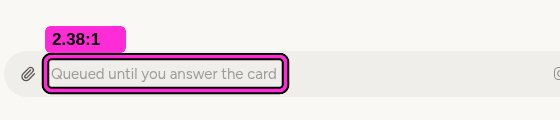

*Light, 1600x1000: the waiting thread's composer. Measured on the capture.*

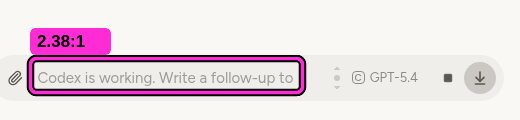

*Light: the working thread's composer beside it.*

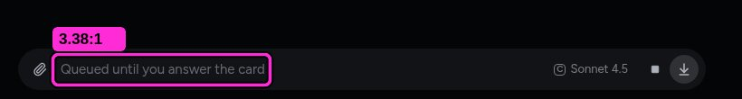

*Dark, the same placeholder.*

**What is wrong, and why.**

The composer's placeholder measures **2.38:1 in light and 3.38:1 in dark**. Text needs 4.5:1, and placeholder text counts ([WCAG 2.2, 1.4.3](https://www.w3.org/WAI/WCAG22/Understanding/contrast-minimum.html)). Every other placeholder in the app passes: Search threads and Search transcripts measure 5.3:1 in light and 6.4 to 6.8:1 in dark.

It matters more here than in most fields. While a turn runs, the placeholder is the only thing that says what typing will do: "Queued until you answer the card" and "Codex is working. Write a follow-up to queue it." The cause is one line: `--placeholder-ink` mixes the muted ink 55% with transparent (`threads.css:220`, and `nextPrompt.css:7` for the ghost suggestion).

**Suggested fix.**

Paint the placeholder in `--tt-text-muted` with no mix, as the search fields already do. That is one token, and it fixes every theme at once. The iPhone shows the longer-lasting shape: its placeholder is a role of its own, which measures 4.59 to 9.3:1 across all seven palettes, so this one is desktop-only. If the composer wants its hint quieter than a field's, use `--tt-text-faint`, but only where that role reaches 4.5:1 on the card. The composer keeps no border; this only changes the colour of its words.

### 2. At the 820x560 minimum, the composer covers the permission card's Allow and Deny

**Impact:** Blocks a task or fails WCAG. **Effort:** medium. **Tags:** interaction, accessibility. **Desktop and iPhone.**

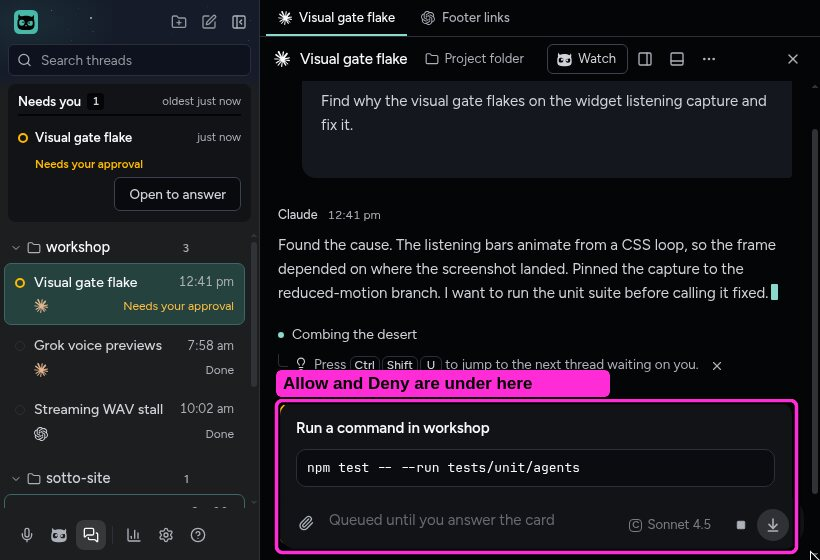

*Dark, 820x560, a thread waiting on a permission, opened from the sidebar.*

**What is wrong, and why.**

Open a thread that waits on a permission at the minimum window size. The card's heading and command show, but its **Deny and Allow sit under the floating composer**. The composer itself reads "Queued until you answer the card", while the card can't be answered until the transcript is scrolled.

The rubric puts content that clips at the smallest supported window at the top of the impact list. If keyboard focus lands on Allow while it is covered, it also fails "focus not obscured" ([WCAG 2.2, 2.4.11](https://www.w3.org/WAI/WCAG22/Understanding/focus-not-obscured-minimum.html)). Terra's Tab walk at 1600x1000 reached Allow with a clear ring; at 820 it wasn't re-tested.

**Suggested fix.**

Give the transcript bottom padding equal to the composer's height, so the last item can always scroll clear of it. When a thread opens on a pending request, scroll the card's buttons into view. A `scroll-padding-bottom` of the same height keeps a focused Allow clear of the composer when it is reached by Tab. The iPhone has the same fault (Watcher's reply box sits over a card's second choice), so the rule for both apps is that content always scrolls clear of a floating composer.

### 3. Right-click does nothing: no Cut, Copy and Paste in fields, no menu on thread rows

**Impact:** Confuses or slows. **Effort:** small. **Tags:** interaction, consistency.

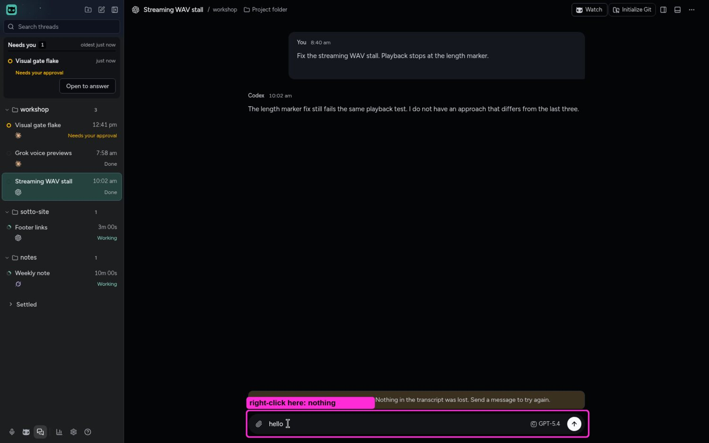

*Dark. "hello" typed in the composer, then right-clicked. Search threads and a thread row gave the same result (shots 96 and 03).*

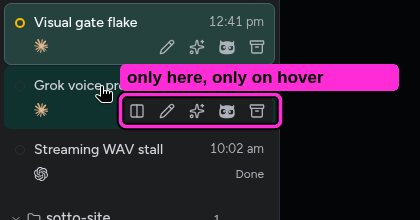

*A row's actions exist only as hover icons.*

**What is wrong, and why.**

Right-clicking inside the composer or Search threads shows no menu, so there is **no Cut, Copy or Paste**. Right-clicking a thread row shows nothing either; its actions (Open beside, Rename, Regenerate title, Watch, Settle) exist only as hover icons, and the sparkle and owl icons need learning. Selected reply text has a good custom menu (Add to prompt), so this is a gap, not a policy. Main registers no `context-menu` handler.

On a desktop, text fields carry Cut, Copy and Paste in a context menu ([Microsoft, menus and context menus](https://learn.microsoft.com/en-us/windows/apps/develop/ui/controls/menus-and-context-menus)). Context menus repeat the commands available elsewhere, in words ([Apple HIG, context menus](https://developer.apple.com/design/human-interface-guidelines/context-menus)). Right-click doing nothing in a text field is one of the plainest "web page in a frame" tells ([Electron, custom window interactions](https://www.electronjs.org/docs/latest/tutorial/custom-window-interactions)).

**Suggested fix.**

In main, answer `webContents` `context-menu` with Electron's role items for editable fields and selections (Undo, Redo, Cut, Copy, Paste, Select All). That's about twenty lines and no new dependency. Give thread rows a context menu with the same actions as their hover icons, in words, which also answers the keyboard finding's Shift+F10.

### 4. Watcher's start screen says "sending starts it" three times, in centred paragraphs

**Impact:** Confuses or slows. **Effort:** small. **Tags:** simplicity, vibe-coded tell.

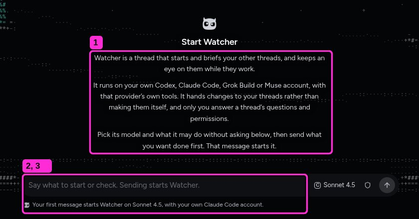

*Dark, 1600x1000, Watcher before it has started.*

**What is wrong, and why.**

Before Watcher starts, the room shows three centred paragraphs, about 90 words, then a composer and a footnote. The same instruction appears three times:
1. "send what you want done first. That message starts it" in paragraph three;
2. "Sending starts Watcher" in the placeholder;
3. "Your first message starts Watcher" in the footnote.

Multi-line body text is centred. Windows' rule is "Align left by default, align center only in rare cases" ([Microsoft, typography](https://learn.microsoft.com/en-us/windows/apps/design/signature-experiences/typography)). "Check each word to be sure it needs to be there" ([Apple HIG, writing](https://developer.apple.com/design/human-interface-guidelines/writing)). "Let each written element do exactly one job" ([Anthropic's frontend-design skill](https://github.com/anthropics/skills/blob/main/skills/frontend-design/SKILL.md)). The night scene is lovely and still, and is not part of this finding.

**Suggested fix.**

Keep one sentence above the composer, left-aligned: "Watcher starts your other threads, briefs them and keeps an eye on them. Your first message starts it." Keep the footnote, which carries the model and account. Move the provider and permissions paragraph behind a "How Watcher works" link to Help.

### 5. A Git refusal names another thread but gives no way to open it

**Impact:** Confuses or slows. **Effort:** small. **Tags:** interaction. **Desktop and iPhone.**

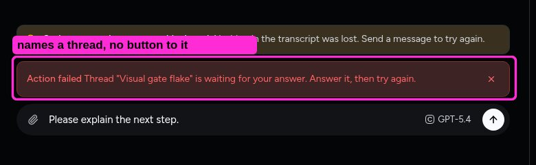

*Dark, 1600x1000. Initialize Git pressed in "Streaming WAV stall" while "Visual gate flake", in the same folder, waits on a permission.*

**What is wrong, and why.**

Pressing a Git action in one thread can be refused because another thread in the same folder holds it. The red banner reads **"Action failed"**, then "Thread 'Visual gate flake' is waiting for your answer. Answer it, then try again." It names the thread to go to but offers no control to get there. It also doesn't say that nothing changed, which the Watcher version of the same message does.

An error should say what happened, whether anything was lost, and what to do, next to its cause ([NN/g, error messages](https://www.nngroup.com/articles/error-message-guidelines/)). `AGENTS.md` asks the same: "whether anything was lost and what to do next." The iPhone review found the same gap ("Try again." with no Try again button), so this is a rule for both apps.

**Suggested fix.**

Give every holder message that names a thread an "Open <title>" button (`checkoutMutations.ts`). Add "Nothing was changed." to the refusal. And word the banner as a hold rather than "Action failed", since nothing failed.

### 6. First-run setup's card has a fixed height: long steps scroll inside it, short ones leave a hole

**Impact:** Confuses or slows. **Effort:** small. **Tags:** consistency, simplicity.

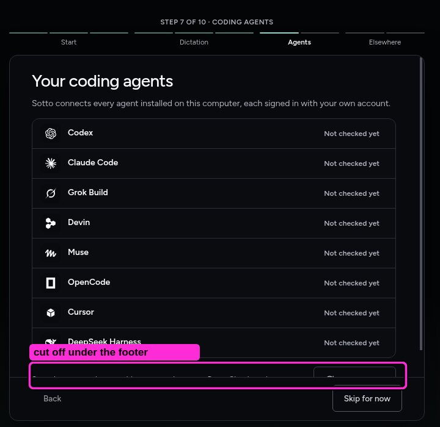

*Dark, 1600x1000, setup step 7 (Coding agents).*

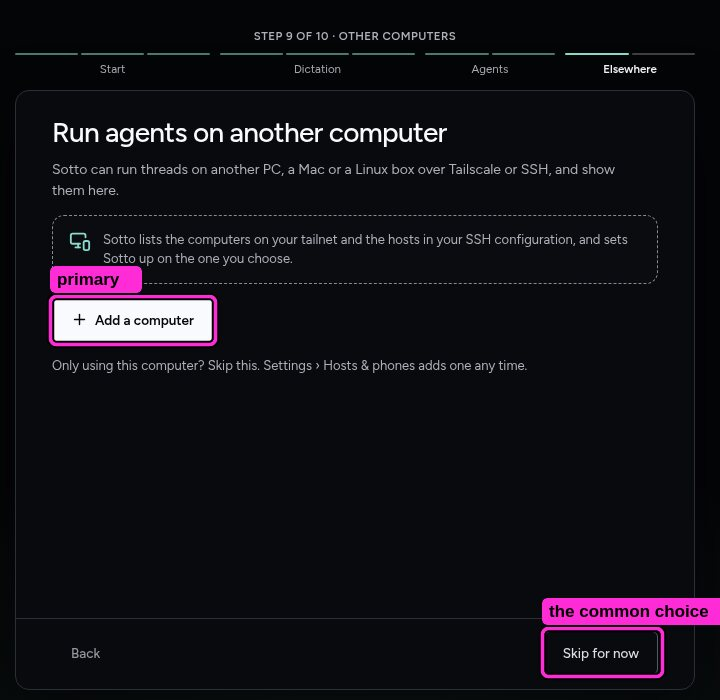

*Step 9: the filled primary is "Add a computer"; most people press "Skip for now".*

**What is wrong, and why.**

At 1600x1000 the setup card stays about 375 px tall. On step 7, eight agent rows fill it and the next line and its button are **cut off under the footer**, with only a thin scrollbar to say there is more. On steps 1 and 9 the same card is half empty. Apple's rule is to test the largest and smallest layouts and let windows "adapt fluidly" to their size.

Step 9 makes "Add a computer" the filled primary, though most people using one computer will press "Skip for now". Keep the prominent button for the expected choice ([Apple HIG, buttons](https://developer.apple.com/design/human-interface-guidelines/buttons)).

The card also has an outline, and step 7's list has another outline inside it. ADR-0110 retired both everywhere else.

**Suggested fix.**

Let the card grow with its content, up to the window, with the footer under the content rather than over it. Drop the outline (ADR-0110). On optional steps where the task isn't started, make Skip for now the filled button and the step's action secondary.

### 7. On Windows and Linux the window answers browser keys (Ctrl+R reloads), and Settings has no Ctrl+,

**Impact:** Confuses or slows. **Effort:** small. **Tags:** consistency, interaction.

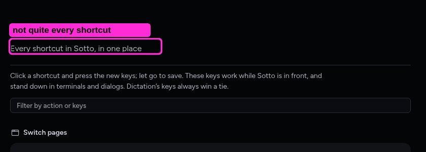

*Settings, Keyboard: "Every shortcut in Sotto, in one place." Ctrl+R and Ctrl+Shift+I are not listed but work.*

**What is wrong, and why.**

**From the code, not exercised:** `applicationMenu.ts` returns no menu on Windows and Linux "so the caller retains Electron's default menu and its zoom and developer-tool accelerators". So in a shipped build, **Ctrl+R and Ctrl+Shift+R reload the window and Ctrl+Shift+I opens developer tools**. The Mac gets Sotto's own menu, with developer tools optional. No browser items should reach a shipped build ([Electron](https://www.electronjs.org/docs/latest/tutorial/custom-window-interactions)).

From the tour: Ctrl+, does nothing on Windows and Linux, though the Mac menu has Settings… ⌘, ([Apple HIG, the menu bar](https://developer.apple.com/design/human-interface-guidelines/the-menu-bar)). Settings sits on Ctrl+5, and New thread on Ctrl+Shift+N with Ctrl+N unbound. Ctrl+K from Threads opens the Journal's search, which is by design (`CONTEXT.md`) but surprised Terra.

**Suggested fix.**

Give Windows and Linux a small hidden menu, as the Mac has: zoom keys only, with developer tools behind the same option the Mac uses. Add Ctrl+, as a second chord for Settings on every platform. Consider Ctrl+N as a second chord for New thread, after checking it against the dictation hotkey, as `AGENTS.md` requires.

### 8. Settle acts at once with no Undo, and the next row slides under the pointer

**Impact:** Confuses or slows. **Effort:** medium. **Tags:** interaction. **Desktop and iPhone.**

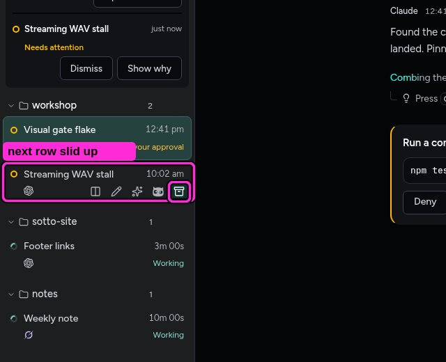

*Dark, 1600x1000, the moment after pressing Settle on "Grok voice previews". The pointer has not moved.*

**What is wrong, and why.**

Pressing a row's Settle action removes the row right away. That part is right: settling is reversible, so it shouldn't ask. But **nothing offers Undo** (Terra checked at once and again after 600 ms, shots 139 and 140). The row below slides up into its place, so **the next thread's Settle button lands exactly under the pointer**. A second click, or a double-click, settles a second thread.

Two rules meet here: "Never use a warning when you mean undo" ([Raskin](https://alistapart.com/article/neveruseawarning/)), and nothing should move under the pointer when the user didn't cause it ([web.dev, layout shift](https://web.dev/articles/cls); [Vercel guidelines](https://vercel.com/design/guidelines)).

**Suggested fix.**

Leave the settled row's slot in place for a few seconds as a one-line "Settled · Undo", and close the gap only once the pointer leaves the list. Undo also makes the shortcut (Ctrl+Shift+E) safe to press by mistake. On the iPhone, Settle sits behind ••• with a confirmation and no Undo, and that review proposes act-at-once with Undo as well, which is how Watch already behaves there. One rule for both apps: reversible actions act at once and offer Undo; only irreversible ones ask.

### 9. 25 presses of Tab never leave the sidebar, and F6 doesn't move between panes

**Impact:** Confuses or slows. **Effort:** medium. **Tags:** accessibility, interaction.

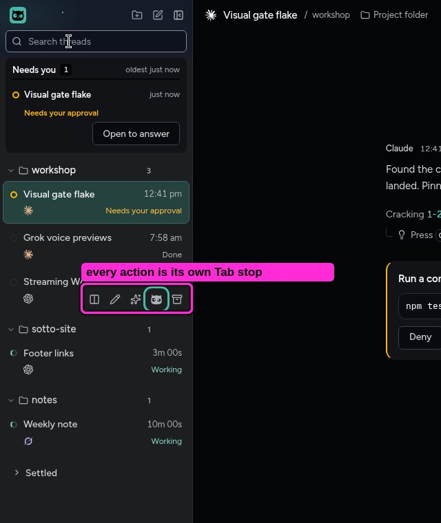

*Dark, 1600x1000, Tab stop 21 of a keyboard walk that started at Search threads.*

**What is wrong, and why.**

From Search threads, Terra pressed Tab 25 times and was still in the sidebar. Each thread row's hidden actions are separate stops: Open beside, Rename, Regenerate title, Watch and Settle. That is five or six stops per row, before the pane is reached. F6 dropped the visible focus instead of jumping to the pane, and Shift+F6 brought it back.

The good news: every stop showed a clear ring, and Escape returned focus to its opener in all five menus and dialogs tried. Windows' guidance is that a list keeps **one Tab stop and arrow keys move within it**, and that **F6 and Shift+F6 move between major panes, which "you must implement explicitly"** ([Microsoft, keyboard accessibility](https://learn.microsoft.com/en-us/windows/apps/design/accessibility/keyboard-accessibility)). `AGENTS.md` asks for a keyboard path that is "designed rather than inherited".

**Suggested fix.**

Make the thread list one Tab stop with a roving focus: Up and Down move between rows, Enter opens, and the row's actions sit behind Shift+F10 or the context-menu key (see the context-menu finding). Add F6 and Shift+F6 to cycle sidebar → pane → composer. This needs a short mock-up of the keyboard path, because it changes how the sidebar's existing shortcuts and the Needs you card behave.

### 10. A pane's header carries up to eight controls, and in a split they squeeze its title

**Impact:** Confuses or slows. **Effort:** large. **Tags:** simplicity.

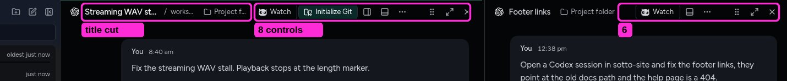

*Dark, 1600x1000, two threads side by side.*

**What is wrong, and why.**

Each pane header holds Watch (outlined), Initialize Git (outlined), split, bottom panel, `...`, a drag handle, maximize and close. In a split, the title, project and folder truncate to make room ("Streaming WAV st…", "works…", "Project f…"). Dragging the divider reflowed the header, and Terra pressed Initialize Git while aiming for the panel button.

Navigation and chrome should recede so the work leads. Linear's 2026 refresh: "Don't compete for attention you haven't earned" ([Linear](https://linear.app/now/behind-the-latest-design-refresh)). Show frequent commands directly and the rest behind one control ([NN/g, progressive disclosure](https://www.nngroup.com/articles/progressive-disclosure/)).

**Suggested fix.**

Keep the title, Watch and close in the header. Put the layout controls (split, bottom panel, maximize, move) in one Layout menu or the existing `...` menu, and drop the drag handle where the title can be the handle. Initialize Git, shown only for a folder without Git, can live in that menu too. This changes a surface Zach has tuned, so it needs a mock-up with two or three variants first.

### 11. All-caps micro-labels and "A · B" eyebrows

**Impact:** Looks unfinished. **Effort:** small. **Tags:** vibe-coded tell, consistency. **Desktop and iPhone.**

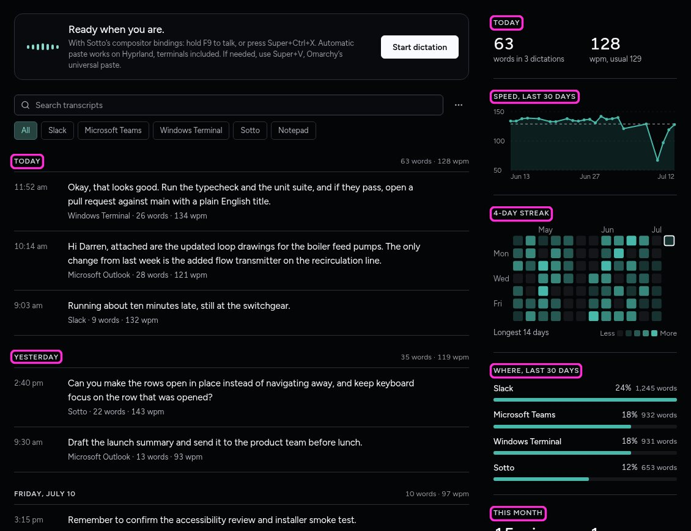

*Dark, 1600x1000, the Dictate room: seven all-caps labels.*

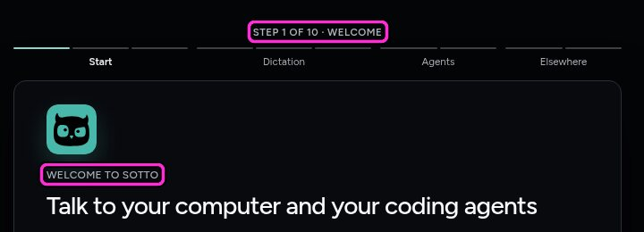

*Welcome: "STEP 1 OF 10 · WELCOME" and "WELCOME TO SOTTO".*

**What is wrong, and why.**

The Dictate room labels its stats and days in tracked capitals: "TODAY", "SPEED, LAST 30 DAYS", "4-DAY STREAK", "WHERE, LAST 30 DAYS", "THIS MONTH", "YESTERDAY". First-run setup opens on "STEP 1 OF 10 · WELCOME" over a "WELCOME TO SOTTO" eyebrow.

Windows: "Use sentence casing for all UI text, including titles" ([Microsoft, typography](https://learn.microsoft.com/en-us/windows/apps/design/signature-experiences/typography)); all caps is harder to read ([Fluent 2](https://fluent2.microsoft.design/typography)). Anthropic's own skill lists "ALL-CAPS eyebrows" and "A · B · C meta strings" as template chrome, and calls all-caps labels one of "the commonest tells" ([frontend-design skill](https://github.com/anthropics/skills/blob/main/skills/frontend-design/SKILL.md)). Elsewhere Sotto writes sentence case, and the iPhone app uses sentence-case headings throughout. These labels are the desktop's outliers, set by a handful of CSS rules.

**Suggested fix.**

Remove `text-transform: uppercase` from those rules and write the labels in sentence case ("Today", "Speed, last 30 days"). Drop the "Welcome to Sotto" eyebrow, since the heading under it says it. Write the step line as "Step 1 of 10", and let the progress bar's own labels name the group.

### 12. A coloured stripe down the left edge of cards

**Impact:** Looks unfinished. **Effort:** small. **Tags:** vibe-coded tell, consistency. **Desktop and iPhone.**

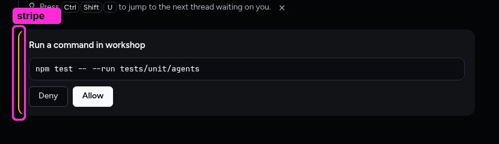

*Dark: the permission card's 2 px attention stripe.*

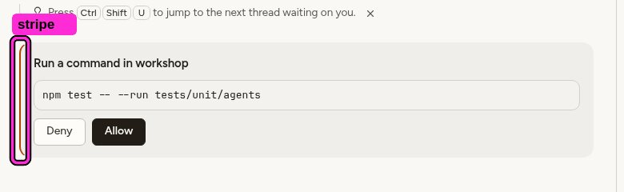

*Light: the same card.*

**What is wrong, and why.**

The permission card wears a 2 px amber stripe down its left edge. The same device appears on six desktop surfaces: the request card, a ready prototype, a lifted thread, client updates, a provider error, and agent errors and notices (3 px). The iPhone has one too (`FailedEdge`).

A border used to colour-code a card, beside words that already say the status, is decoration doing a label's job. It is a stock device of generic card kits. It runs against ADR-0110's "no outline" card and "use fewer borders" ([Refactoring UI](https://medium.com/refactoring-ui/7-practical-tips-for-cheating-at-design-40c736799886)), and it repeats a status the card already says in words. "Let each written element do exactly one job" ([Anthropic's frontend-design skill](https://github.com/anthropics/skills/blob/main/skills/frontend-design/SKILL.md)). The card already says its state in its heading, buttons and the sidebar's "Needs your approval".

**Suggested fix.**

Drop the stripes in one change, on both apps. Where a card needs to stand out, tint its fill with a little of the status colour, the way a selected card mixes in the accent (ADR-0110). The words keep carrying the meaning.

### 13. Leftover container styles: a card inside a card, flat rows, dashed boxes

**Impact:** Looks unfinished. **Effort:** small. **Tags:** consistency, vibe-coded tell. **Desktop and iPhone.**

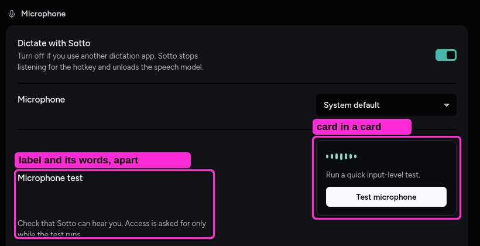

*Settings, Dictation: the Microphone test.*

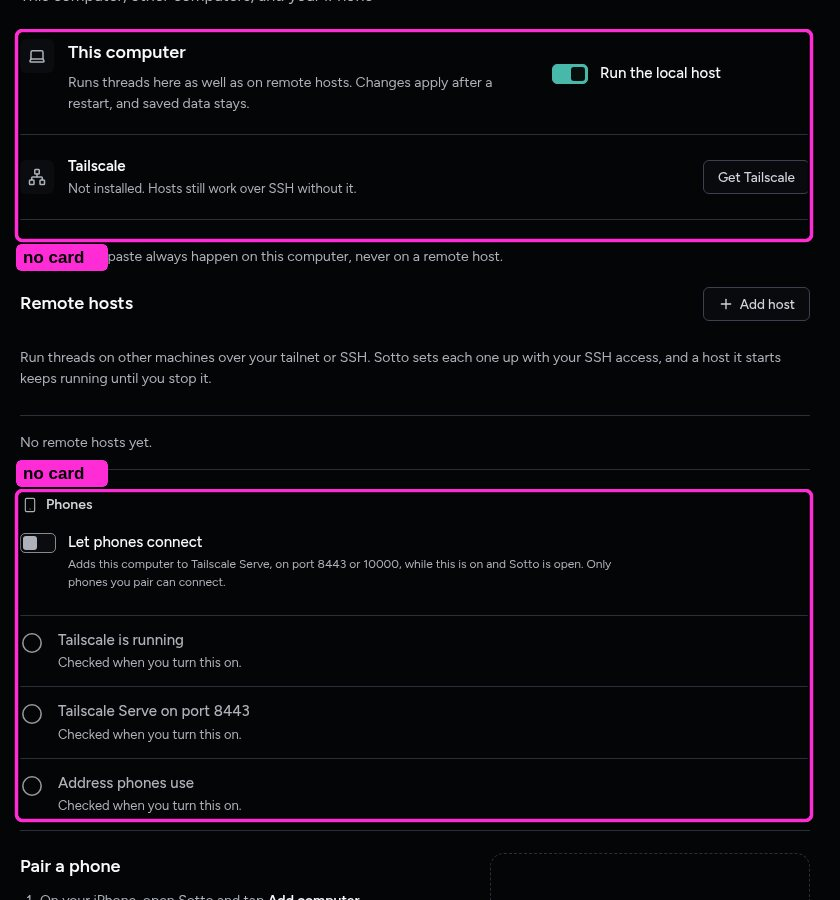

*Settings, Hosts & phones: flat rows and a dashed box, where every other Settings page uses cards.*

**What is wrong, and why.**

ADR-0110 made every container a filled card with no outline, and that holds almost everywhere. The leftovers stand out:
- **Settings, Dictation:** the Microphone test is an outlined box inside the Microphone card. Its label sits mid-row and its description about 75 px below it, with the box between them and the words.
- **Settings, Hosts & phones:** flat rows divided by hairlines, a dashed "Pair a phone" box and three empty status circles, where every other Settings page groups rows on cards.
- **Setup:** an outlined card, and step 9 adds a dashed note.

"Card-in-card" nesting and mixing several container styles are listed tells ([Anthropic's frontend-design skill](https://github.com/anthropics/skills/blob/main/skills/frontend-design/SKILL.md); [Refactoring UI, fewer borders](https://medium.com/refactoring-ui/7-practical-tips-for-cheating-at-design-40c736799886)). The iPhone's card stacks four layers, so both apps should converge on the desktop's card.

**Suggested fix.**

Apply ADR-0110 to these three:
- Make the microphone test a row on the Microphone card, with its button at the row's end.
- Put Hosts & phones' groups on cards.
- Draw setup's card and notes as fills.
These are style changes only.

### 14. Every button shows the hand pointer

**Impact:** Looks unfinished. **Effort:** small. **Tags:** consistency.

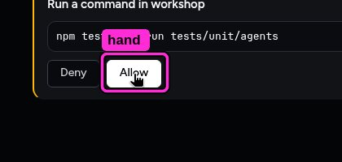

*Pointing at Allow. Thread rows, header icons and Start dictation show the same hand (shots 98 to 100).*

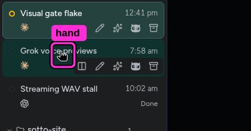

*Pointing at a thread row.*

**What is wrong, and why.**

Allow, thread rows, pane-header icons and Start dictation all switch the pointer to the hand; 239 rules set `cursor: pointer`. On Windows the hand is "only for text and graphic links. Command buttons already have a strong affordance" ([Microsoft, mouse guidelines](https://learn.microsoft.com/en-us/windows/win32/uxguide/inter-mouse)). On the Mac the pointing hand means a link to a page or document ([Apple HIG, pointing devices](https://developer.apple.com/design/human-interface-guidelines/pointing-devices)). It's a small thing, but it's the cursor of a web page, not a desktop app.

**Suggested fix.**

Set `cursor: default` on buttons, rows and tabs in `global.css`, keep `pointer` for real links (a file link in a reply, a URL), and delete the per-component `cursor: pointer` rules as they're touched.

### 15. Twelve font sizes in one room, and 34 across the app

**Impact:** Looks unfinished. **Effort:** medium. **Tags:** consistency. **Desktop and iPhone.**

*The Dictate room, with sizes from `dictate.css`. 12, 12.5 and 13.5 px also appear here.*

**What is wrong, and why.**

Text sizes are literals in every stylesheet: 34 distinct values across the renderer, in half-pixel steps (11, 11.5, 12, 12.5, 13, 13.5, 14, 14.5, 15…), with no type tokens. The Dictate room alone sets twelve. Radii drift the same way: three radius tokens exist, but only 126 of 731 radius declarations use them (43 distinct values). There are also 62 distinct shadows.

Platforms keep a short ramp of named roles (Windows: Caption 12, Body 14, Body Strong, Subtitle 20, Title 28) and radii by level (4 px controls, 8 px overlays) ([Microsoft, typography](https://learn.microsoft.com/en-us/windows/apps/design/signature-experiences/typography); [Microsoft, geometry](https://learn.microsoft.com/en-us/windows/apps/design/signature-experiences/geometry)). Nobody sees 12.5 next to 13 as a choice; they see text that is slightly off. The iPhone review found the same drift in SwiftUI.

**Suggested fix.**

Add a type ramp and a radius scale as `--tt-*` tokens shared with the iPhone (for example 12, 13, 14, 16, 20, 28, and radii 4, 6, 10, 14). Move the literals onto the nearest step, one stylesheet at a time, and let `themeTokens.test.ts` hold new stylesheets to the tokens the way it holds them to colour roles. This is drift, not a new look: the captures should barely change.

### 16. Empty rooms show their full scaffolding

**Impact:** Looks unfinished. **Effort:** medium. **Tags:** simplicity.

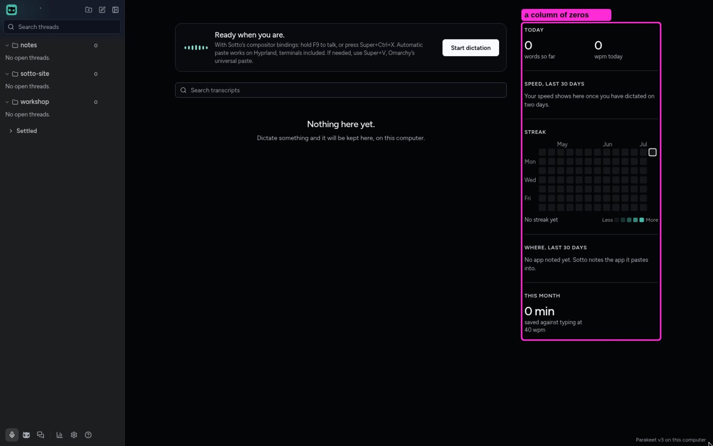

*Dark, 1600x1000, Dictate with nothing dictated yet.*

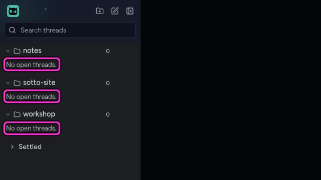

*Threads, empty: "No open threads." under every project.*

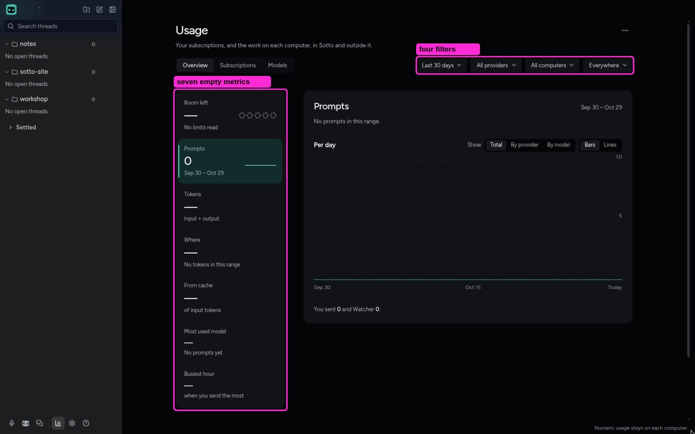

*Usage with no usage: the same filters, tabs, chart and metrics as a busy month.*

**What is wrong, and why.**

A new user's rooms show everything a busy user's do, filled with zeros and dashes:
- **Dictate:** a full stats column with 0 words, an empty streak calendar and "0 min saved". Its sentences are good ("Your speed shows here once you have dictated on two days").
- **Usage:** four filters, three tabs, a chart and seven metrics, all dashes.
- **Threads:** "No open threads." under every project as well as in the room.

An empty state should say what is missing, how content gets there and how to act ([NN/g, empty states](https://www.nngroup.com/articles/empty-state-interface-design/)). Here the scaffolding buries that sentence. Interfaces shouldn't show information that is "irrelevant or rarely needed".

**Suggested fix.**

Below a threshold, swap each scaffold for its sentence:
- **Dictate:** one line in place of the stats column until there are two days of records.
- **Usage:** one empty-state message, with the filters hidden until there is data.
- **Threads:** an empty project folder shows its name alone, and the room says it once.
Each is one component's empty branch.

## Seen and left alone, because Zach already decided them

- The composer has no border or outline in any state; the effort trace at the highest level is a light, not an edge (ADR-0110, ADR-0019). Its focus shows as the caret.
- Watcher's night scene stays still, and nothing in it blinked during the tour (ADR-0126, ADR-0149).
- The Spaceballs working words ("Combing the desert", ADR-0134). Terra found them noisy beside the permission card; they're a recorded choice.
- A thread needing you shows both in Needs you and in its folder (ADR-0135 accepts the repeat, as the iPhone does).
- Ctrl+K opens the Journal's search from any room (`CONTEXT.md`). The effort colourways, the creature, the night sky and the Appearance preview's own Light and Dark switch (Zach's pick).

## Left out

- **Fixture artifacts:** the model picker showing one model with letter tiles (the fixture's providers have no marks), the native file picker opening behind the window, and the widget clipped at the nested desktop's edge.
- **Didn't reproduce:** a "blank Journal after searching". Terra twice reported it, and both of its own shots show the results.
- **Not covered:** the stable build side by side, every Settings scroll position, and the dictation widget's processing state, which the fixture finishes too fast to catch. The design gate's widget captures cover the widget.

The annotated captures are in `artifacts/ui-hillclimb-desktop/`. The 141 raw captures and Terra's notes stay on forge, in `~/ui-hillclimb/desktop/`.
