# Sotto for iPhone: UI hillclimb findings

A review of the iPhone app's look and interaction, October 29, 2026, on `main` at `e1f838016`. It changes no app code. Each finding has a screenshot with the area marked, what's wrong and why, the principle it rests on, a fix, and impact against effort. They are ordered by impact, then by effort. **Both apps** marks a finding the [desktop review](2026-10-29-ui-hillclimb-desktop.md) shares.

Impact and effort use the desktop review's scale. High: it confuses or slows on a page people use daily. Medium: it confuses or slows less often. Low: it looks unfinished. Effort: Small is one view or one value, Medium is one component on several pages, Large changes a layout or an interaction model.

The rubric behind every "rubric §" reference is [`docs/research/ios-ui-good-practice.md`](ios-ui-good-practice.md), built from Apple's Human Interface Guidelines, eleven WWDC sessions, WCAG 2.2 and NN/g. It leans on the desktop review's rubric for general principles.

## What was looked at

- **Main's CI run** 40997668803: 107 captures on an iPhone SE (375 points wide), at the default text size, mostly dark, with a few light at Sotto's Larger step. That run's Pro Max journeys never ran, because the SE journeys failed first (#1320); every recent run is the same.
- **A capture-only run**, [41007086418](https://github.com/millZach/Sotto/actions/runs/41007086418), on the throwaway branch `chore/ios-ui-hillclimb-captures`: 244 captures from an iPhone SE (3rd generation) and an iPhone 17 Pro Max on iOS 26.5, each at the default size and at accessibility-large, in dark and light. That is 26 screens per pass: Threads, search, New thread, Computers, Settings, a busy thread, steps, the reply box with the keyboard up, the question and permission sheets, the pull request and Agents sheets, Watcher, Watched, and three problem states. The SE at accessibility-large couldn't reach the permission sheet (its walk failed to scroll a control into view after the question sheet), so those two screens exist only on the Pro Max.
- **The SwiftUI code** for what a still can't show: gestures, menus, haptics, sheets and how each page reacts to text size.
- **Not looked at:** a real phone, VoiceOver, Voice Control, Bold Text, Increase Contrast, Glass, the Duo, landscape. Both runs build with Xcode 26.6 for CI's iOS 26 simulators; the TestFlight builds on Zach's and Drake's phones use Xcode 27.1, so their system bars and sheets can differ from these pictures.

## Rules both apps share

Agreed with the [desktop review](2026-10-29-ui-hillclimb-desktop.md) so that one change can fix both apps. The desktop page uses the same words.

- **A flat card with no stripe:** iPhone finding 5; desktop findings 12 (#1830) and 13 (#1831).
- **Counts count threads:** iPhone finding 7. The desktop already does this.
- **An error names its control:** iPhone finding 17; desktop finding 5 (#1823).
- **Reversible actions act at once with Undo:** iPhone finding 14; desktop finding 8 (#1826). Watch already works this way on the iPhone.
- **Content scrolls clear of a floating composer:** iPhone finding 2; desktop finding 2 (#1820).
- **Sentence case:** the iPhone already writes it everywhere; desktop finding 11 (#1829).
- **One type ramp and one radius scale, as tokens:** desktop finding 15 (#1833). The iPhone's text already sits on its six-step ramp (`TextScale`); its icons don't (finding 13). Its corners use the four `Radius` tokens 40 times and literal radii 30 times, at ten values from 2 to 26. That tidy-up has nothing to show in a screenshot, so it is listed here rather than as a finding. The two apps can share the names without sharing the points, since iOS body text is 17.

## Already right, and worth keeping

- One type scale tied to text styles, so Dynamic Type and the in-app text step scale together, and the step never shrinks an accessibility size (`TextScale`, `PhoneTextSize`).
- Contrast is a rule with a test: every text role is generated to keep 4.5:1 on every surface it sits on, in every palette (`iosPalettes.test.ts`). The reply box's placeholder, which the test doesn't cover, measures 4.59:1 at worst (Sotto, light) across all seven palettes, where the desktop's fails.
- Sentence-case headings with the header trait; no all-caps micro labels and no emoji anywhere.
- One accent action per surface, and small drawn buttons (+, Send, Stop) keep 44-point press areas that don't overlap.
- Haptics are restrained and mean what Apple says they mean: success and error on pairing, selection on picks, a soft impact on a retry.
- Undo instead of "Are you sure?" for Watch and Stop watching; confirmations leave by themselves, and errors stay until dismissed.
- Reduce Motion turns movement into fades and stops the breathing; Reduce Transparency makes glass solid; nothing loops in SwiftUI.
- Wide tables become one card per row instead of scrolling sideways, and at regular width a thread keeps a 680-point reading width.
- Questions and permissions come first and answer on their card with Sending, then Answered: honest, optimistic feedback.
- Pull to refresh where a list can go stale, and the keyboard leaves when the conversation is scrolled.

## Findings, by impact

Within an impact level, smaller effort comes first. Boxes on the captures mark the area.

### 1. A request sheet opens on its own, even when this iPhone can't answer it

**Impact:** High (it confuses or slows on a page people use daily). **Effort:** small. **Tags:** interaction, simplicity. **Issue:** #1846.

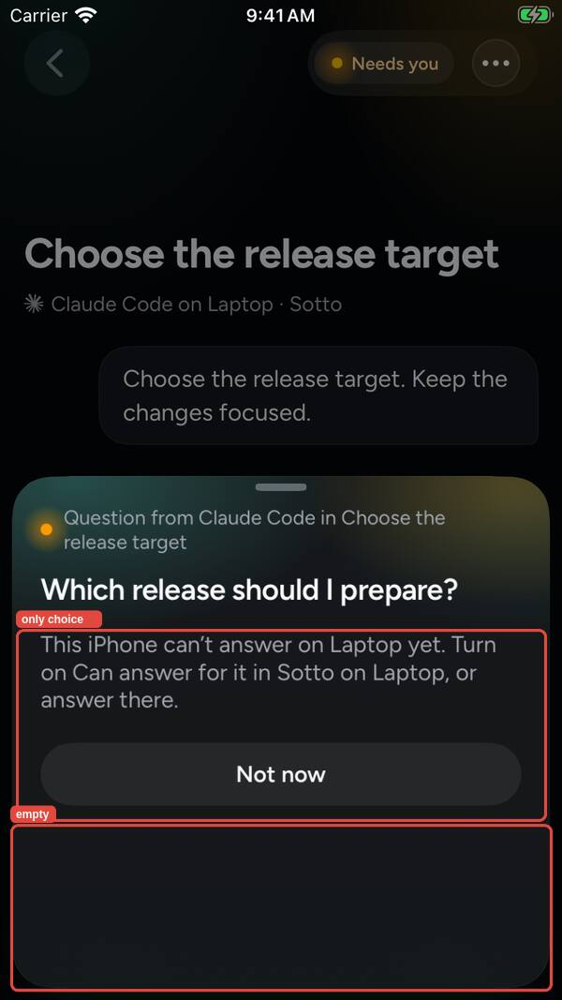

*iPhone SE, opening Choose the release target. The sheet rises by itself. Its only control is Not now, and its lower half is empty.*

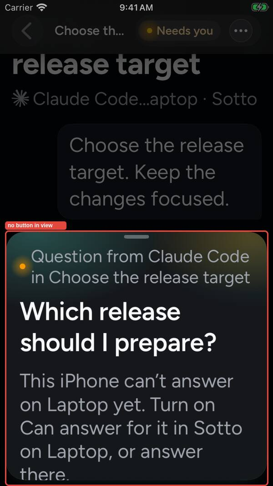

*The same sheet on an SE at accessibility-large. Now the medium height is too short: the words run off the bottom and Not now is out of view.*

**What is wrong.**

Opening a thread with a waiting question or permission raises its sheet at once (`ThreadView.offer()`, `ThreadViews.swift:81`). It does this whatever this iPhone may do there. Where Can answer is off for that computer, the sheet only says so and offers **Not now**. So the first thing every such thread asks for is a tap to clear something away.

The sheet opens at medium height whatever it holds. At the default size that leaves half of it empty; at accessibility-large on an SE the same height cuts its words off and hides its only button. A thread with two requests raises the second sheet after the first Not now, so the user dismisses twice before they can read the thread.

**Why it matters.**

Present modally only "when there's a clear benefit", for "a scoped task" ([HIG Modality](https://developer.apple.com/design/human-interface-guidelines/modality)). A sheet with no task in it is the modal-overuse tell (rubric §5, row 22). The medium detent is for content that benefits from it ([HIG Sheets](https://developer.apple.com/design/human-interface-guidelines/sheets)).

**Suggested fix.**

Raise the sheet by itself only where this iPhone can answer. Where it can't, let the request wait in the reply box's place, where it already goes after Not now, with the reason, and leave the conversation readable.

Size the sheet to what it holds: a measured `.height` detent, with `.large` for long requests.

### 2. Words under the floating reply box show through its gaps

**Impact:** High (it confuses or slows on a page people use daily). **Effort:** small. **Tags:** vibe-coded tell, accessibility. **Desktop and iPhone.** **Issue:** #1847.

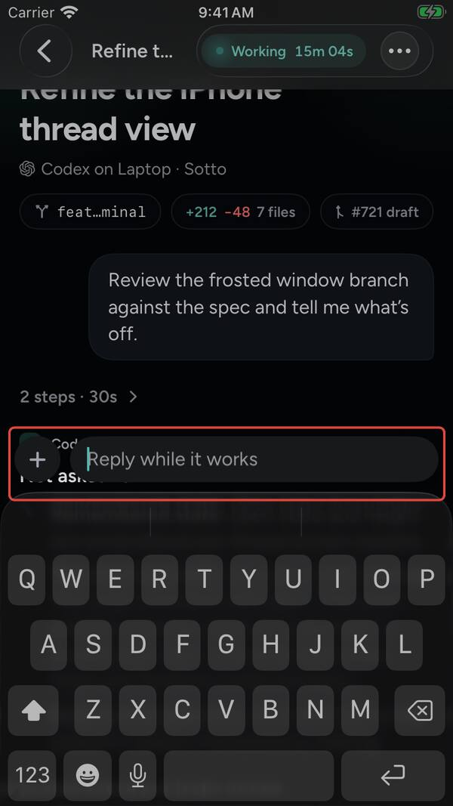

*A thread with the keyboard up. The provider's name and a message's first words sit in the gap between + and the box.*

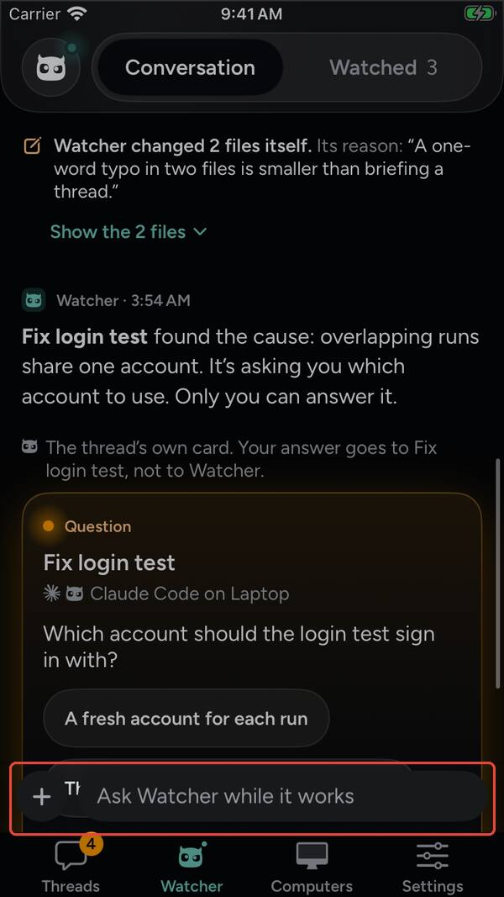

*Watcher. The box lies on a card's second choice, so its first letters show beside +.*

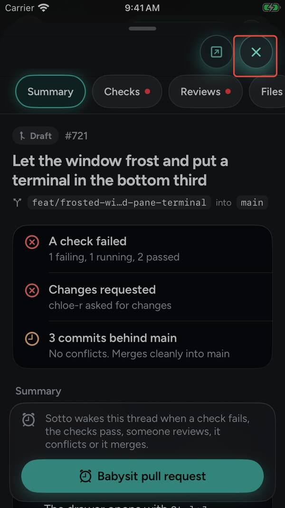

*The pull request sheet. Babysit floats over the summary, with text visible under and around it.*

**What is wrong.**

The reply box and **+** float over the conversation with nothing behind them, so whatever scrolls under them shows between and around them. In a thread with the keyboard up, the provider's name and a message sit beside **+**. On Watcher the box covers a card's second choice and leaves its first letters showing; a press there can land on the box instead of the choice. The pull request sheet's Babysit button does the same over its summary.

**Why it matters.**

"In steady states ... avoid intersections between content and Liquid Glass" ([Meet Liquid Glass, 17:54](https://developer.apple.com/videos/play/wwdc2025/219/)). Controls that float get a scroll edge effect so content fades before it reaches them; it "isn't decorative" ([HIG Scroll views › Scroll edge effects](https://developer.apple.com/design/human-interface-guidelines/scroll-views)). Messages, whose composer the box takes after, fades its transcript under it.

**Suggested fix.**

The desktop has the same: at its minimum size its composer covers a waiting card's Deny and Allow until the transcript is scrolled. One rule for both: content can always scroll clear of a floating composer, with a fade where it passes under.

Keep the box floating (ADR-0051, October 29, pick A) and add a short fade in the room's colour behind the reply row and the pull request's action, so text dissolves before it reaches them: the system scroll edge effect on iOS 26, a gradient of about 24 points before that. Pad the scroll content by the dock's height so the last card can always scroll clear of it.

**Known work.** PR #1816 names this and leaves it: "The reply box floats over the conversation, so text shows in the gaps between its pieces; that is ADR-0051's floating box, not this fix." This finding keeps the floating box and adds only the fade.

### 3. At accessibility text sizes on a small iPhone, a thread is cut off at both edges

**Impact:** High (it confuses or slows on a page people use daily). **Effort:** small. **Tags:** accessibility. **Issue:** #1848.

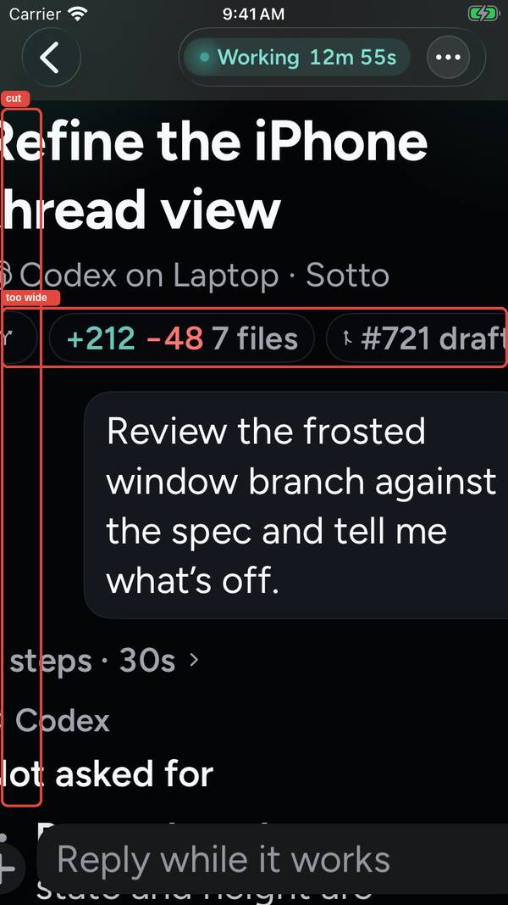

*iPhone SE at accessibility-large: "efine the iPhone", "hread view", "steps", "ot asked for", and + half off the screen. The chip row runs off the right.*

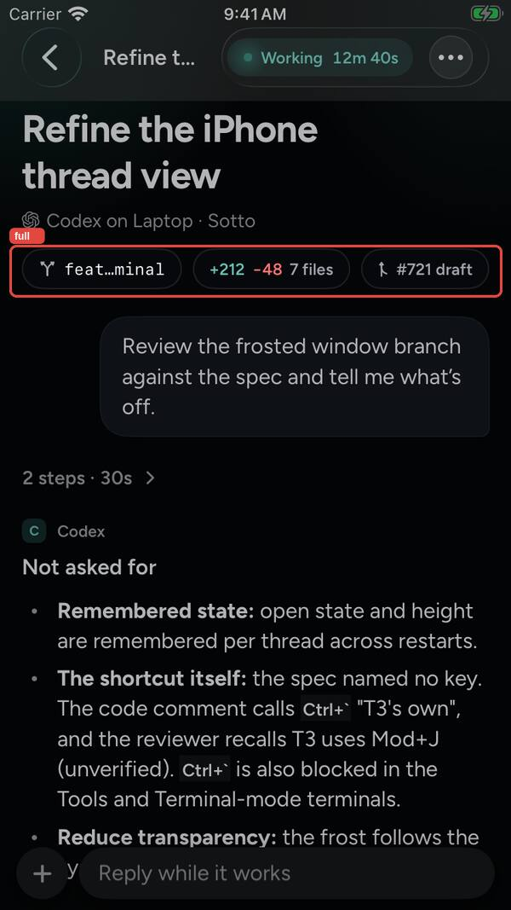

*The same thread at the default size. It fits, but the chip row already fills the width exactly.*

**What is wrong.**

On an iPhone SE at accessibility-large, the whole thread is wider than the screen and sits centred on it, so the first and last letters of every line are cut off: the title, the steps line, the agent's words, and **+** beside the reply box. It is unreadable at exactly the sizes chosen by people who need large text. The Pro Max at the same size is fine.

The likely cause is the Git chip row under the title (`GitChipRow`, `ThreadViews.swift:657`). Its changes and pull request chips are `.fixedSize()` in one `HStack`, so at large text the row can't fit and pushes the page wider than the screen. The branch chip has already shrunk to its icon. At the default size the row fills the SE's width exactly, so a bigger diff or a longer state ("#1816 merged") would probably tip it over there too.

**Why it matters.**

Aim to show "as much useful text at the largest accessibility font size as you do at the largest standard font size", and stack inline items rather than squeeze them ([HIG Typography › Supporting Dynamic Type](https://developer.apple.com/design/human-interface-guidelines/typography)). Rubric §1.3's check: at the largest size, no clipped or overlapping text. Clipped labels at large sizes are rubric §5, row 5.

**Suggested fix.**

Let the chip row wrap: a small flow layout, or `ViewThatFits` that falls back to stacking the chips. A row of chips should never be able to widen its page. Then add the SE at accessibility-large to the iPhone journeys' captures, so the next fixed-size row is caught.

### 4. On a small iPhone, Threads shows five rows of controls before the first thread

**Impact:** High (it confuses or slows on a page people use daily). **Effort:** small. **Tags:** simplicity. **Issue:** #1849.

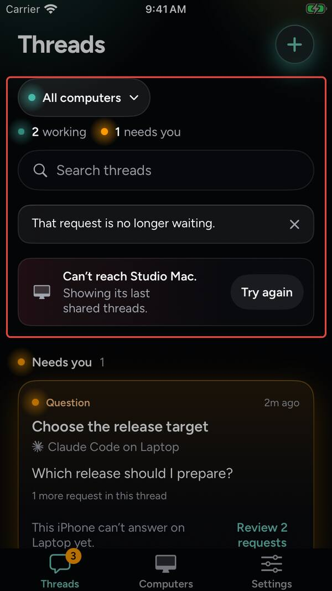

*SE, default text, with one banner. The first card starts 62% of the way down.*

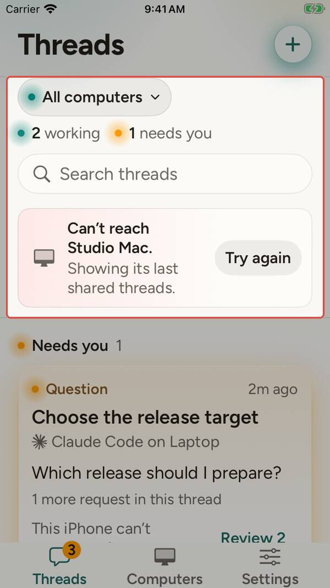

*SE at Sotto's Larger step, no banner. The first card starts 64% of the way down.*

**What is wrong.**

Under the title and **+** come the computer menu, a counts line, search, any banner, and a note for each computer that can't be reached. On an SE the first Needs you card, the reason the page exists, starts 55 to 65% of the way down, and one card fits.

The counts line repeats the section headings under it (Needs you 1, Working now 2) and the tab badge. The computer menu takes a full row for a choice most people rarely change.

**Why it matters.**

Put the most important items "near the top and leading side" ([HIG Layout › Visual hierarchy](https://developer.apple.com/design/human-interface-guidelines/layout)). Limit onscreen controls and keep secondary ones "discoverable with minimal interaction" ([HIG Designing for iOS](https://developer.apple.com/design/human-interface-guidelines/designing-for-ios)). Rubric §3: for each element, ask what breaks if it goes.

**Suggested fix.**

Drop the counts line; the section headings count already. Put the computer menu in the search row as a compact menu button, as the regular-width layout already does (`TabViews.swift:63`). Fold several unreachable computers into one line ("Can't reach Studio Mac and 1 more"). That lifts the first card by about 100 points on an SE.

### 5. Every card is four layers and a glow, and a failed one gets the edge stripe

**Impact:** High (it confuses or slows on a page people use daily). **Effort:** medium. **Tags:** vibe-coded tell, consistency. **Desktop and iPhone.** **Issue:** #1850.

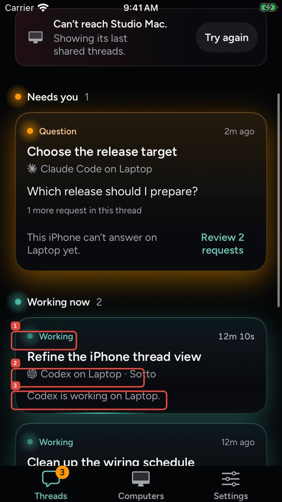

*Threads on an SE. A glowing Needs you card above two glowing working cards, each with a ring, a top highlight and a gradient.*

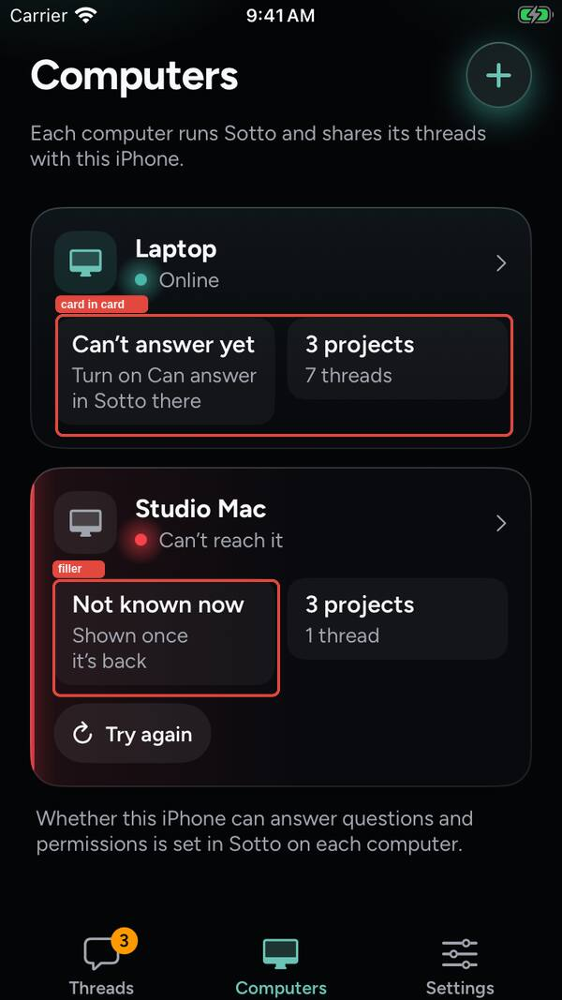

*Computers. The unreachable computer's 3-point danger stripe, with a glow of its own.*

**What is wrong.**

`CardSurface` (`Design.swift:921`) draws each card as a top-down tinted gradient, a hairline or tinted ring, a highlight stroke along its top edge and, behind Needs you and working cards, a breathing glow. One SE screen holds three glowing cards, a glowing **+**, a glowing light on each row and a warm wash over the page. With everything lit, the one card that needs the user has to out-glow the rest.

`FailedEdge` (`Design.swift:1182`) adds a 3-point danger bar down a card's leading edge, with its own glow and a red gradient behind it. The desktop thread found the same stripe on its permission card and in six other places.

The desktop's cards are one fill a step off the room, with no outline (ADR-0110). The iPhone's are the outlier.

**Why it matters.**

"When every element is tinted, nothing stands out" ([Meet Liquid Glass, 17:21](https://developer.apple.com/videos/play/wwdc2025/219/)). Hierarchy should come "through layout and grouping" rather than decoration ([Get to know the new design system, 8:33](https://developer.apple.com/videos/play/wwdc2025/356/)). Glow overuse, border plus fill plus shadow on one box, and the coloured edge stripe are all rubric §5 tells (rows 14, 16 and 24). The stripe also says "failed" in colour alone ([HIG Color › Inclusive color](https://developer.apple.com/design/human-interface-guidelines/color)).

**Suggested fix.**

Make the iPhone's card the desktop's: one fill a step off the room, with no ring, top highlight or gradient. Keep one light, the warm glow on Needs you, since that is the only card asking for the user. Working cards keep their breathing dot and the runner along the bottom, without the halo.

Drop the stripe in both apps in one change. The card's own words (Can't reach it) and its Try again already say what's wrong.

**Decision.** This changes the Glow look approved in ADR-0051, so it needs a mock-up and Zach's pick first. The question at the end of this review asks it.

### 6. On every tab page, scrolled text runs under the clock

**Impact:** Medium (it confuses or slows less often). **Effort:** small. **Tags:** vibe-coded tell, consistency. **Issue:** #1851.

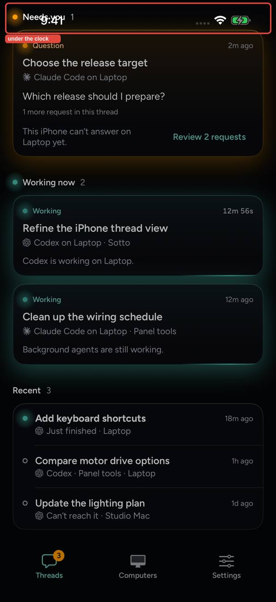

*iPhone 17 Pro Max, Threads scrolled: "Needs you 1" sits under 9:41.*

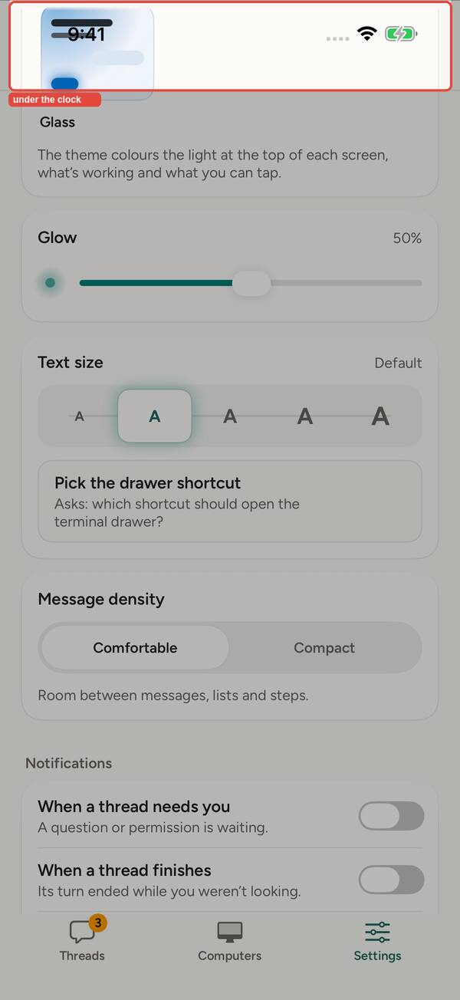

*Settings scrolled, in light: the Glass theme tile sits under the clock.*

**What is wrong.**

Threads, Computers, Settings and Watcher scroll as one sheet with no bar (`SheetPage`, `Design.swift:690`). Its comment promises that "once the page moves, content fades out under the status bar so text never meets the clock". In every scrolled capture, at both sizes, on both phones, in dark and light, text and tiles sit under the time and the battery instead.

Worth checking first: `StatusBarFade` sizes itself from `proxy.safeAreaInsets.top` inside a `GeometryReader` that ignores the top safe area, so it may come out about 10 points tall rather than the status bar's height.

**Why it matters.**

Nothing goes under the status bar but backgrounds (rubric §1.2, from [HIG Layout](https://developer.apple.com/design/human-interface-guidelines/layout)); where content scrolls under floating chrome, a scroll edge effect keeps it legible ([HIG Scroll views › Scroll edge effects](https://developer.apple.com/design/human-interface-guidelines/scroll-views)). Content under the status bar is rubric §5, row 23.

**Suggested fix.**

Make the existing fade cover the full status bar height plus a little. On iOS 26, the system's soft scroll edge effect at the top does the same job. One change in `SheetPage` fixes all four pages.

### 7. The badge, the counts line and the card count different things

**Impact:** Medium (it confuses or slows less often). **Effort:** small. **Tags:** consistency. **Issue:** #1852.

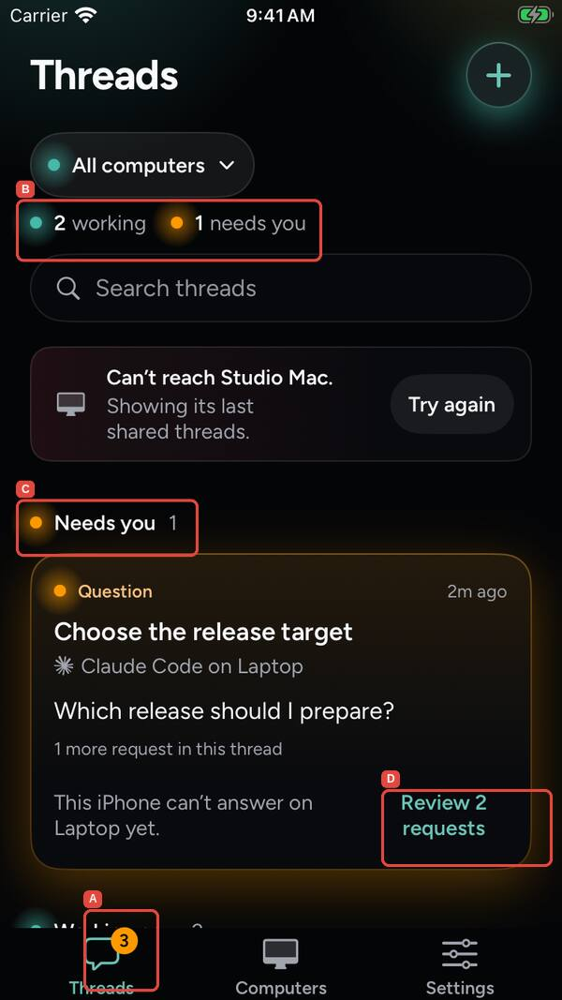

*One screen, four counts: the badge 3, the counts line 1, the section heading 1, the card 2.*

**What is wrong.**

One waiting thread with two requests, plus one thread that finished unseen, gives a tab badge of **3** (requests plus unread finishes, `AppModel.threadsBadge`, `AppModel.swift:73`), **1 needs you** in the counts line and the section heading (threads), and **Review 2 requests** on the card. Nothing on the page says what the 3 is.

**Why it matters.**

"Reserve badges for critical information" ([HIG Tab bars](https://developer.apple.com/design/human-interface-guidelines/tab-bars)). A badge and a sentence that report one status should agree, or one should go (rubric §5, row 13).

**Suggested fix.**

Count one thing everywhere: threads that need you. A thread that finished unseen keeps its dot, bold title and Just finished, without adding to the number. The card can say how many requests it holds; the badge and heading count threads. The desktop already counts threads in its Needs you heading and rows, so this brings the iPhone into line with it.

**Decision.** ADR-0046 has the badge count unread finishes too, so this amends it. Recommendation: the badge counts only threads that need you.

### 8. Sotto's own tab bar drops two things the system's gives for free

**Impact:** Medium (it confuses or slows less often). **Effort:** small. **Tags:** interaction, accessibility. **Issue:** #1853.

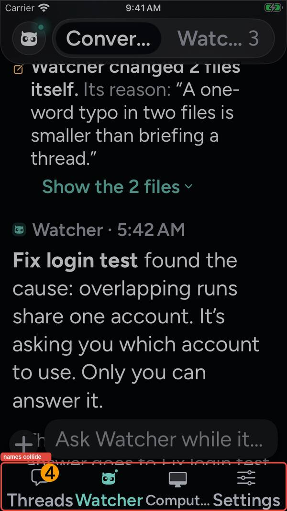

*iPhone SE at accessibility-large with Watcher on: "ThreadsWatcherComput… Settings". The names grow until they touch and one is cut; the icons stay at 24 points.*

**What is wrong.**

ADR-0051 (October 27) hid the system tab bar for `TabsBar` (`Views.swift:145`), which draws the same tabs straight on the page. Two behaviours didn't come across. Pressing the tab you're on does nothing (`Button { tab = id }`, `Views.swift:171`); in a system tab bar it goes back to that tab's first page, and a second press scrolls to the top. A long press at the accessibility text sizes shows nothing, where the system bar shows the large content viewer.

Instead the names grow with the text size while the icons, framed at 24 by 24, don't. At accessibility-large on an SE with Watcher on, the four names run into each other and Computers is cut to "Comput…".

**Why it matters.**

Custom bars should adopt the large content viewer, `accessibilityShowsLargeContentViewer()`, for items that "must remain small", such as tab bar buttons ([Get started with Dynamic Type, 12:50](https://developer.apple.com/videos/play/wwdc2024/10074/)). A custom control where a system one fits loses what the system gives (rubric §5, row 2). Threads is the home page; getting back to its top is the most common move in the app.

**Suggested fix.**

On a press of the chosen tab, pop its navigation path to the root; on a second press, scroll its page to the top. Add `.accessibilityShowsLargeContentViewer { icon; title }` to each tab and hold the names at the size the system bar uses, as Apple's does. Both are a few lines in `TabsBar`.

### 9. A working card says it's working three times

**Impact:** Medium (it confuses or slows less often). **Effort:** small. **Tags:** simplicity. **Issue:** #1854.

*"Working", then "Codex on Laptop", then "Codex is working on Laptop."*

**What is wrong.**

"Working · 12m 10s", then "Codex on Laptop · Sotto", then "Codex is working on Laptop." The third line repeats the first two, and it has the most room of any line on the card. The next card shows what that line is for: "Background agents are still working." says something the others don't.

**Why it matters.**

"Check each word to be sure it needs to be there" ([HIG Writing](https://developer.apple.com/design/human-interface-guidelines/writing)). Rubric §5 (redundant labels): let each written element do one job.

**Suggested fix.**

Show the third line only when it adds something: background agents, the step running now where this iPhone has read the thread (ADR-0051 allows that already), or the agent's last words. Otherwise the card is three lines.

### 10. The permission sheet leads with who is asking, not with what it asks

**Impact:** Medium (it confuses or slows less often). **Effort:** small. **Tags:** simplicity, consistency. **Issue:** #1855.

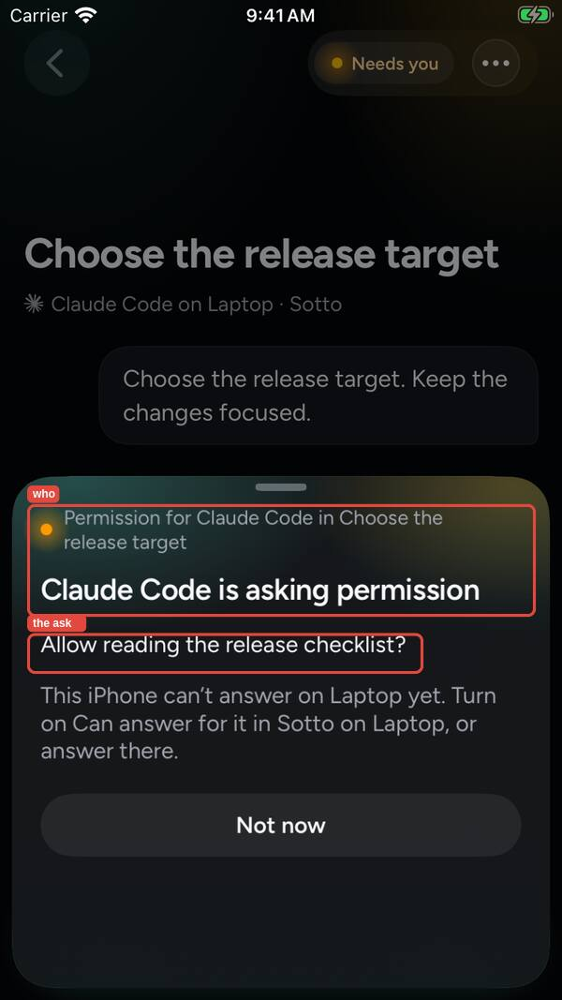

*Two lines of who and where, a headline that says "asking permission", and then the request.*

**What is wrong.**

The headline is **Claude Code is asking permission**. The thing to decide, "Allow reading the release checklist?", sits under it in body type. Above both, "Permission for Claude Code in Choose the release target" names the thread whose page is right behind the sheet. Three lines of who and where come before the one that matters. The question sheet already leads with its question; the permission sheet doesn't.

**Why it matters.**

Put the most important item first ([HIG Layout › Visual hierarchy](https://developer.apple.com/design/human-interface-guidelines/layout)), and "Check each word to be sure it needs to be there" ([HIG Writing](https://developer.apple.com/design/human-interface-guidelines/writing)). Rubric §5: redundant labels.

**Suggested fix.**

Make the request the headline ("Allow reading the release checklist?") and put who asks on one quiet line ("Claude Code · Choose the release target"), as the question sheet does. The desktop's permission card already leads with the ask ("Run a command in workshop", then the command, then Deny and Allow); it is the model.

### 11. New thread asks where to run when only one computer can take it

**Impact:** Medium (it confuses or slows less often). **Effort:** small. **Tags:** simplicity. **Issue:** #1856.

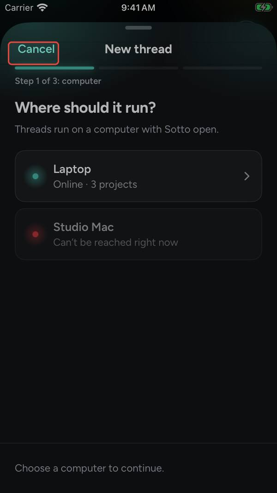

*Step 1 of 3 with one computer online: one live row, one grey one, and "Choose a computer to continue."*

**What is wrong.**

New thread always opens on Step 1 of 3, Where should it run? (`NewThreadViews.swift:13`), and nothing moves past it on its own. With one computer reachable, the step is one live row and a grey one, so every new thread costs a press that decides nothing.

**Why it matters.**

"Too much progressive disclosure can make work flows inefficient" ([Essential Design Principles, 57:12](https://developer.apple.com/videos/play/wwdc2017/802/)). Rubric §3: if nothing breaks when it goes, it's a finding.

**Suggested fix.**

When only one computer can take a new thread, open on the project step with it chosen. Step 3 already shows the computer as a chip, which can open the list. Keep step 1 when two or more can.

### 12. At accessibility sizes, side-by-side rows collide or cut words to a few letters

**Impact:** Medium (it confuses or slows less often). **Effort:** medium. **Tags:** accessibility. **Issue:** #1857.

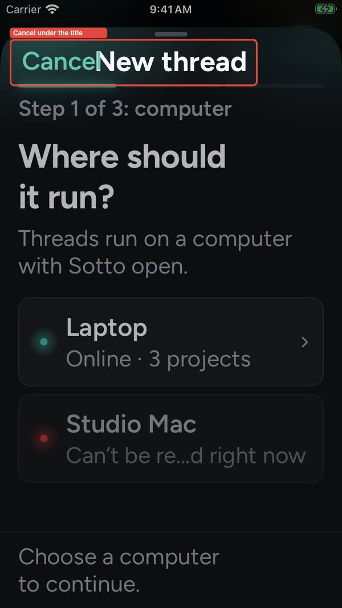

*New thread on an SE at accessibility-large: "CanceNew thread". Step 2 reads "‹ BackNew threadCancel".*

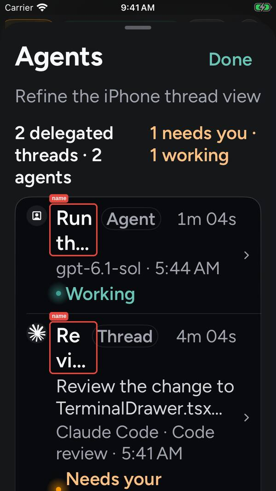

*Agents on the same SE: the names are cut to "th…" and "vi…" to keep the kind and time beside them.*

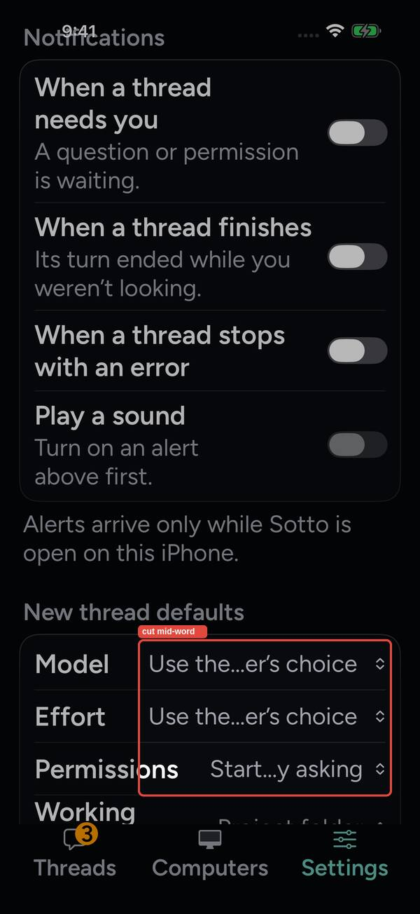

*Settings on a Pro Max at accessibility-large: "Use the…er's choice", "Start…y asking".*

**What is wrong.**

Where a label and a value or a control share a line, they stay side by side at every text size. At the accessibility sizes the words win the fight by overlapping (the sheet headers) or lose it by being cut mid-word (Agents rows, Settings' New thread defaults, Watcher's "Conver… Watc… 3", "Can't be re…d right now" in New thread). Some views already switch layout at those sizes (`isAccessibilitySize` in Agents' button, the Computers rows, Watcher), so the app knows how; these don't.

**Why it matters.**

"Keep text truncation to a minimum" and stack inline items under text at large sizes ([HIG Typography › Supporting Dynamic Type](https://developer.apple.com/design/human-interface-guidelines/typography)); switch an `HStack` to a `VStack` at accessibility sizes ([Get started with Dynamic Type, 6:06](https://developer.apple.com/videos/play/wwdc2024/10074/)). Rubric §1.3 and §5, row 5. Cutting a sentence in the middle makes it a puzzle.

**Suggested fix.**

At `isAccessibilitySize`, stack: the value under its label in Settings, the kind and time under the name in Agents, and the sheet's title on its own line under Back and Cancel (or the system navigation bar, which does this already). Truncate only names and paths, never a sentence.

### 13. Icons stay the same size while the words beside them grow

**Impact:** Medium (it confuses or slows less often). **Effort:** medium. **Tags:** accessibility, consistency. **Issue:** #1858.

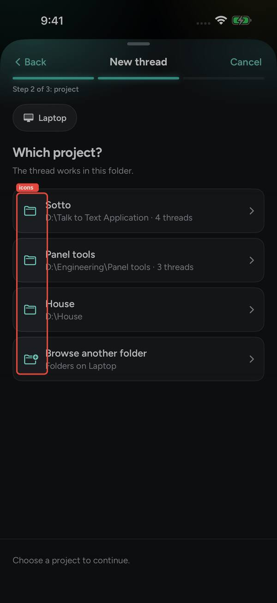

*iPhone 17 Pro Max, New thread step 2, default text.*

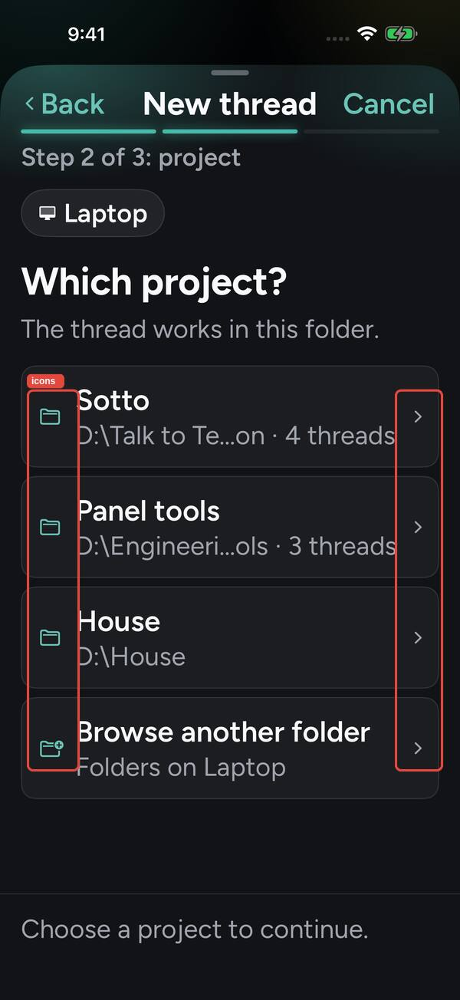

*The same step at accessibility-large. The words about double; the folder icons, the chevrons and the Laptop chip's icon don't grow.*

**What is wrong.**

57 views, nearly all SF Symbols, are set with `.font(.system(size:))` at eleven sizes from 9 to 24 points. Figtree beside them follows Dynamic Type; they don't. At the accessibility sizes, chevrons, the ••• button, the settled chevron and row marks stay small next to large words.

Eleven sizes is also more than the type scale has steps, so an icon's weight drifts from its label's from page to page.

**Why it matters.**

"Increase the size of meaningful interface icons as font size increases"; SF Symbols do it when they take a text style ([HIG Typography › Supporting Dynamic Type](https://developer.apple.com/design/human-interface-guidelines/typography)). Icons share "a consistent size, level of detail, stroke thickness" and should "match the weights of interface icons and adjacent text" ([HIG Icons](https://developer.apple.com/design/human-interface-guidelines/icons)).

**Suggested fix.**

Put icons on the type scale: `.font(.sotto(.small, .semibold))`, or a system text style with a weight, so each scales with its label; `@ScaledMetric` where a frame is needed. Three icon sizes (row mark, control, tab) cover every site. It's mechanical, a file at a time.

### 14. Thread rows have no swipe actions, and Settle is only on the thread's own page

**Impact:** Medium (it confuses or slows less often). **Effort:** medium. **Tags:** interaction. **Issue:** #1859.

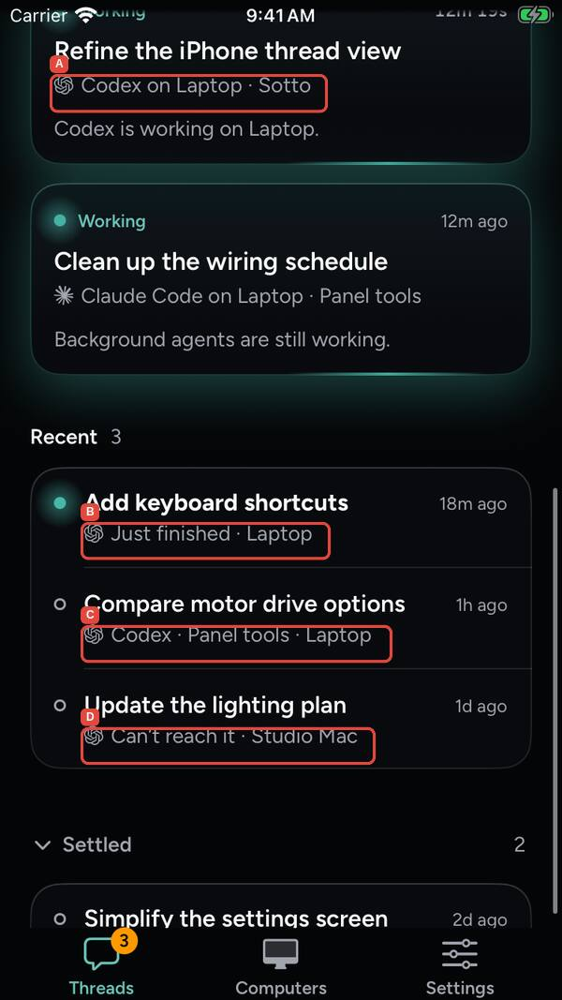

*Recent rows. No swipe, and a long press offers only Watch, only where a computer runs Watcher.*

**What is wrong.**

Recent and Settled rows are custom views in a scroll view, so they get no swipe actions. Settle and Restore live only behind ••• on the thread's page (`ThreadMenu`, `ThreadViews.swift:192`). A long press offers Watch, and only where a computer runs Watcher; with a stable desktop it offers nothing (`TabViews.swift:761`). Putting finished threads away means opening each one.

**Why it matters.**

"It's especially important to let people swipe to navigate back or initiate actions in a list row" ([HIG Designing for iOS](https://developer.apple.com/design/human-interface-guidelines/designing-for-ios)). Support context menus "consistently throughout your app", with their items in the main interface too ([HIG Context menus](https://developer.apple.com/design/human-interface-guidelines/context-menus)). Mail and Messages teach exactly this for a list of conversations.

**Suggested fix.**

Give Recent rows a trailing swipe to **Settle**, and Settled rows **Restore**, with a full swipe acting at once and Undo in the toast, as Watch already works. The desktop review reaches the same rule from the other side (its row Settle acts with no Undo): reversible actions act at once and offer Undo; only irreversible ones ask. Put Settle or Restore, and Watch where it applies, in every row's context menu. `swipeActions` needs a `List`, so either Recent becomes a `List` section or the row gets its own drag to reveal.

### 15. Sheets close four different ways

**Impact:** Low (it looks unfinished). **Effort:** small. **Tags:** consistency. **Issue:** #1860.

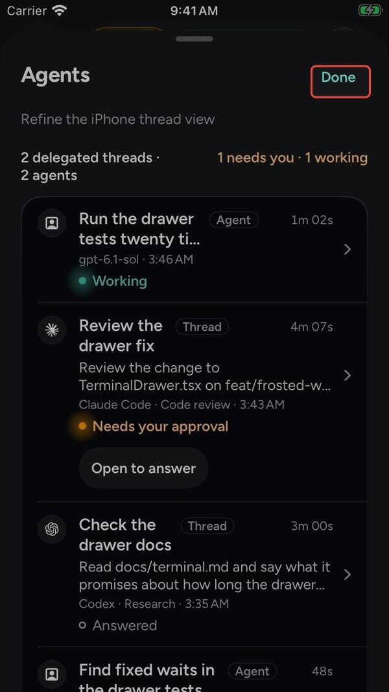

*Agents: Done, trailing.*

*Pull request: a glass ×.*

*New thread: Cancel, leading.*

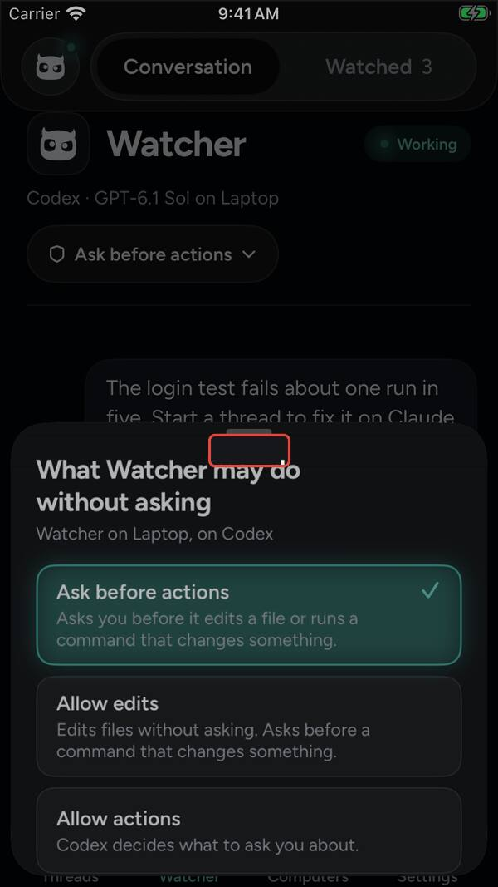

*Watcher's permissions: only the grabber.*

**What is wrong.**

Agents closes with **Done** at the trailing edge, the pull request sheet with a glass **×**, New thread with **Cancel** at the leading edge, and Watcher's permissions with only a drag. Each is fine alone. Together, the way out moves from sheet to sheet.

**Why it matters.**

Cancel on the leading edge for a task that would be lost, Done on the trailing edge otherwise; the close symbol "only when modal presentations require minimal interaction and no text input" ([HIG Sheets](https://developer.apple.com/design/human-interface-guidelines/sheets); [Explore navigation design for iOS, 22:08](https://developer.apple.com/videos/play/wwdc2022/10001/)). "If you use a swipe gesture to dismiss a view, also make a button available" ([HIG Accessibility › Mobility](https://developer.apple.com/design/human-interface-guidelines/accessibility)).

**Suggested fix.**

Sheets that only show things (Agents, the pull request, a machine, Watcher's permissions) close with one trailing **Done**. New thread keeps **Cancel**, since it throws work away. Request sheets keep **Not now**, which is an answer of its own.

### 16. The line under a title has three grammars

**Impact:** Low (it looks unfinished). **Effort:** small. **Tags:** consistency. **Desktop and iPhone.** **Issue:** #1861.

*A: provider on computer · project. B: state · computer. C: provider · project · computer. D: state · computer.*

**What is wrong.**

Cards say "Codex on Laptop · Sotto" (provider on computer, then project). Recent rows say "Codex · Panel tools · Laptop" (provider, project, computer). A just-finished row says "Just finished · Laptop", dropping provider and project, and an unreachable one "Can't reach it · Studio Mac". The same facts change places from row to row, so the eye can't learn where the computer is.

**Why it matters.**

Text should keep "a limited number of font faces and sizes and colors" and glyphs one style ([Essential Design Principles, 26:34](https://developer.apple.com/videos/play/wwdc2017/802/)). Follow one pattern so people don't have to guess (rubric §3, consistent patterns).

**Suggested fix.**

One order everywhere, in both apps: provider · project · computer. State words (Just finished, Can't reach it) get a place of their own, such as the trailing slot where the time is, not the meta line.

### 17. An error says "Try again" but gives nothing to press

**Impact:** Low (it looks unfinished). **Effort:** small. **Tags:** interaction. **Desktop and iPhone.** **Issue:** #1862.

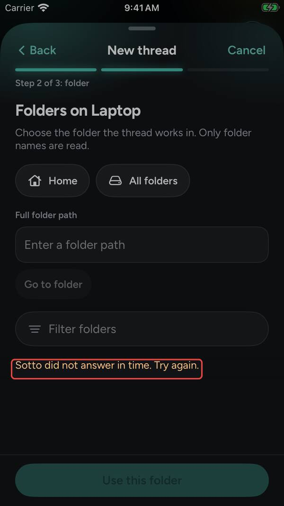

*New thread, Folders on Laptop, after a read timed out.*

**What is wrong.**

When a computer doesn't answer a folder read, the page says "Sotto did not answer in time. Try again." in warning text, with no Try again. The way to retry is a guess: Home, All folders, or typing a path.

**Why it matters.**

Sotto's own rule: an error says what happened, whether anything was lost and what to do next (AGENTS.md › Plain words). What to do next should be a press away (rubric §5, row 20, and the desktop rubric's error guidance).

**Suggested fix.**

Put a **Try again** button under the sentence that reads the folders again.

The desktop has the same gap: "Action failed. Thread 'Visual gate flake' is waiting for your answer. Answer it, then try again." names a thread and offers no way to open it. One rule for both: an error that names an action gives that action a control.

### 18. Computers nests tiles inside each card, and one of them holds nothing

**Impact:** Low (it looks unfinished). **Effort:** small. **Tags:** vibe-coded tell, simplicity. **Issue:** #1863.

*Each computer card holds an icon tile and two smaller cards. For one that can't be reached, the first tile says only that nothing is known.*

**What is wrong.**

Each computer is a card holding an icon tile and two smaller cards: "Can't answer yet / Turn on Can answer in Sotto there" and "3 projects / 7 threads". For a computer that can't be reached, the first tile reads "Not known now / Shown once it's back", a box that holds nothing. The radii don't nest either: 20 outside, 12 for the tiles, 13 for the icon.

**Why it matters.**

Card-in-card nesting and radii that clash are rubric §5 tells (rows 3 and 16); nested containers should be concentric ([Get to know the new design system, 5:04](https://developer.apple.com/videos/play/wwdc2025/356/)).

**Suggested fix.**

One card per computer, with plain lines: its name and state, then "Can't answer here · 3 projects, 7 threads". Leave out what isn't known. The whole card already opens the computer's page.

### 19. Settings is a stack of cards, each with a heading of its own

**Impact:** Low (it looks unfinished). **Effort:** medium. **Tags:** vibe-coded tell, simplicity. **Issue:** #1864.

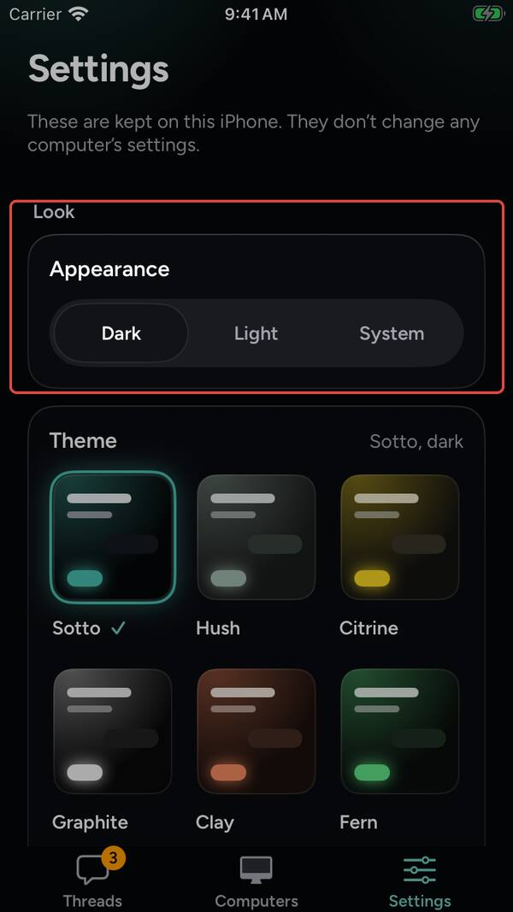

*Look, then Appearance in a card, then Theme in a card. Glow, Text size and Message density follow, each in a card.*

**What is wrong.**

Each control sits in its own card with its own heading, under a section label: Look › Appearance, Look › Theme, Look › Glow, Look › Text size, Look › Message density. That is five cards and six headings for the look alone, and the page scrolls about four screens on an SE.

**Why it matters.**

"Express your brand with familiar components" ([HIG Branding](https://developer.apple.com/design/human-interface-guidelines/branding)); a column of cards where iOS has grouped rows is the web-like layout tell (rubric §5, row 1). Fewer elements (rubric §3).

**Suggested fix.**

Group rows, not cards: one Look group holding Appearance, Text size, Glow and Message density as rows in one surface, divided by hairlines, as Notifications already is. Keep the theme tiles as they are; they are the page's best part.

## Considered and left alone

- **Recorded decisions, not scored:** the in-app Dark, Light or System choice with Dark the default (ADR-0039); the tab bar hidden under a thread (ADR-0051); the Spaceballs working words, which VoiceOver reads as the plain fact (ADR-0134); the floating Messages-shaped reply box itself (ADR-0051, October 29).
- **Body text at 15.5 points** against iOS's 17. It is a deliberate step in the type scale and scales with Dynamic Type, so it isn't a finding, but it is why some captures read small.
- **The custom search field** instead of `.searchable`: it is well built (a 44-point clear button, Search on the keyboard, closes on a tap outside or a scroll) and it scrolls with the page as ADR-0051 asks.

## Known work, not repeated here

- **#1816** (open): a thread's top bar on narrow iPhones. The SE captures show the title cut to "Refine t…" beside the state, Watch and •••; that PR covers it. The Pro Max at accessibility-large cuts it the same way ("Refine the…"), so it is worth checking that fix at large text on a large phone too.
- **#1320**, **#1752**, **#1166**, **#1576**: the flaky and failing iPhone journeys, which are why CI has no large-phone screenshots.
- **#1702**: the iPhone's lag. Not a design matter, and not measured here.

## Leads that need a phone to prove

- **Bold Text probably doesn't reach Figtree.** Nothing reads `legibilityWeight`, and SwiftUI doesn't synthesize bold for a custom font. One look on a phone with Bold Text on settles it.
- **No Increase Contrast palettes.** The palettes have light and dark only, and nothing reads `colorSchemeContrast`. They already pass 4.5:1, so this matters most for the hairlines and rings, which are the only edge some controls have.
- **Differentiate Without Color is never read.** The failed edge, the warm glow and the wash carry state in colour; in most places words carry it too, but not on the stripe.
