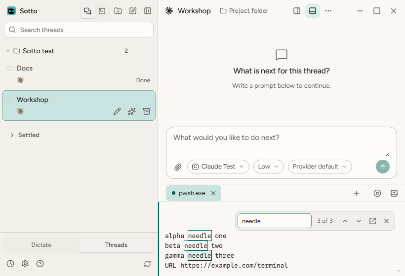

# Keep the terminal search match after a repaint

Verified in the built Windows Electron app through [Desktop check](https://github.com/millZach/Sotto/actions/runs/38497283705/job/115635917808). The run's PR head is `c29693291aa7344c1c1a66cf91dd15c9ab42eec8`. GitHub checked out test merge `c9abb85f69c17651510ffe0da064c7f1b351b1e8`, whose tree `f96fd22b96a94e47a205624f9b755e6db97a56fa` exactly matches that head. The job succeeded at 01:48 UTC on October 14 (October 13 locally). Captures were then downloaded from that run's `windows-desktop-journeys-1` artifact.

Zach chose **Keep current match** when the drawer reopens. Before changing production code, the [logic prototype](https://github.com/millZach/Sotto/blob/8b42bcaad8f0b9e435210d3872b81ed946a88f33/docs/prototypes/terminal-search-recovery.prototype.html) was driven through closing at result 2, reopening at 2, repainting, advancing to 3 and returning to 2. Its guided missing-match and resize cases were also inspected. The prototype remains outside the implementation branch.

## Failure and correction

The [earlier Windows job](https://github.com/millZach/Sotto/actions/runs/38488999999/job/115610256379) failed the drawer's repeated Ctrl+F/Enter check: it stayed at 1 of 3 instead of advancing to 2 of 3. A controlled regression using real xterm and SearchAddon reproduced the same result on the old helper. An actual CSI erase/repaint disposed the selected marker; detaching and remounting the drawer retained its query and stale count. The old helper could no longer restore the selection. Recovering the marker alone exposed stale cached match positions when Enter arrived before the addon's delayed refresh.

The helper now recovers only an exact surviving logical line, using its last known row to distinguish duplicates, and rebuilds cached matches before advancing when necessary. A changed or missing line starts a fresh search. Closing or clearing search clears the recovery state. No timer or new control was added. The original hosted failure did not record the precise marker and refresh arrival order; the controlled regression proves this failure path rather than claiming that missing trace exists.

The focused final check passed **6 files / 46 tests**, with native exit 0 and no skipped tests. It covers refresh before and after Enter, retained first and second matches, missing/changed/duplicate lines, previous navigation, clear/close and wide-character reflow. Earlier failed runs remain recorded separately.

## Hosted app checks

The successful Desktop job ran the normal recovery command: **15 files / 271 tests**, a fresh build, and **3 Electron recovery journeys**. Its remaining desktop command passed **8 journeys**, including all three terminal surfaces: Terminal mode, Tools and the drawer. These are real Windows ConPTY sessions with synthetic terminal output, not live provider sessions.

The drawer now explicitly closes at result 2, retains result 2 after reopening, advances to 3, and returns through 2 to 1. The original repeated Ctrl+F/Enter 1-to-2 assertion remains. Neighboring checks cover search focus, previous/next navigation, empty/no-match queries, Escape, links, clipboard images, text size, reload and saved settings. Each terminal surface checks light and dark themes with reduced motion at 1600x1000, 1280x800 and 820x560, including search and link-picker bounds, highlights on their text and absence of renderer errors.

Fresh captures were opened and inspected: minimum-size search in all three surfaces, the light minimum drawer link picker, the dark 1280x800 drawer and the light 1600x1000 drawer. Search controls remain readable above the output, and the minimum link picker stays within the window. Only this cited capture is retained; the rest remain in the hosted artifact:

This verifies the Windows terminal recovery journey on the stated revision. It does not claim a clean full PR: Windows unit shard 2 failed a separate paired-host Watcher accounting assertion in this same run. No macOS or Omarchy desktop journey, native Muse installation or installer update was performed for this check. No design baseline was regenerated.
