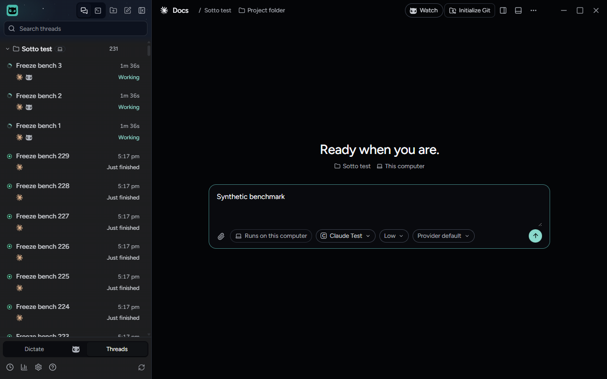

# A draft save's reply waits behind the next keystroke

October 20, 2026, on Windows 11 with the built app, on `test/keys-diagnosis`. The change is cbbedcbdc (#1245): the window
commits main's reply to a composer draft save (`save-thread-draft`) as a transition, as it does a broadcast, instead of
urgently. Every other command's reply stays urgent. `docs/perf/2026-10-20-main-lag.md` (Keystrokes) has the diagnosis;
this note records the runs that prove it in the running app.

## How it was measured

`tests/e2e/main-freeze.spec.ts` with `SOTTO_PERF_BENCH=1` and its default scale, with no `SOTTO_FREEZE_THREADS`
override: 232 threads on this computer (230 padding threads and the fixture's 2), each with a provider session, and a
paired headless host with 40 more, so 272 in the sidebar. Watcher's record held 5 standing watches, 160 requests and 150
operations, and `request-drafts.json` 256 answer retirements, 40 of them on the paired host. Each case types 40 keys into
an idle thread's composer over 15 seconds, with nothing streaming, then one thread, then three. Builds ran one at a
time, with 7 to 9 GB of memory free.

- Keystroke latency: keydown to the next animation frame after the composer's input event.
- Long tasks: the window's own `longtask` entries during the case.
- Main stalls: stretches of 100 ms or more without main's event loop going idle.

The window has to be on screen. A minimized, covered or locked window is drawn about once a second, and every key then
waits up to a second for its frame. The last two rows below are such runs, kept to show it: the same half second on
main and with the fixes.

## Results

| Build | Window | Case | Main stalls | Keys p50 / p95 (ms) | Long tasks (ms) |
| --- | --- | --- | ---: | ---: | ---: |
| `origin/main` 9376061ef with the gate, neither lag fix | on screen | nothing streaming | 101 | 22 / 31 | 2 (108) |
| | | one thread | 106 | 21 / 25 | 3 (189) |
| | | three threads | 130 | 22 / 34 | 22 (1,287) |
| Both lag fixes (#1230 at 86759be29, #1231 at 75a3f62f0), without this change | on screen | nothing streaming | 0 | 10 / 38 | 32 (1,933) |
| | | one thread | 0 | 29 / 40 | 29 (1,743) |
| | | three threads | 0 | 17 / 44 | 23 (1,364) |
| Both lag fixes with this change | on screen | nothing streaming | 0 | 10 / 27 | 0 (0) |
| | | one thread | 0 | 15 / 26 | 1 (79) |
| | | three threads | 1 | 6 / 24 | 1 (88) |
| Both lag fixes, without this change | minimized | nothing streaming | 0 | 525 / 970 | 28 (1,741) |
| `origin/main` with the gate | minimized | nothing streaming | 105 | 583 / 948 | 0 (0) |

With the change, the window drew 57, 50 and 48 frames a second in the three cases; without it, 55, 37 and 26.

A later run with this change, #1230 from `main` and #1231 at its newest commit (c5bde672c, PR #1243), a current Watcher
in the record and the window at 1280x800, with `SOTTO_PERF_ASSERT=1` and a screenshot halfway through each case's
typing, passed in 2.5 minutes: no stall of 100 ms or more in any case, keystrokes p50 / p95 of 7 / 28, 22 / 31 and
11 / 25 ms, and 0, 2 and 2 long tasks.

The window halfway through the three-thread case: the three streaming threads working at the top of the sidebar, and
the synthetic text being typed into Docs' composer.

What it shows:

- With main no longer freezing, every draft save's reply reached the window, and each urgent commit rendered the whole
  sidebar synchronously: about 30 long tasks in each 15-second case, against 2 on main, where a broadcast that arrived
  during the save usually made the window skip its reply.
- Committed as a transition, the reply leaves the window 0 or 1 long tasks a case, and keystroke p95 drops from 38 to 44
  ms to 24 to 27 ms.
- The half-second keystrokes first reported with both fixes were the off-screen window, not Sotto: minimized, main reads
  the same.

## Evidence

The console output of each run, as JSON per case (counts and timings only), is in `artifacts/draft-save-reply-priority/`:

- `gate-alone-on-screen.json`
- `both-fixes-on-screen.json`
- `both-fixes-and-reply-priority-on-screen.json`
- `both-fixes-minimized.json`
- `gate-alone-minimized.json`
- `screenshot-run-on-screen.json`, the run the screenshot comes from, with `typing-three-threads-streaming-1280x800.png`

The runs without the change used the keys lane's diagnostic build of the spec, which also printed each case's IPC
counts (`ipc`), the split of each key's time (`keySplit`) and frames drawn (`frames`). The run with the change used the
committed spec, which reports frames a second, state broadcasts a second, long tasks and key handling time itself.

`tests/unit/renderer/draftSaveReplyPriority.test.tsx` counts the window's transitions: one for a draft save's reply and
none for `refresh`. It failed before the change and passes with it.

## Not shown

- One run per build on one machine; the numbers vary from run to run by a few milliseconds.
- Typing on the owner's own machine and profile, which is the hand test the pull request asks for.
