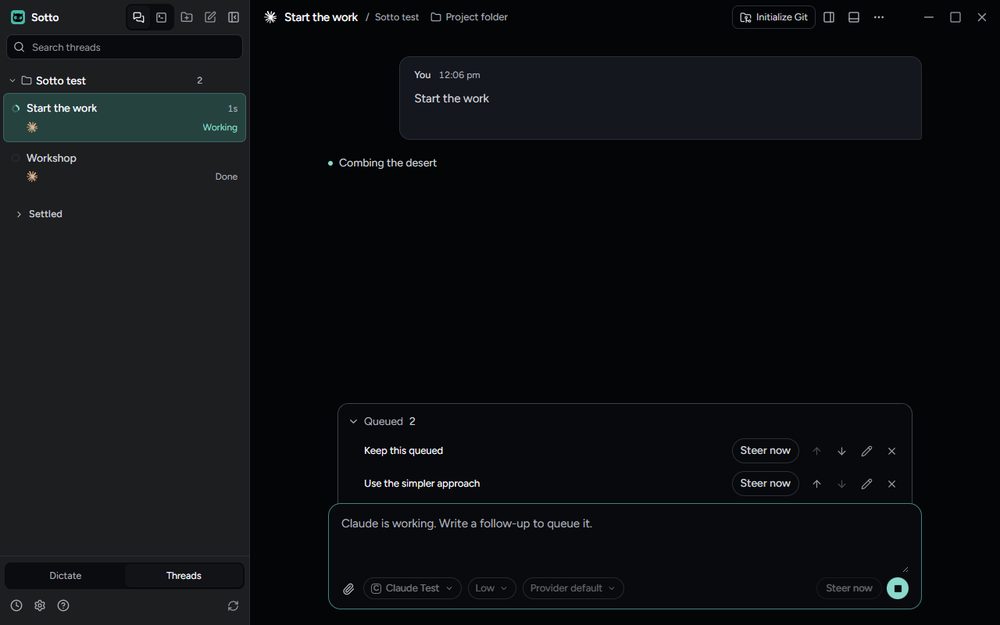
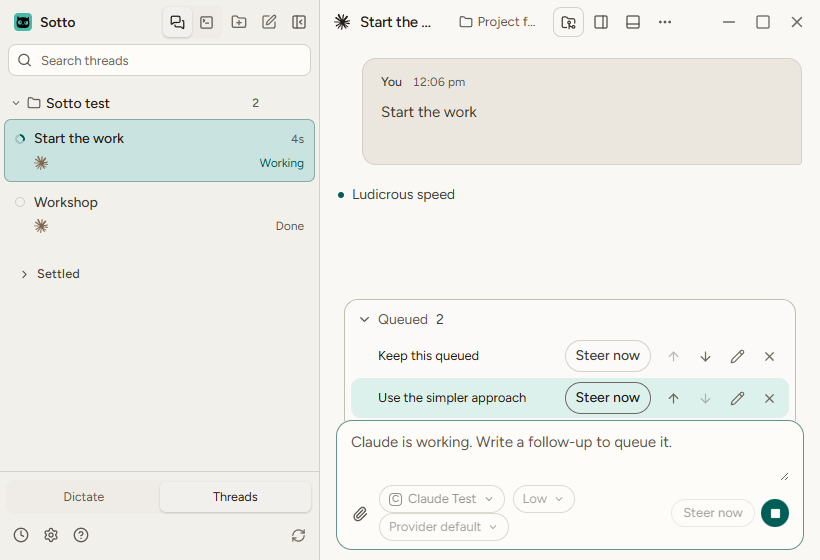
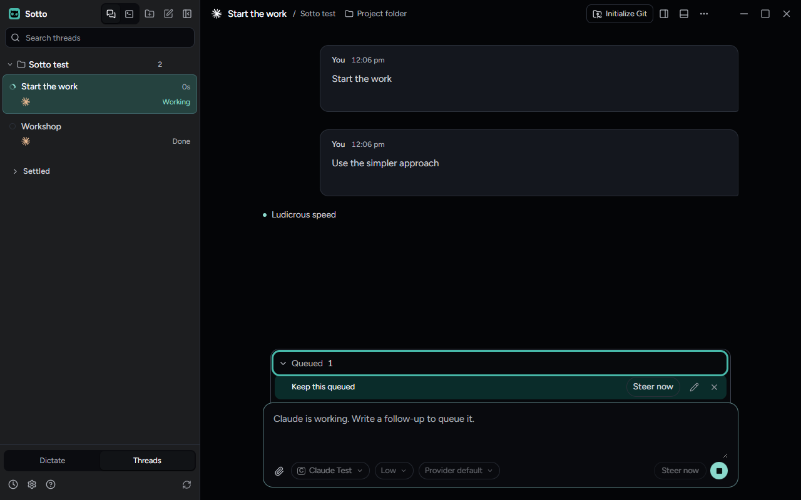
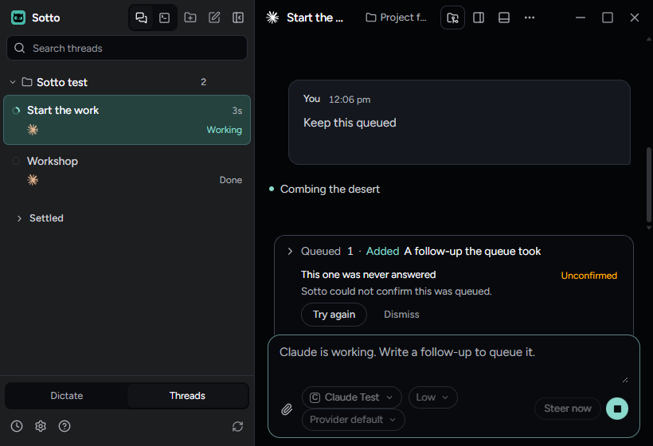
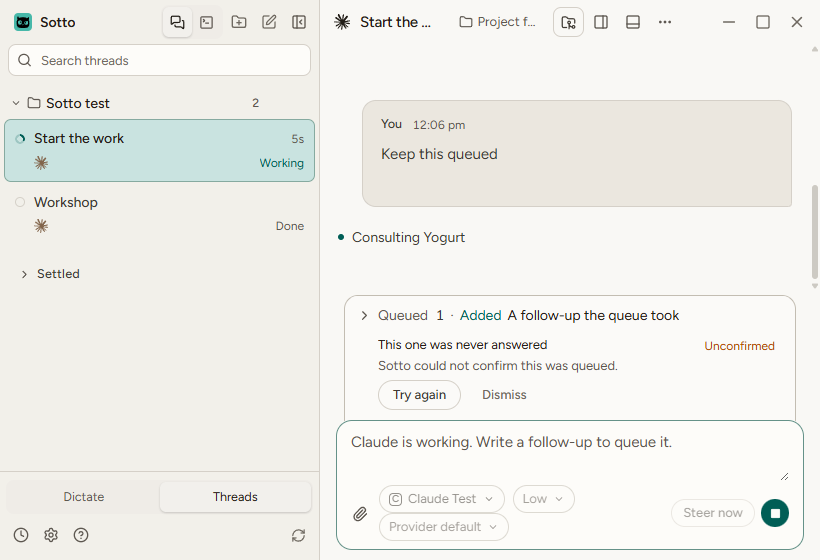
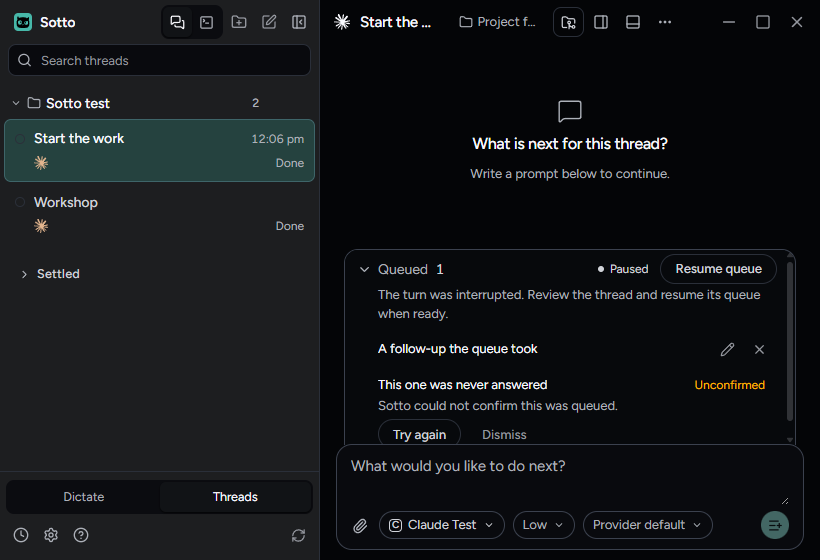

# A queued message shows only in the queue

Checked on Windows 11 on October 21, 2026, in the built app at `4282197c8` on `fix/watcher-queue-no-echo` (#1260,
closes #1271). A follow-up written while a thread works used to show twice: in the queue above the composer and as a
"You · Queued" bubble in the transcript. Now the queue holds it alone until the provider's history carries it, and then
it shows once, as an ordinary message.

## How it was driven

A throwaway Playwright spec, not committed, ran the `queued-steering` fixture the way `tests/e2e/queued-steering.spec.ts`
does: a real controller, renderer and queue over the synthetic provider. It sent "Start the work" to Docs and queued two
follow-ups while the turn ran. Each state was checked at 1600x1000, 1280x800 and 820x560, in dark and light, and the
steer was pressed with reduced motion on. At every size it read the layout: no horizontal overflow in the window or the
queue, the queue inside the pane, and the prompt on screen. All held.

Two states needed a hand on the fixture:

- **Unconfirmed admission.** For one prompt, main's handler for the agent command channel was made to throw, so the
  window got no answer for that `queue-followup` and main never took it. Every other command went through.
- **Empty history with a held queue.** Stop paused the queue, then the fixture replaced Docs' history with nothing. The
  thread was idle with no messages, a summary of zero and the queue still holding a paused item and the unconfirmed one.

## What it showed

**Two queued follow-ups.** Both were listed in the queue, with Steer now, move, edit and remove. The transcript showed
only "Start the work" and the working line. No queued bubble and no "Queued" status were drawn there, from the press
through the queue owning the item. At 820x560 the queue starts collapsed to one line, "Queued 2" and the newest or next message; opened,
both rows and their controls fit above the composer.

**Steer now, then the turn finishing.** Steer now on "Use the simpler approach" put it in the transcript once and took
it out of the queue, which kept "Keep this queued". When the turn finished, the queue sent the rest. "Keep this queued"
joined the transcript once and the queue closed. After the steer, each message was drawn once at every size in both
themes; after the turn finished, at every size in dark and at 820x560 in light.

**Unconfirmed admission in a collapsed queue.** Collapsed at 820x560, the queue still listed the unanswered prompt with
"Unconfirmed", "Sotto could not confirm this was queued.", Try again and Dismiss. The item the queue did own stayed
folded into the header line. Nothing of either showed in the transcript. The same held collapsed and open at every size.
In light, "Unconfirmed" reads at 5.37:1 and Dismiss at 5.2:1; everything else in the queue reads higher.

**Empty history, queue holding something.** The transcript kept its empty line, "What is next for this thread?", and no
greeting was drawn. Removing the queued item and dismissing the unconfirmed one brought the greeting ("Let's make
something.") in its place, so the queue is what held it back. At 820x560, with the paused note and both rows open, the
queue reaches its height limit and scrolls inside itself; Try again and Dismiss sit at its lower edge and scroll into
full view.

## Keyboard

With the queue open, Tab goes from the queue's toggle ("Queued 2") through each row in order: Steer now, Move up, Move
down, Edit, Remove. Then it goes to the prompt, Attach screenshots and Stop agent. Enter on Edit opens "Edit queued
message"; Escape closes it, hands focus back to that Edit button and leaves the transcript as it was. Enter on Steer now
moved focus to the queue's toggle. The queue is a disclosure, not a popup, so Escape has nothing to close on it.

## What was not checked

- Watcher's own pane. It draws the same shared transcript, and `watcherView.test.tsx` covers the reported Watcher case,
  but this run did not open Watcher.
- A restart with messages queued.
- macOS and Linux.

`tests/e2e/queued-steering.spec.ts` and `tests/e2e/babysitting.spec.ts` passed on the same build.
