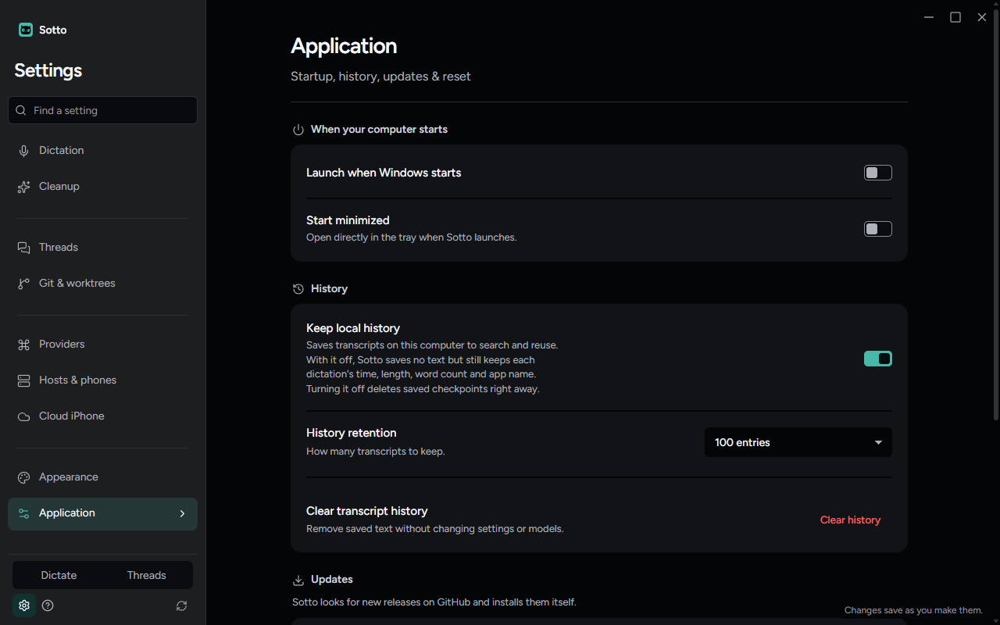
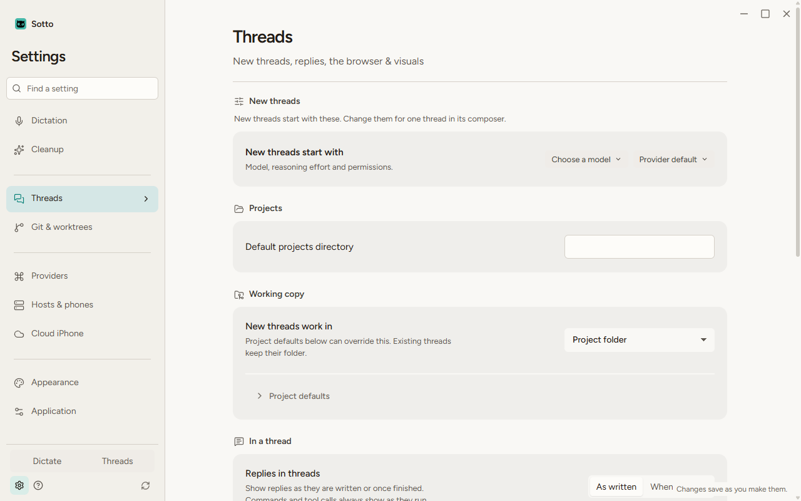
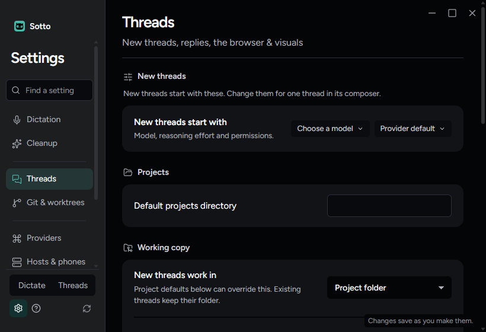
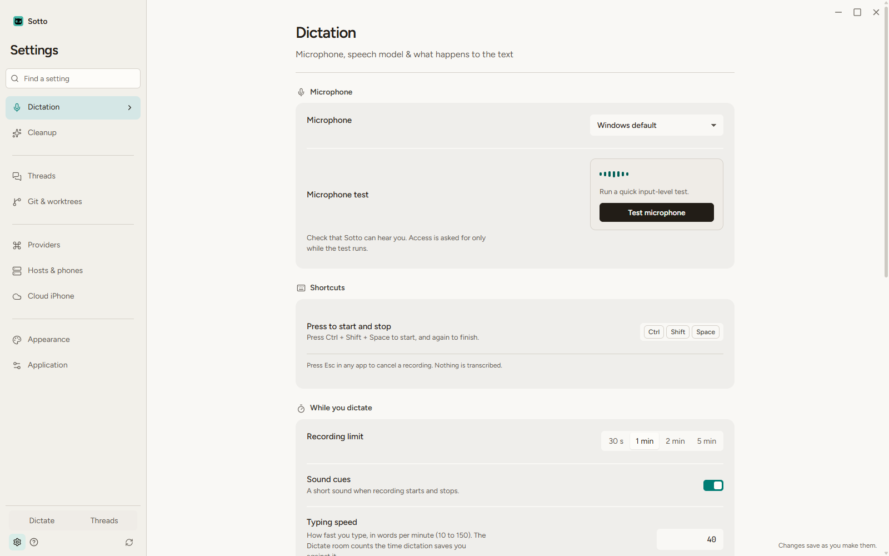
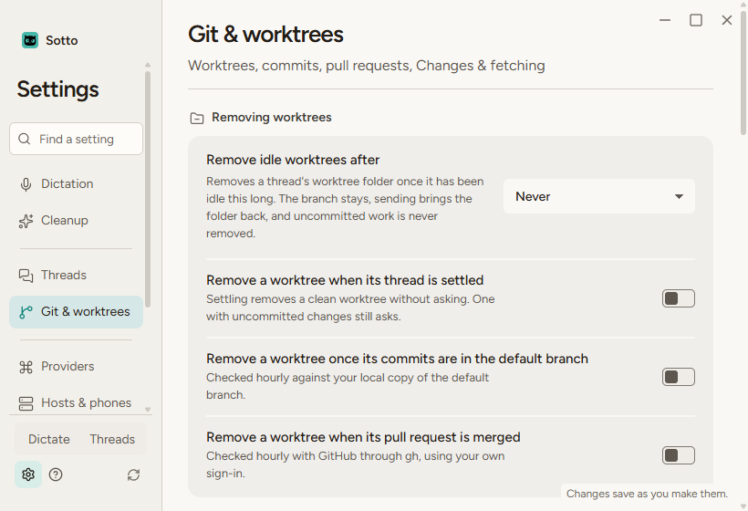
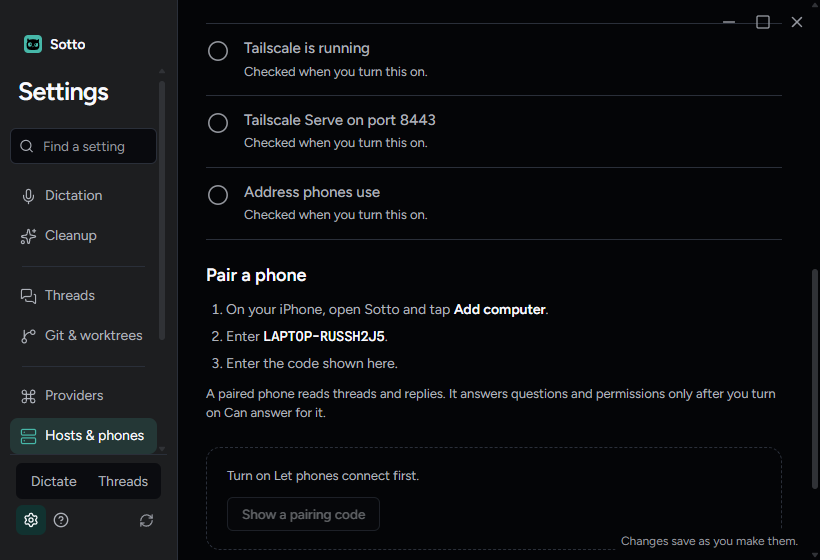
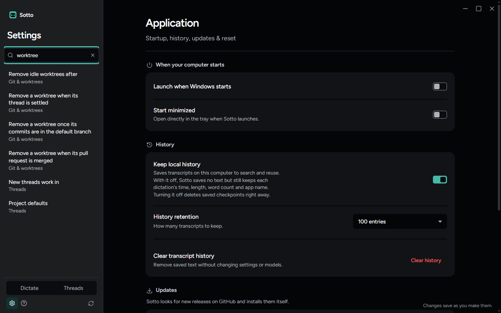
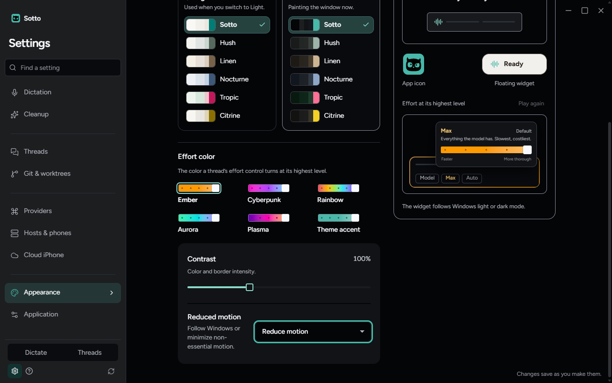

# Settings pages and Find a setting

October 22, 2026. ADR-0112: Settings regrouped into nine pages in four runs (Zach's pick B from `docs/prototypes/settings-structure-prototype.html`), Find a setting, and Open Settings buttons that open their own page.

## What was run

- `tests/e2e/settings-pages.spec.ts` against `npm run build` on Windows. It opens all nine stable pages at 1600 × 1000, 1280 × 800 and the 820 × 560 minimum, in dark and light, and checks that neither the form, any element in the open page nor the sidebar is wider than its room. It types in Find a setting, opens Reduced motion with Enter and checks that focus lands on it. It saw no page errors. Passed.
- `tests/unit/renderer/features/settings/settingsReachable.test.tsx`, on win32, darwin and linux copy. Every entry in Find a setting's index names a control on its own page, and every control on every page is reached by an entry. All 15 section ids Settings has answered to still open the right page, with the element carrying the id inside it. Find a setting is tested from the keyboard. Passed, with the rest of `tests/unit/renderer/features/settings` (305 tests).
- The Playwright specs that walk Settings, moved to the new pages: `settings-index`, `git-settings`, `phones`, `native-provider-selection`, `new-thread-settings`, `babysitting` and `watcher-gate`. 11 passed.

## What it looks like

- Application keeps only the app itself, in four cards: startup, History, Updates and Start over. 
- Threads holds what new threads start with, the projects folder, the working copy, what happens in a thread, and the browser rows.  
- Dictation takes in the speech model and what happens after dictating, as groups. 
- Git & worktrees opens on Removing worktrees. 
- Phones sits under Hosts on Hosts & phones. 
- Find a setting lists matches with their page in place of the pages. Enter opened Appearance with focus on Reduced motion.  

## Not verified here

- macOS and Linux desktops. Their copy runs through the unit test above, but the windows were not opened.
- The design capture baselines (`npm run design:verify`). Settings looks different on purpose, so they need regenerating on the machines that hold them.
- At 820 × 560 the sidebar scrolls, as it did with twelve pages, because Find a setting takes a row; the prototype said it would not. The open page stays in view.
- The iPhone and Android strings now say Settings › Hosts & phones; neither client was built here.
