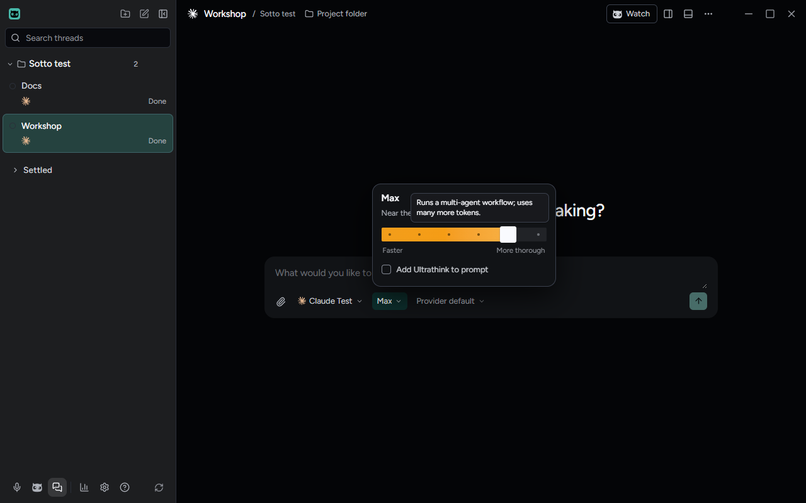
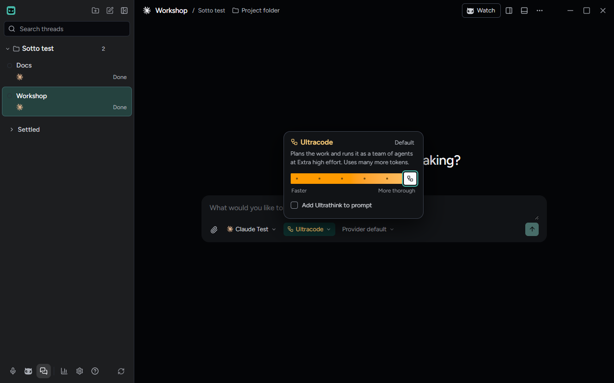
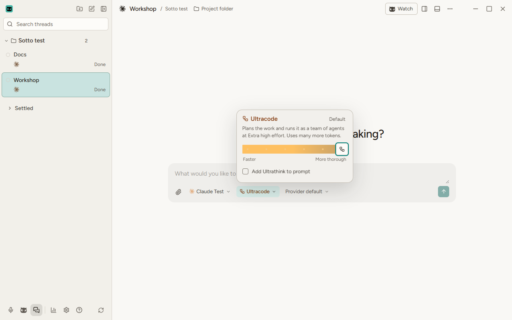
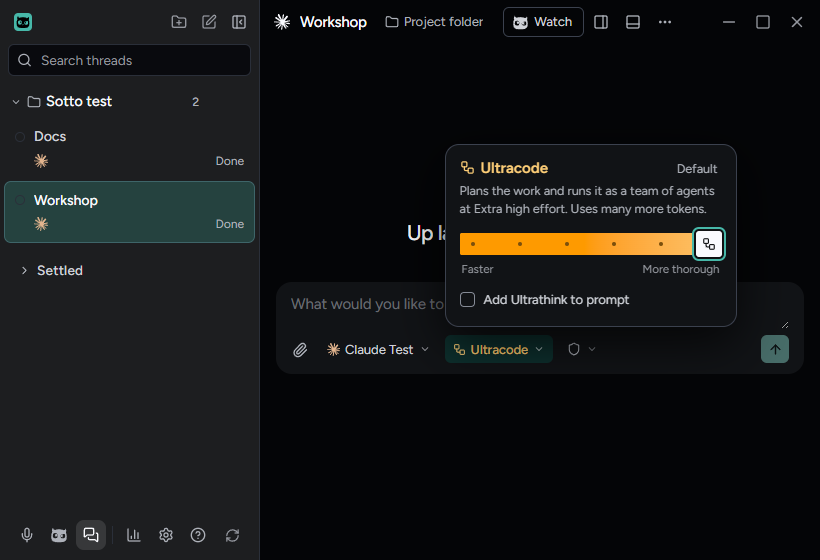
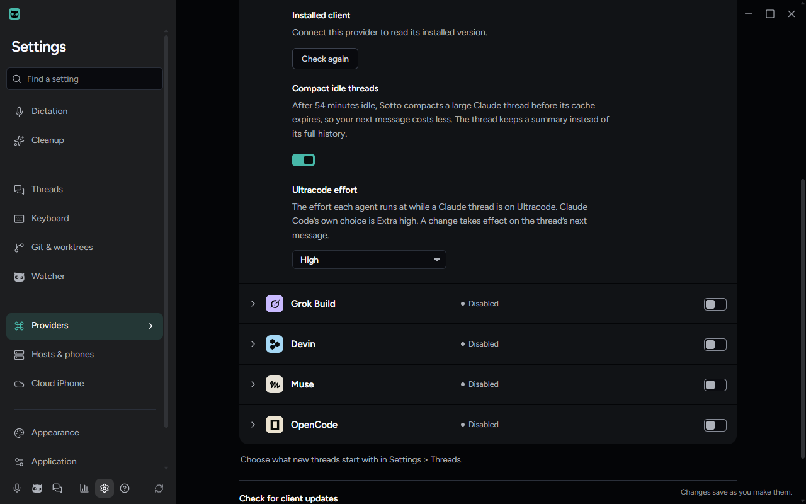

# Ultracode is the stop past Max on a Claude thread

Checked on Windows 11 on October 26, 2026, in the built app on `feat/ultracode-effort` (closes #1628, ADR-0148). A Claude
model with Extra high now offers **Ultracode** past Max on the effort card; a thread keeps it like any level, and each agent
runs at the effort **Ultracode effort** names in Settings → Providers → Claude Code.

## How it was driven

`tests/e2e/ultracode-effort.spec.ts` ran the built app over the `ultracode` fixture, where the test Claude model reports
Extra high and so offers Ultracode, with reduced motion on. It started Workshop on Max, rested the pointer on Max's stop and
then on the last stop, pressed → to choose Ultracode, and checked the card at 1280x800, 1600x1000 and 820x560 in dark and at
1280x800 in light, then under the Rainbow colourway. It then set **Ultracode effort** to High in Settings and opened the card again. The spec asserts every
step below; the captures are what it saw.

What the fixture cannot show, a real Claude Code taking the session setting, `tests/integration/claudeUltracode.test.ts`
covers against the fake CLI, and the flags it checks were read from Claude Code 2.1.311 and sent to it with control
requests that ran no prompt.

## What it showed

**Before choosing.** On Max the track has a sixth stop. With the pointer on it, a small note over the stop says "Runs a
multi-agent workflow; uses many more tokens." On Max's own stop it does not show.

**At Ultracode.** The word, the chip and the thumb carry the workflow mark, the card and chip wear the effort colour as at
any model's highest level, and the line reads "Plans the work and runs it as a team of agents at Extra high effort. Uses
many more tokens." The chip's tooltip adds the cost note. The composer has no edge. Under the Rainbow colourway, which
paints the word through a clipped gradient with a transparent fill, both marks keep an opaque ink.

At 820x560 the card stays whole above the composer, and the permissions chip shrinks to its shield.

**The setting.** Under Compact idle threads on Claude Code's row, **Ultracode effort** is a list from Low to Max, starting
on "Extra high (Claude Code’s choice)". Choosing High saved it, and the card's line then named High.

## Not checked here

- A real Claude Code turn running a workflow: that spends a workflow's tokens, and whether one runs is Claude Code's to
  decide once the session setting is on.
- macOS and Linux: nothing here is platform-specific.
