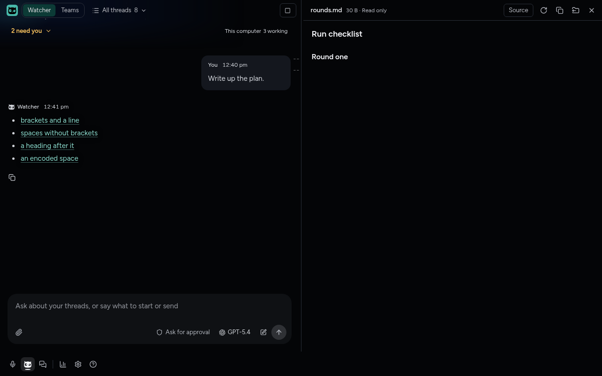

# A file link opens however the agent wrote the path

November 9, 2026. Zach reported that a Codex thread's link, `[project instructions](</D:/Seduce Jensen/AGENTS.md>)`, opened "This file is not on the computer this thread runs on, or it has moved" although `D:\Seduce Jensen\AGENTS.md` is there. Fixes #2218 in the same change. ADR-0120, November 9 amendment.

## The forms agents write

Every Markdown link in assistant text from the last ten days of Claude Code and Codex transcripts was collected on the laptop (733 files, 13,633 links that were not web addresses) and on forge (5,280 files). The file links fell into these forms, and each is now a test in `tests/unit/renderer/messageContent.test.tsx`, with main's half in `tests/unit/main/files.test.ts`:

| Form | Example from a real reply | Before |
| --- | --- | --- |
| Slash before the drive, angle brackets, space | `</D:/Seduce Jensen/AGENTS.md>` | Not found: Windows reads `/D:/` as a folder on the current drive |
| The same with a line | `/C:/Users/zache/.../note.md:12` | Not found |
| Drive first, forward slashes, `%20` or brackets | `D:/Talk%20to%20Text%20Application/AGENTS.md`, `<D:/Talk to Text Application/AGENTS.md:80>` | Opened |
| Backslashes through a dot folder | `C:\Users\zache\.claude\CLAUDE.md` | Not found: Markdown ate the `\` before `.claude` (#2218) |
| Spaces with no angle brackets | `(D:/Watcher Audit/Watcher audit 2026-11-05.md)`, `(D:\Crash Sim\AGENTS.md)` | Not a link: shown as text |
| Doubled backslashes | `D:\\Watcher Audit\\...` | Opened |
| `file:///` | `file:///C:/...` | Opened |
| Linux paths with spaces, dot folders, lines | `</home/zach/Projects/Anime Rivals/.zstack/film.md:14>` | Opened |
| `~/`, relative, `./`, `../` | `../verification/2026-10-10-watcher-owl-gate.md` | Opened |
| A line anchor | `src/host/socketServer.ts#L628` | Opened |
| `~\` or `.\` through a dot folder (found in review, not seen in replies) | `<~\.claude\CLAUDE.md>` | Not found, as #2218 |
| A heading anchor | `docs/ci.md#reading-a-failure` | Showed in its folder instead of the side panel, and main could not find it |

Codex's own instructions ask for `</abs/path/My Project/My Report.md:3>`, which on Windows it writes as `</D:/...>`. Sotto's instructions showed `[plan.md](/full/path/to/plan.md)` with no angle brackets, which agents copied for paths with spaces. They now ask for angle brackets and forward slashes.

## Checked

- **On the laptop, main's file lookup against Zach's real files.** This branch's `FilesService.previewLink`, bundled with esbuild and run under the laptop's Node with the thread's folder at `D:\`, read `/D:/Seduce Jensen/AGENTS.md`, `/D:/Seduce Jensen/.zstack/refinement-five-rounds.md`, `D:/Seduce Jensen/AGENTS.md:3`, `D:\Seduce Jensen\.zstack\refinement-five-rounds.md`, `Seduce Jensen/AGENTS.md#project-instructions` and `C:\Users\zache\.claude\CLAUDE.md`. The same probe on `main`'s code failed the two `/D:/` links and the heading with `path-unavailable`, the notice in Zach's screenshot.
- **On forge, the built app.** `tests/e2e/markdown-side-panel.spec.ts`, "a link opens its file however the agent wrote the path", seeds a Watcher reply with one link of each form to a folder named `Seduce Jensen` with a `.zstack` folder, and presses each in turn. All open in the side panel. On Windows the spec adds the slash-before-drive and backslash forms. The paired-host journey in the same spec now also opens `docs/plan.md#the-plan` from the host's thread folder.

## Not checked here

- Pressing the link in Zach's own thread on the laptop needs an Owl build with this change.
- The iPhone has no file links yet (#2140).
