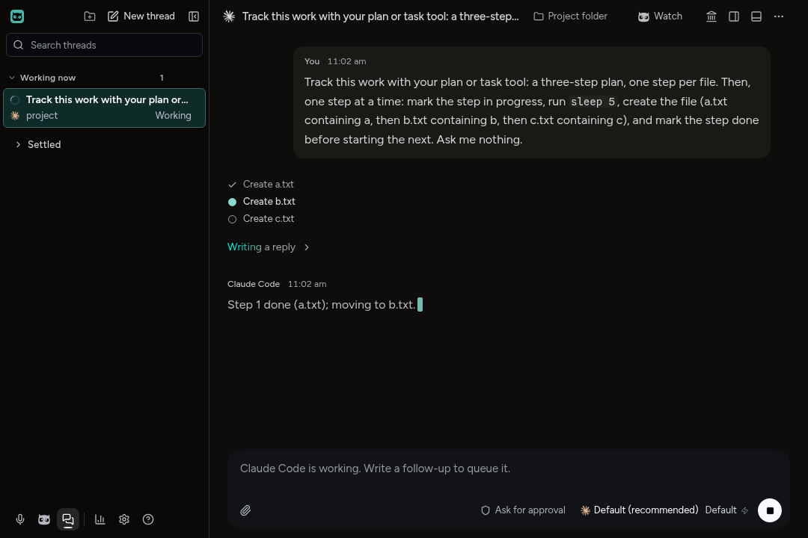
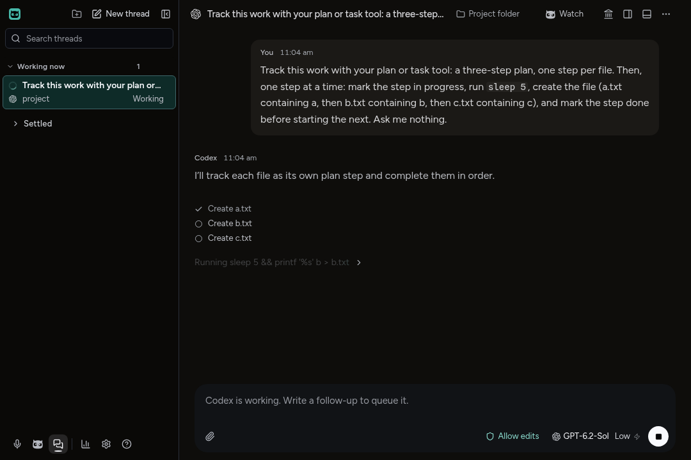

# Claude and Codex plans in the checklist

November 19, 2026, forge (Omarchy), Claude Code 2.1.328, Codex CLI 0.170.0; the laptop runs the same two versions. Zach reported that the plan checklist showed in other providers' threads and never in Claude or Codex threads. The decision is in ADR-0134's amendment of this date.

## What the stores held

On the laptop, 493 Claude threads and 408 Codex threads held no plan record at all. Muse threads held 22 plans, and Cursor and Devin threads held some too. The thread in Zach's screenshot, with its "Barometer" request and three plan items, is a Devin thread. Forge's store was the same: 187 Claude threads and 12 Codex threads, no plans. In the last ten days of forge's Claude transcripts no call named TodoWrite, TaskCreate or TaskUpdate.

## Cause

**Claude Code.** A probe turn on Sonnet 5.5 listed `Task` and `TaskStop` in its init frame and no task tools. With `CLAUDE_CODE_ENABLE_TODO_TOOLS=1` it also listed `TaskCreate`, `TaskGet`, `TaskList` and `TaskUpdate`. Claude Code 2.1.328 turns its task tools on only for models up to the Claude 4 family unless that variable is set. When they are on, they replace TodoWrite, the tool Sotto read. A real turn made one `TaskCreate` per item, and its result named the item's id (`{"task":{"id":"1",…}}`). After that, a `TaskUpdate` call moved each task on by its id. A second turn in the same session read the first turn's three finished tasks back with `TaskList`: the list lasts the whole session.

**Codex.** A Codex 0.170.0 turn told to use its plan tool answered "NO PLAN TOOL". The tool list in a real Sotto Codex session had `create_goal` and `update_goal` and no `update_plan`. With `-c 'tools.update_plan={enabled=true}'`, the same turn made a three-step plan and updated it as each file was written. Without the setting, nothing sends `turn/plan/updated`, which Sotto already reads.

## The run

`SOTTO_PLAN_LIVE=1 npx playwright test tests/e2e/plan-checklist-live.spec.ts`, under `xvfb-run` on forge, built from the branch. One real turn went to each provider in an isolated profile, asking for a three-step plan with a `sleep 5` in each step. The spec records every state the checklist above the working line shows while the turn runs.

| Thread | Model | States the checklist showed | Fold after the turn |
| --- | --- | --- | --- |
| Claude Code | Sonnet 5.5 | 8: the items appear one by one, then each goes to in progress and then done | "plan 3 of 3 done" |
| Codex | GPT-6.2-Sol | 4: three to do, then each done in turn | "plan 3 of 3 done" |

After the Claude turn, its fold reads "Worked for 41s · 9 steps · Ran 3 commands, used ToolSearch, plan 3 of 3 done". The task calls are not counted as tools of their own. ToolSearch is Claude Code loading its task tools, which it keeps behind a search ([claude-ended.png](../../artifacts/plan-checklist-claude-codex/claude-ended.png)). Each state is in `claude.json` and `codex.json` beside the pictures.

## After Bug Bot's review

- **Codex never sends a plan after its turn ends.** The worry was that a late `turn/plan/updated`, arriving after `turn/completed`, would be dropped and leave the checklist part done. A probe drove `codex app-server` straight, with the setting on, and told the agent to make its plan update the very last thing it did. The order on the wire was: plan, command, plan, command, plan (both completed), the closing reply, then `turn/completed`. `update_plan` is a tool call inside the turn, so its notification always comes first on that one ordered stream. Sotto was left as it is.
- **Claude's task ids are strings.** All 28 task results in the real two-turn transcript carry string ids, `"1"` to `"5"`, so a list of numeric ids that would empty the checklist does not happen on Claude Code 2.1.328. Left as it is.
- **A result whose call was never seen is read.** The same real transcript, given to a fresh projector from the line after the first `TaskCreate` call, gives the same two plans as reading it whole. Turn one is a, b and c done, and turn two is d and e done, without turn one's tasks. Every task result made no tool row. The one "Tool result" row left is ToolSearch's, whose call came before the cut, as any result without its call reads.

## Where else it shows

The iPhone draws no checklist for any provider. A phone's activity summaries leave plan steps on the host (ADR-0025), and its step run names a plan record "Planning". A Claude or Codex thread now gives it that step, as a Devin thread does. A desktop paired with a host draws the host's records with the same renderer, and the host runs the same adapters, so it shows the same checklist. That was not run separately.

## Not checked

Windows and macOS were not run. Nothing here differs by platform: one environment variable for Claude Code and one thread setting for Codex.
