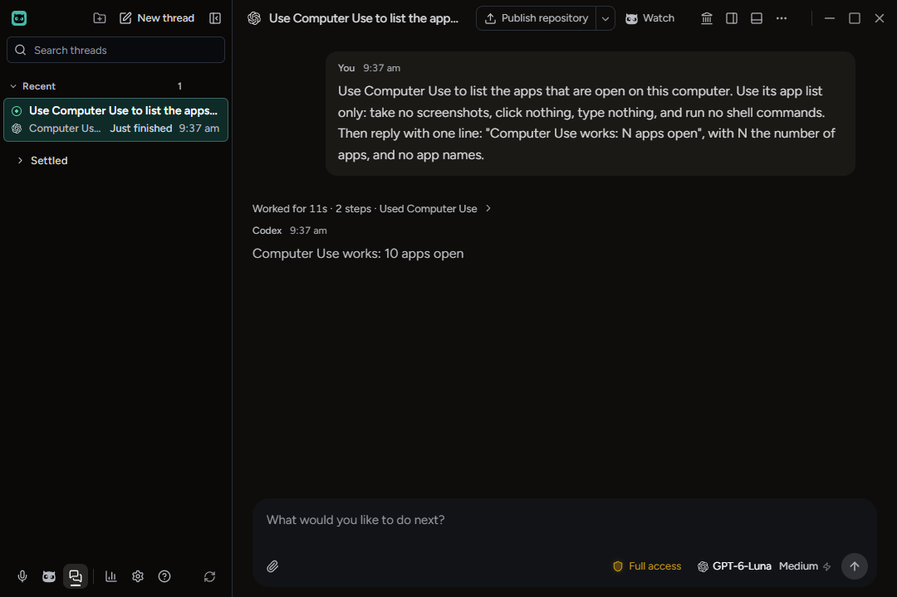

# Codex's Computer Use without the Codex app

November 19, 2026, Windows 11, Codex CLI 0.170.0, Codex desktop app 26.1111.2228.0 installed but closed. Zach reported that a Codex thread's Computer Use worked only while he ran the Codex desktop app. The decision is in ADR-0005's amendment of this date.

No run printed a prompt reply other than the one-line count the last prompt asked for, or any app name, page or screenshot. Each run asked only for Computer Use's list of open apps: nothing was clicked, typed or captured.

## Cause

Each time the Codex app starts, it writes `SKY_CUA_NATIVE_PIPE = "1"` and `SKY_CUA_NATIVE_PIPE_DIRECTORY = '\\.\pipe\codex-computer-use-<uuid>'` into the env of two servers:

- `node_repl`, in `~/.codex/config.toml`;
- `cua_repl`, in the installed copy of its bundled plugin, `~/.codex/plugins/cache/openai-bundled/unified-computer-use/26.1111.21308/.mcp.json`. Its source in the bundled marketplace is a template (`"command": "node"`, disabled), so the app is what fills it in.

In OpenAI's Computer Use library (`@oai/sky` and `@oai/cua`, `targets/windows/internal/computer_use_client.js`), `"1"` selects the transport that connects to that pipe, which only the running app serves. Any other value starts `codex-computer-use.exe` as a child with `--parent-pid`. Both transports send their question before each app ("Allow Codex to use <app>?") as the same MCP elicitation through `node_repl`'s `createElicitation` (`requestComputerUseApproval` arrives on the pipe; `helper_transport.js` builds it for the child). It has nothing to fill in, so in Full access Codex 0.170.0 accepts it itself (`codex-rs/codex-mcp/src/elicitation.rs`, `can_auto_accept_elicitation`), with the app open or closed.

With the app closed (no `ChatGPT.exe`, no `codex-computer-use` pipe), Sotto's adapter in Full access (`tests/integration/codexComputerUseLive.test.ts`, the `full-access` case) ended with a failed Computer Use step: "Computer Use native pipe is unavailable: failed to connect native pipe: The system cannot find the file specified. (os error 2)".

## What no longer worked from September

The September note found the switch on `node_repl` alone. Setting `mcp_servers.node_repl.env.SKY_CUA_NATIVE_PIPE="0"`, as a thread config key or as an app-server `-c`, still failed: the model now calls `cua_repl`, whose computer surface the November app turned on (`CUA_REPL_ENABLED_SURFACES = "browser,computer"`). Plain `codex exec` with that `-c` failed the same way, on `cua_repl`.

A plugin's server takes no partial override: `codex -c 'mcp_servers.cua_repl.env.SKY_CUA_NATIVE_PIPE="0"' mcp get cua_repl` answered "invalid transport in `mcp_servers.cua_repl`". The same happens for a `node_repl` override on a computer with no `node_repl`, which is why Sotto overrides only servers it finds.

## Probes

| Run | Result |
| --- | --- |
| `codex exec`, Full access, `cua_repl` redefined whole in `-c` from the plugin's `.mcp.json`, pipe `"0"` | three `cua_repl` calls completed, reply listed the open apps |
| Same, pipe left `"1"` (control) | `cua_repl` failed with the pipe error, reply `UNAVAILABLE:` |
| Sotto adapter, the same redefinition as thread config | two Computer Use steps completed, no failure |

No helper was running after any turn ended and its app-server closed. `config/read` answers in about 14 ms with `mcp_servers` and `plugins`. `plugin/installed` took 2 seconds and lists remote marketplaces, so Sotto does not call it.

## After the change

- `tests/integration/codexComputerUseLive.test.ts`, `full-access`, app closed: two Computer Use steps completed, reply no failure. With `$computer-use:computer-use`: three completed.
- The built app, through `tests/fixtures/nativeThreadProtocolMain.cjs` on a fresh profile with the installed Codex, app closed and no Codex app process: a Full access thread on GPT-6-Luna replied "Computer Use works: 10 apps open" with two completed Computer Use steps. The helper ran while the thread's app-server did and was gone once it closed. 
- `tests/unit/main/codexComputerUseHelper.test.ts` and `tests/integration/codexComputerUseHelper.test.ts` cover the overrides in one `mcp_servers` table, the version Codex loads, a plugin that is off, the user's own policy for a plugin server, a server config already defines, a missing or relative command, an unknown version folder or manifest, and an unreadable config, which starts the thread as before.

## Unchecked

- macOS. The library's Mac transport in this bundle does not read the switch, and no Mac was tried, so off Windows Sotto still reads the config but adds nothing to a thread's.
- A per-app question from the self-started helper in a live run. Listing apps raised none; the code says Full access accepts it either way.
- A managed requirement that disallows a plugin the user's config enables. Sotto reads the config, not the requirements.
- The thread whose app-server is running when the Codex app updates. Its copied `cua_repl` names the old install until that app-server restarts.
