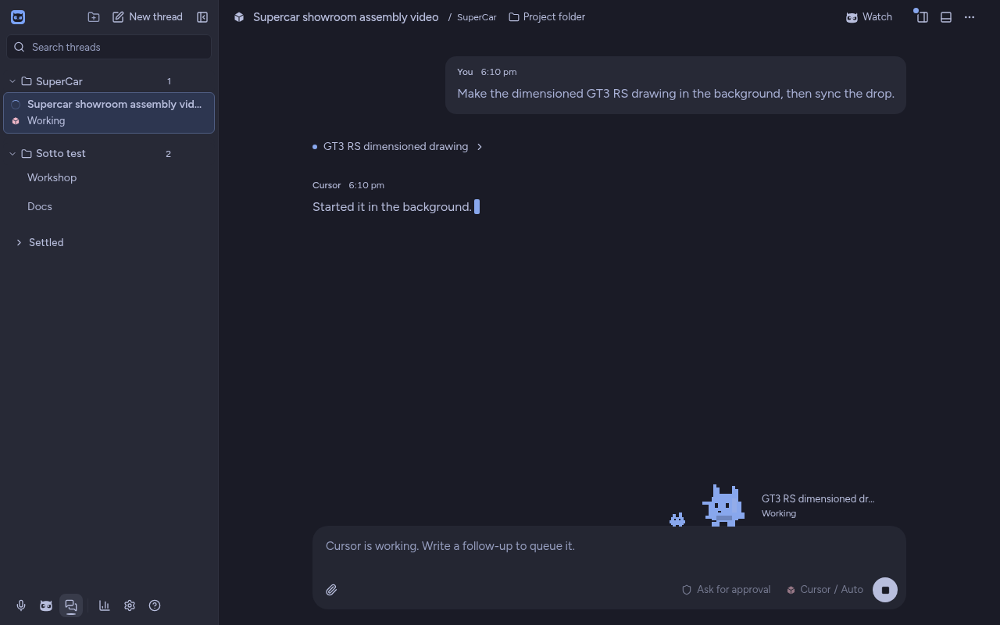
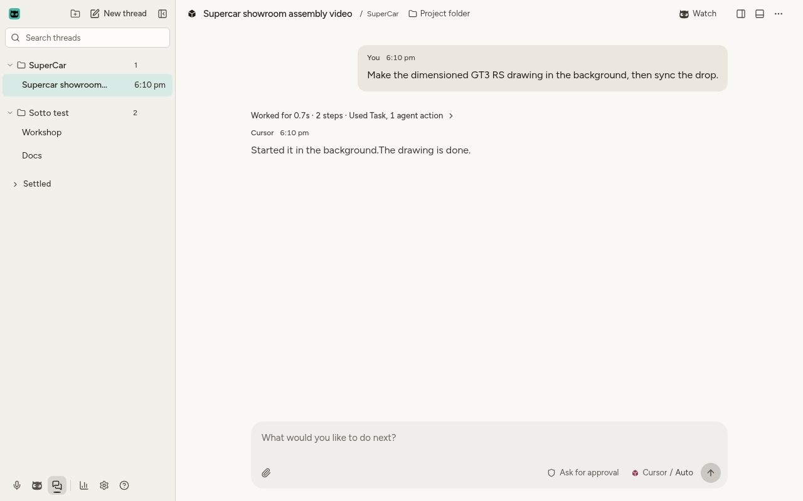

# Cursor background subagents verification

November 15, 2026. `fix/provider-background-agents`, issue #2631, [ADR-0023](../adr/0023-working-reads-the-providers-agent-tasks.md) (amendment of November 15, 2026). Zach's picks on November 15, 2026, from `docs/prototypes/provider-background-work-prototype.html`: c1, **Turn held open**, for Cursor; n1, **Find its process**, for the follow-ups whose providers never say their background work ended.

## How it was run

On forge, with Node 24.22.1 and the built app (`npm run build`):

```sh
npm run typecheck
npx eslint <changed files>
npx vitest run tests/integration/cursorAdapter.test.ts tests/unit/main/cursorSubagents.test.ts
npx vitest run tests/integration/watcherOnCursor.test.ts tests/unit/main/cursorClientUpdates.test.ts tests/unit/main/cursorModels.test.ts tests/unit/main/cursorRequests.test.ts tests/unit/main/cursorRpc.test.ts
xvfb-run -a -s "-screen 0 1920x1200x24" npx playwright test tests/e2e/cursor-background-subagent.spec.ts
```

## What was checked

**What Cursor sends.** Read in Cursor 2026.11.11's own ACP code on forge (the laptop runs 2026.11.13), since the forge client is not signed in. A Task that Cursor moves to the background returns at once with `isBackground: true`. Only a client that says it takes `subagents` hears `subagent_spawned` and, when the subagent really ends, `subagent_state_update`; Cursor then keeps the prompt open until its subagents end. `docs/research/cursor-cli.md` has the fields.

**The failure on main.** The fake Cursor client (`tests/fixtures/fakeCursorAgent.mjs`) now behaves the same way: `background-task` starts a subagent and moves it to the background, and `background-task-end` ends it. With the new tests and main's adapter, both Cursor tests failed at the same place: once the Task returned, the subagent's row read `completed` while the fake's subagent still ran. With the fix, all 63 run Cursor adapter tests pass.

**The fix, in the adapter** (`cursorAdapter.test.ts`, `cursorSubagents.test.ts`):
- the row stays **running**, with no 12 ms duration, from when the Task returns until Cursor says it ended;
- the thread's background work holds the subagent, labelled by its description, and the turn stays running;
- when it ends, the row reads `completed`, the background work clears, the agent's reply with the result arrives, and the turn finishes `completed`;
- a permission the subagent asks for on its own session becomes the thread's card;
- **Stop** ends the subagent with the turn and its row reads `interrupted`;
- a subagent started by a subagent is never the thread's work;
- `cancelled` reads as interrupted and `disconnected` as unknown.

**In the built app** (`tests/e2e/cursor-background-subagent.spec.ts`, the real Cursor adapter over the fake client, at 1280x800, dark and light, reduced motion on). While the subagent ran, the sidebar row read **Working**, and the readout named **GT3 RS dimensioned drawing** with **Working** and the creature. The composer said Cursor is working and a follow-up would queue. Once Cursor said the subagent ended, the thread read Done, its background work was empty, its row read `completed`, and the agent's reply with the result was shown (`artifacts/cursor-background-subagent/journey.json`).





No new look: the change reuses the readout, the creature and the sidebar's Working state, so no design capture was regenerated and only 1280x800 was captured.

## Not checked here

- **A live Cursor.** The forge client is not signed in, and the laptop's is Zach's. The frames come from Cursor's own code, but not from a live session. The first live Cursor background Task on the next Owl is the check: its row and the thread should read Working until the subagent finishes.
- **The words after the subagent ends.** The fake's two replies run together ("background.The drawing is done."), because Sotto joins words that come with nothing between them. A live session will show whether Cursor separates its own reply from what it says after a subagent ends.
