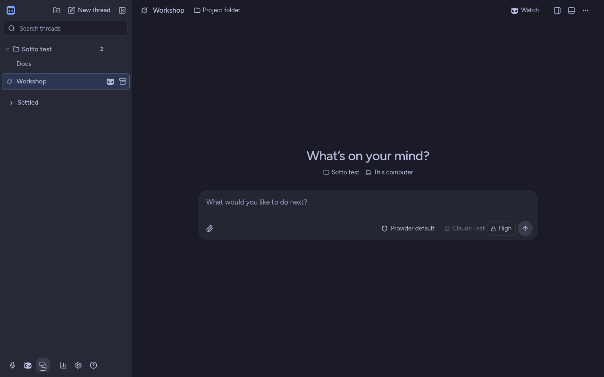
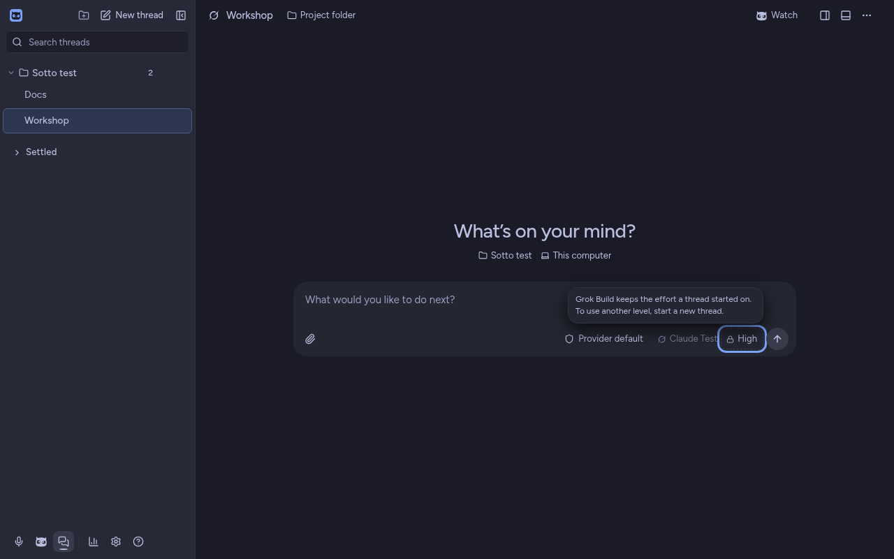
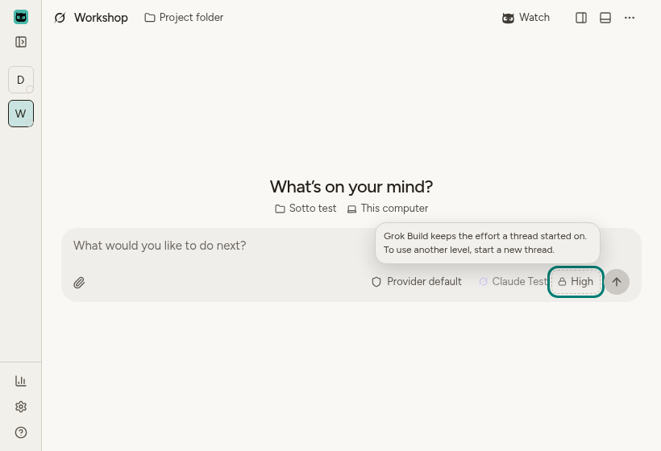

# A started Grok thread says why its effort stays

Issue #228. Grok can't change reasoning effort on a thread that has already sent, so Sotto holds the effort chip, and the chip used to be greyed out with no word on why. Zach picked B from the prototype (tag `prototype/grok-effort-locked`, November 9, 2026), for the desktop and the iPhone: a chip with a dashed edge and a lock that opens nothing, with the reason in a tip.

## Desktop

Checked on forge on November 9, 2026: the built app under xvfb, run by `tests/e2e/grok-fixed-effort.spec.ts` on the `grok-fixed-effort` scenario. In that scenario the fixture model is Grok Build's and Grok keeps a started thread's model and effort. The composer is the quiet one, which stable uses.

- Resting, the chip reads **High** with a lock and a dashed edge. The model chip next to it is held too, as it already was.

  

- When the pointer rests on the chip, the tip says "Grok Build keeps the effort a thread started on. To use another level, start a new thread." A press opens no card and no list, and moving away puts the tip away.
- With the keyboard in the message box and the pointer bringing the tip up, Escape still puts it away.
- From the message box, Tab reaches the chip (the held model chip is passed over), and the tip shows. Escape puts the tip away and leaves focus on the chip.
- The chip's accessible name is "Thread reasoning, High", it carries `aria-disabled`, and its accessible description is the reason.
- The tip stays inside the window in dark and light at 1600x1000, 1280x800 and the 820x560 minimum, and nothing scrolls sideways.

  
  

- With reduced motion on, the tip shows in place: no slide, and the transition is cut to Sotto's 1 ms.
- Nothing is saved: the thread stays on High.

The reason names the provider by its Sotto label, Grok Build, as the model chip's own lines do. The prototype said "Grok".

Unit tests in `tests/unit/renderer/providersSettings.test.tsx` cover the same chip in both composers, and check that a provider that can change a started thread's effort keeps its effort chip a choice.

## iPhone

The iPhone draws a thread's settings as one pill that opens a sheet. On a started Grok thread, the sheet's **Effort** row now shows its level with a lock in place of the chevron and opens no menu. A tap shows the same reason under the row. VoiceOver reads the row as one element, with the reason after the value, so it is heard whether or not hints are on. `ThreadSettingsTests.testAStartedThreadWhoseAgentKeepsItsEffortSaysWhy` checks the reason the panel gives. This can't be checked on forge, which only syntax-parses Swift, so the macOS CI job is the first compile. Seeing the row on a phone is a hand test for TestFlight.
