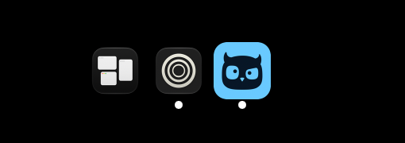
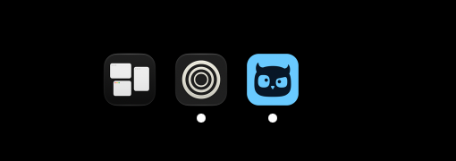

# macOS Dock icon size

October 30, 2026. Apple silicon Mac, macOS 27.0. Installed Sotto Owl
`0.1.41-owl.20261030.1` (`c380b3245e153f6200f2b75acc978c1ffe76f0f6`),
with saved appearance Dark and theme Glass. Sidebar was updated from 2.2.7 to
2.2.8 during the investigation.

## Finding and change

Sotto's existing runtime painter uses the saved theme correctly. The owner
confirmed blue in the native Dock while Sidebar showed the teal bundle icon.
Independent AppKit reads of `NSRunningApplication.icon` and
`NSWorkspace.icon(forFile:)` returned the same teal bundle artwork. The installed
coverage file was present and valid; the installed main bundle contained the
startup, settings and native-theme repaint hooks. A separate two-hour unified-log
search found no Dock-icon failure, but Sotto's standard output and standard error
were `/dev/null`, so that absence alone does not prove a successful repaint.

Sidebar 2.2.8 still showed teal after enabling and refreshing its live-app-icon
option on this Mac. A custom Glass dark icon is the verified local workaround;
there is no change to Sotto's signed bundle or to its runtime API calls.

The first custom icon exposed a separate Sotto defect: the generated runtime
coverage filled all 512 pixels. The blue tile was about 72 pixels wide beside
58-pixel native tiles in the captured Sidebar. The generator now centres a
412-pixel mark in the 512-pixel canvas, with 50 transparent pixels on every side.
The master owl and its theme colours are unchanged. Only the macOS coverage is
regenerated; `--dock` skips the unrelated brand assets and their Windows font
requirement.

The inset is based on measured Apple icons on this Mac: Notes, Mail and Music
each have a 206-pixel body on a 256-pixel canvas at the half-opacity edge,
excluding their shadows. Doubling that gives the 412-pixel body used here. This
is a sizing inference confirmed by the Sidebar comparison below, not a claim
that Apple specifies a universal 50-pixel border. Apple's
[design resources](https://developer.apple.com/design/resources/) and
[icon-design session](https://developer.apple.com/videos/play/wwdc2025/220/)
recommend using its icon grid and templates.

## Checks

- `node scripts/generate-brand-assets.mjs --dock` produces a 524,288-byte inflated
  coverage buffer. Running it again gives the same SHA-256:
  `d86ca31031ebd59f18cf8795408ed5a4d182bfb5ff6665aa08bd25545ad675cb`.
- `NODE_OPTIONS=--no-experimental-webstorage npx vitest run tests/unit/main/dockIcon.test.ts`:
  seven tests passed. The added check verifies both coverage channels are clear
  through the whole 50-pixel margin, the tile reaches all four intended edges,
  and the existing colour, eye and pupil checks still pass at the new scale.
  Node 25 exposes a partial `localStorage` by default; the first run without this
  flag failed in the existing test teardown's `localStorage.clear()`.
- `npm run typecheck`: passed.
- `npm run lint`: passed.
- Review found one weakened assertion: the rounded-corner sample still pointed
  at the old canvas corner. It now checks the inset tile's corner at `(50,50)`.
- No Sotto restart, branch build installation, full suite or desktop test run.
  GitHub runs the CI gates.

## Local visual check

The owner imported and selected `Sotto-Glass-Dark-Native.png` in Sidebar. It was
rendered with the same unchanged runtime painter and the newly generated
coverage, using Glass dark's tile `#69caff` and owl `#071727`. The final desktop
capture shows the blue tile at about 58 pixels wide, matching the neighbouring
native tiles. The images here are crops of the actual desktop captures, with
no changes to the displayed icons.

This proves the corrected asset's local appearance in Sidebar. The installed
Sotto was not replaced or restarted, so its native runtime Dock icon still uses
the installed build's old coverage until a release containing this change is
installed. A Sidebar custom icon is a fixed image: changing Sotto's theme later
requires importing the corresponding image again.
