# A 3D model Meshy made, drawn in its thread

Checked on Windows on November 15, 2026, in the built app, for #2497: ticket 4 of `docs/plans/2026-10-22-meshy-3d-models.md`.
A 3D model a thread makes with `make_3d_model` is drawn in that thread as Zach's variant A (ADR-0141), the prototype kept
as the tag `prototype/meshy-inline`, with his picks on #2497: Meshy's percent and the time left while it works, closed
until pressed once done, and no Try again.

Meshy was the stand-in in `tests/fixtures/fakeMeshy.ts`, on one address on this computer that answered the balance read,
the API and the files, as main reaches it through `SOTTO_E2E_MESHY_API_URL`, which a packaged build never reads. Its
tasks were read every second and held in progress until the run let each step go. It served a real GLB, a cube whose
six faces are painted from one picture inside the file (`texturedCubeGlb` in `tests/fixtures/glb.ts`), and a real PNG as
the still picture. The run is `tests/e2e/plugins-meshy-model.spec.ts`, with the Owl feature turned on by
`SOTTO_OWL_FEATURES=plugins=1`. Nothing reached Meshy, and the key was made up.

## What was done

A Meshy account named Studio was added on Settings › Plugins, its key checked with the stand-in's balance read. In the
thread, its agent called `make_3d_model` with the name Oak barrel and words. The card asked, and **Make the model** was
pressed.

The line came in under the agent's last message. While Meshy made the shape it read "Step 1 of 2: making the shape ·
18%, about 10 seconds left", with a bar filled to the percent and a ring in place of the picture. It offered nothing to
open.

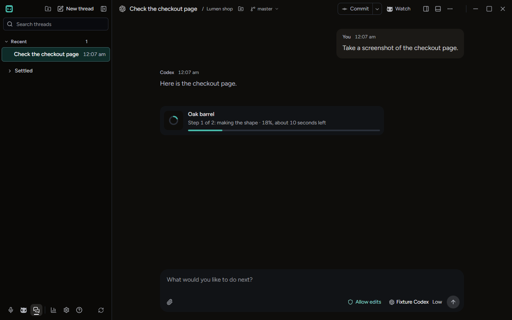

While Meshy painted the texture it read "Step 2 of 2: painting the texture · 18%, about 10 seconds left" and offered
**Show the shape**. Beside the button the words wrap rather than lose the time left.

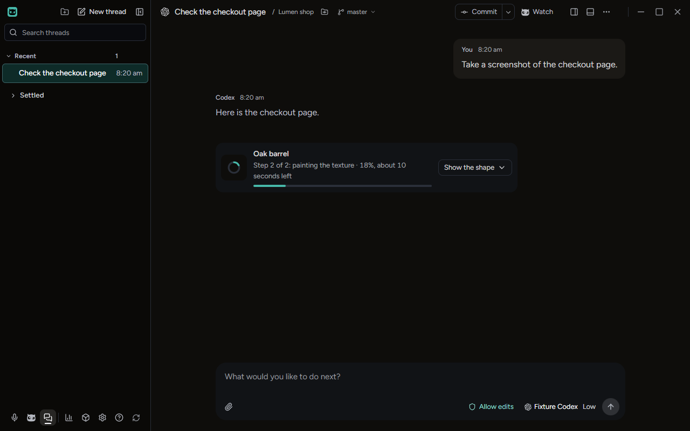

**Show the shape** opened the view in place on the shape Meshy had made, which Sotto fetched into memory when the button
was pressed. The view took focus and turned slowly by itself, over "The shape is ready to turn. The texture follows, then
the files go to models/." Escape closed it and gave focus back to **Show the shape**.

Once done, the line was closed: the still picture, Oak barrel, and "3D model · 30 credits · 3 files", with **Show the
model**. The agent was told "The 3D model "Oak barrel" is made, for 30 credits."

**Show the model** opened the view on the GLB from the thread's `models/` folder. It took focus and turned by itself: two
captures of the drawing 0.8 seconds apart differed. Under it were "Made from words · 30 credits" and a chip for each
file, ".png 1 KB", ".glb 2 KB" and ".usdz 1 KB". Every face of the cube had its own colour, so the picture inside the GLB
was drawn from the GLB's own bytes, under the main window's content policy as it stands.

From the keyboard, Home faced it to the front, a three-quarter view from a little above, and stopped its turning: the
view said "Facing the front". The right arrow turned it 15 degrees ("Turned 15 degrees from the front"), and the drawing
then held still. A second right arrow made 30. Home brought back exactly the first front drawing. Escape closed the view
and gave focus back to the button, named **Show the model** again.

Open, the line was checked in dark and light at 1600x1000, 1280x800 and the 820x560 minimum. Nothing in it reached past
the thread's pane, and nothing in it scrolled sideways.

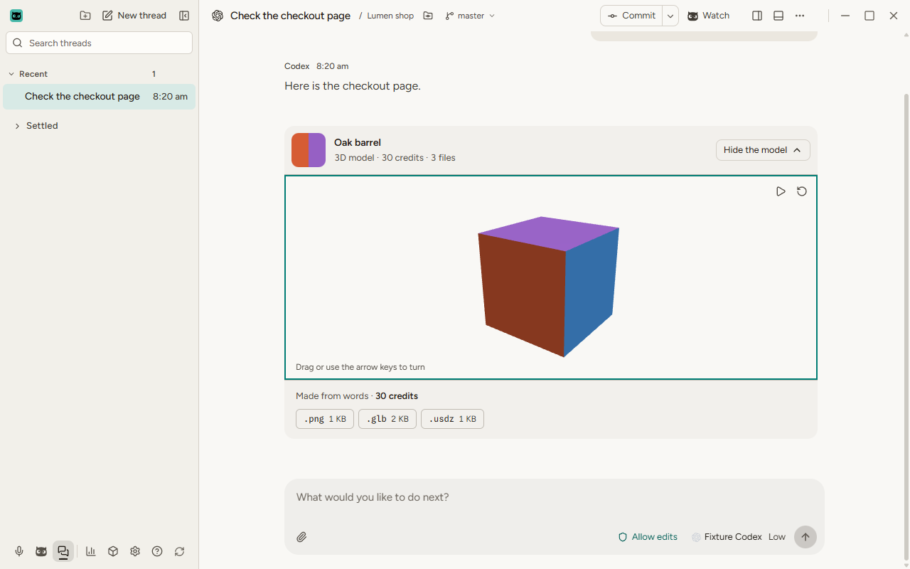

With Reduce motion on, the view opened without turning by itself, with no **Stop turning** button, and two captures 0.8
seconds apart were the same.

A second 3D model, Brass lantern, was asked for and allowed, and Meshy failed its texture. Its line read "Could not
finish · nothing saved · 20 credits counted", with a box in place of a picture, and **Show what happened** opened "The
Brass lantern was not made." and "Meshy could not finish it, and gave back the credits of what it could not make. Sotto
saved no files. 20 credits were counted against this month's limit." There was no Try again. Escape closed it and gave
focus back to the button. It was checked in dark and light at 1280x800 and at the 820x560 minimum.

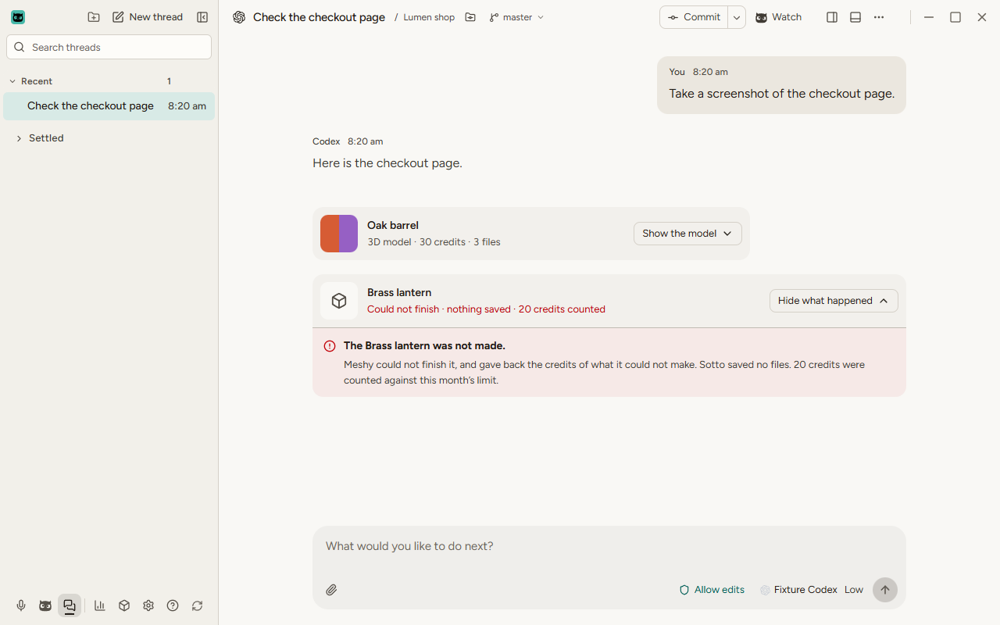

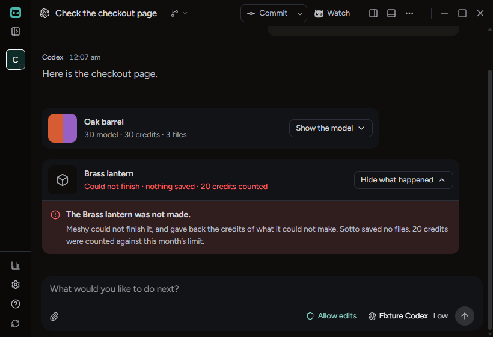

The stand-in was asked only for its API and its files, and the window raised no error.

## Fixed from what the running app showed

- At the front, the model faced the camera square on and read as a flat tile. The front is now the prototype's
  three-quarter view from a little above.
- The model touched the bottom of the view at 1600x1000. The camera now stands back far enough for the model to fit the
  narrower way with room around it.
- Beside **Show the shape**, the line under the name cut the time left off ("about 10 secon…"). It now wraps.

## What else covers it

- `tests/unit/renderer/agents/modelLine.test.tsx`: the line in each state, the photo's one step, Saving the files,
  Escape from the view and from what happened, the still picture where WebGL cannot draw, and nothing at all with the
  Owl feature off.
- `tests/unit/main/tools/meshy/meshyView.test.ts` and `meshyGlb.test.ts`: the bytes by a 3D model's ID alone, a folder or
  a file swapped for a link outside the thread's folder, and a GLB that names any `uri`.
- `tests/unit/main/tools/meshy/meshyModels.test.ts`: Meshy's percent and the time left held in memory, and the shape
  fetched into memory only when asked for.
- `tests/unit/main/plugins/pluginMeshyTool.test.ts`: the line placed once Meshy has the request, and never when the card
  is denied or the limit refuses it.

## Not checked here

- A real Meshy account and one of Meshy's own models: its sizes, its materials, and a shape without a texture, which the
  stand-in gives the same textured cube. That waits for Zach's key on a paid plan.
- A 3D model from a photo in the running app; the unit test holds its one step.
- A window that cannot draw WebGL; the unit test holds the still picture that takes the view's place.
- A host's thread and the iPhone, which came with tickets 6 and 7: see [the last part of this note](#a-paired-hosts-3d-models-and-the-iphone).

# The 3D models page and Tools › 3D models

Checked on Windows on November 15, 2026, in the built app, for #2497: ticket 5 of `docs/plans/2026-10-22-meshy-3d-models.md`.
The page is Zach's variant C (ADR-0141), the prototype kept as the tag `prototype/meshy-page`, with his picks on #2497:
the page as shown, Tools showing the chosen 3D model's view over the thread's list, and 3D models that were not made
left as their line in their thread. The stand-in Meshy, the cube it serves and the Owl switch are as above. The run is
`tests/e2e/plugins-meshy-page.spec.ts`.

## What was done

A Meshy account named Studio was added, and the thread made Oak barrel. Then it asked for Brass lantern, and the stand-in
held its texture.

With Tools open on Files, the rail's **3D** tile, between iPhone and Terminal and named "3D models", carried a dot
described as "A 3D model is being made". On it, Tools read "Made with the Meshy account Studio · 60 credits in this
thread", turned the Oak barrel with a chip for each file, and listed both under "Made in this thread", the lantern with
its step and percent. The lantern's 30 credits count from when its texture was asked for.

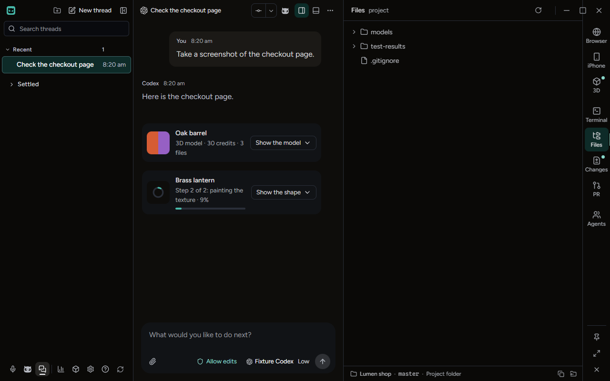

On its own surface the tile carries no dot, as no open surface does: the surface's own list says the lantern's step and
percent.

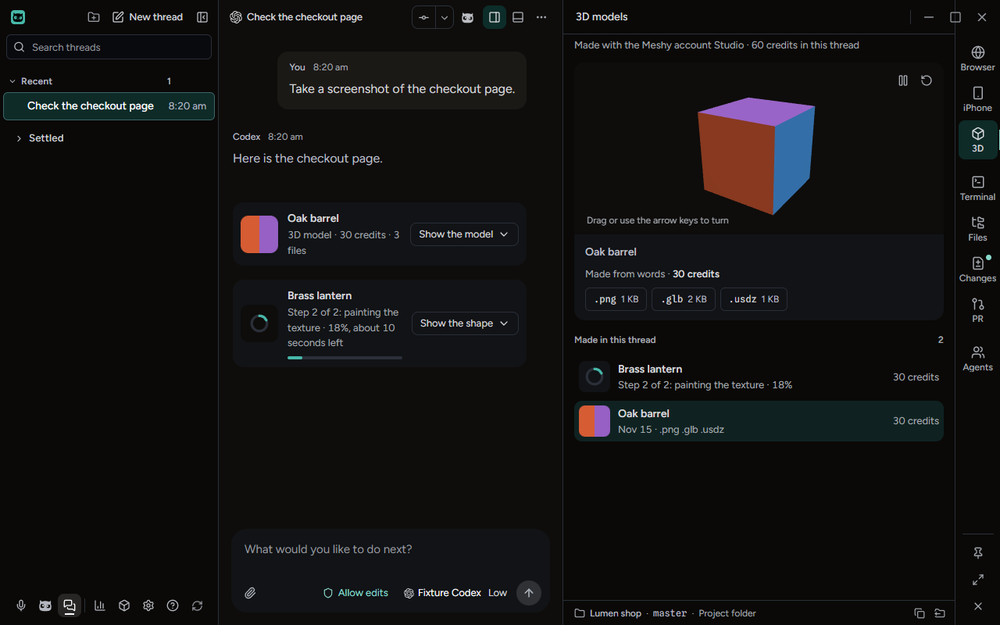

The cube at the sidebar's foot, named "3D models", sits between Usage and Settings. The page read "2 3D models from 1
thread · 60 credits this month". The lantern's tile led with its percent ("18% · Step 2 of 2: painting the texture"),
and choosing it drew the shape and put its step, the time left, a bar and "The files go to models/ in the thread's folder
when it is done." in its details, with its cost "counted while it is made". It offered no Show in File Explorer yet.

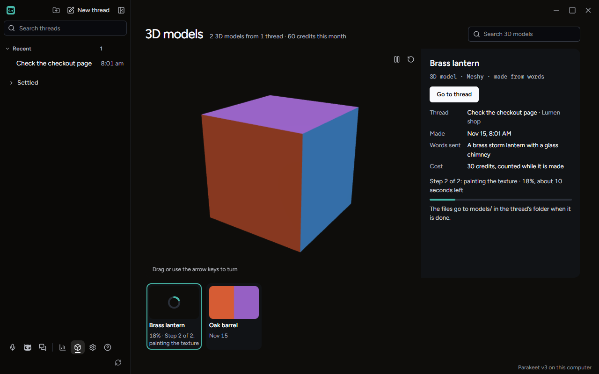

Once the lantern was done its tile took its date. From the keyboard, the chosen tile was the filmstrip's one Tab stop.
The right arrow chose the Oak barrel and moved focus to it, and the left arrow came back. On the view, Home said "Facing
the front" and the right arrow turned it 15 degrees, as in the thread.

**Show in File Explorer** showed `models/Oak barrel.glb`, and the `.usdz` row's own button showed that file. Main took
both from the record and checked them inside its folder; the run noted them where it would have opened File Explorer.

The page was checked in dark and light at 1600x1000, 1280x800 and the 820x560 minimum. Nothing reached past the window,
and only the filmstrip scrolls sideways. At the minimum the view, the details and the filmstrip all fit, and the details
scroll beside the view.

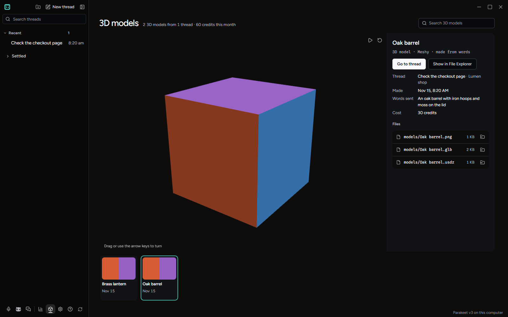

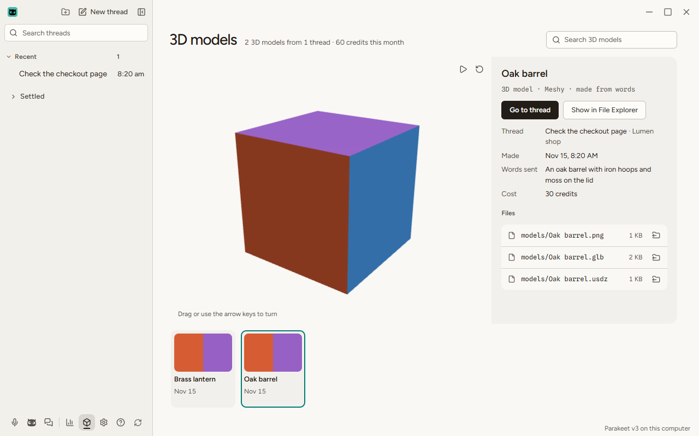

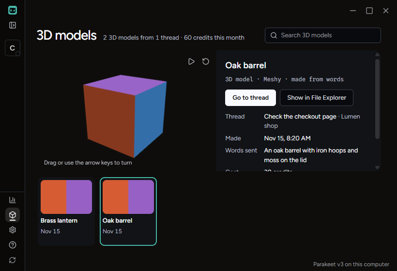

With Reduce motion on, the view did not turn by itself and offered no **Stop turning**.

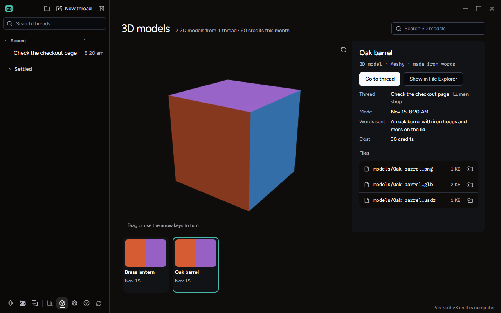

**Go to thread** opened the thread the barrel came from, with its line in it. Tools was checked there in dark and light
at the three sizes, with the newest, the lantern, chosen.

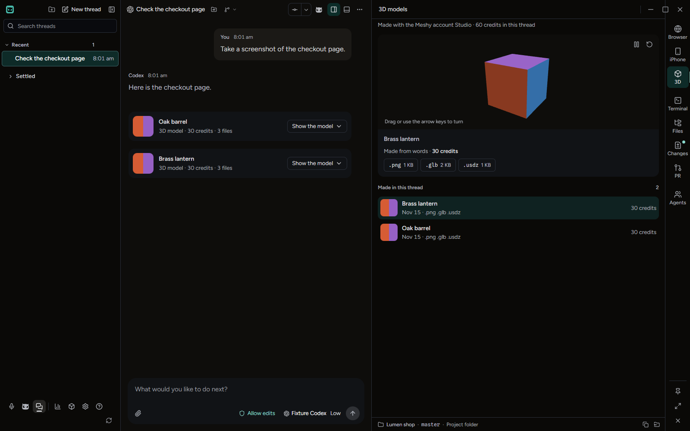

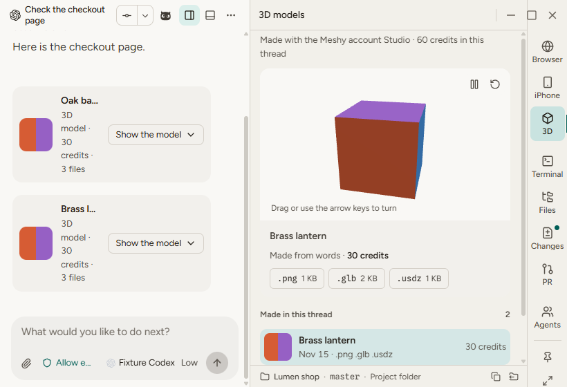

The barrel's three files were then deleted outside Sotto. On the page its tile read "Files gone", and its details said
"Its files are gone. The Oak barrel's files are no longer in models/ in its thread's folder: they were moved, renamed or
deleted.", then "Removing it takes it off this list. It deletes no file." with **Remove from 3D models**, and no Show in
File Explorer. It was checked in dark and light at 1280x800 and at the minimum.

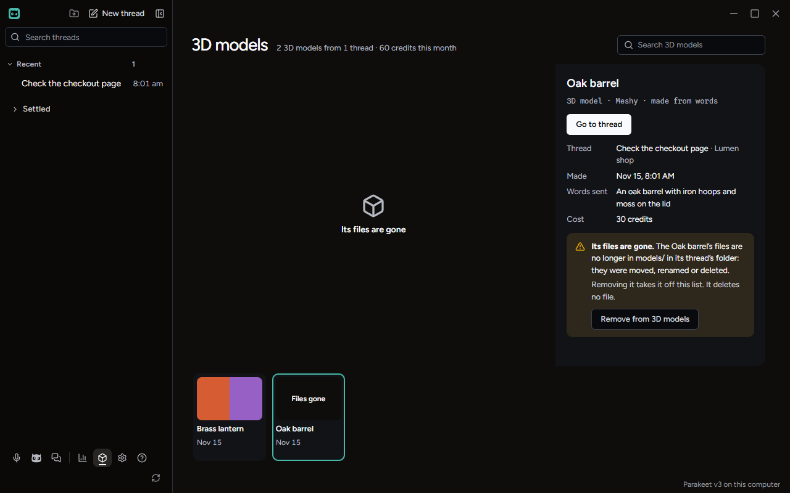

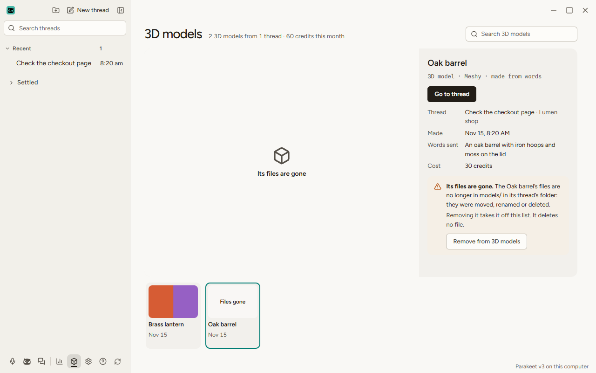

**Remove from 3D models** took the barrel off the page and moved focus to the lantern's tile. The lantern's three files
were still in `models/`, and the header still counted 60 credits this month: the removed record's cost stays counted.
With the lantern's files deleted and its record removed the same way, the page said there were none yet.

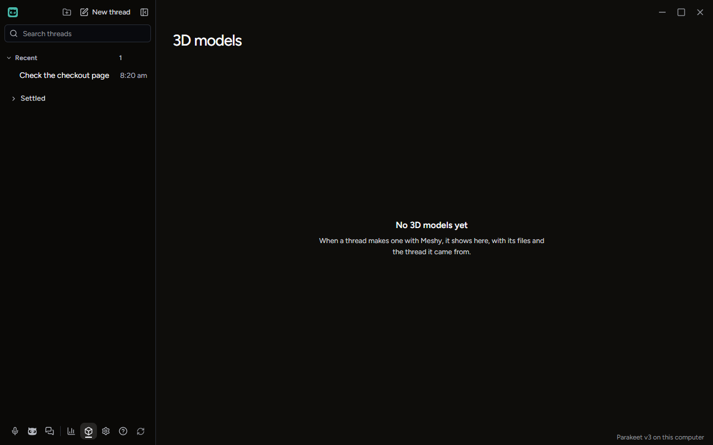

The stand-in was asked only for its API and its files, and the window raised no error. Ticket 4's journey,
`tests/e2e/plugins-meshy-model.spec.ts`, passed again after the line's still picture, ring and words moved into
`modelParts.tsx`.

## Fixed from what the running app showed

- The page could not find the thread: the window names this computer's threads by a key that says which computer holds
  them, and the record by the thread's own ID. It now reads the key as main does, and Go to thread opens it by the key.
- "3D models" did not fit the rail's tile and read "3D mod…". The tile now reads "3D", as PR stands for Pull request,
  and its name is "3D models".
- At 820x560 Tools squeezed the chosen 3D model's card and hid its file chips. Each row of the surface is now as tall
  as what it holds.
- At 820x560 the page's details pushed the filmstrip below the window. The page now takes the room's height and the
  details scroll beside the view.
- A tile being made lost its percent off the end of its step; the percent now comes first. "Files gone" was drawn over
  the cube in its tile, which now shows the words alone.

## Fixed after Sol's review of the branch

- The sidebar's foot, one tile wider with the cube, sent the update control to a second row at 1280x800 and 1600x1000.
  With the cube there its gaps and its hairline's margins draw in by a pixel each, and every control is on one row; the
  run checks it at each size. A foot without the cube is as it was. Ticket 4's captures above were taken again for it.
- At 820x560 the eighth tile pushed Tools' Expand and Close below the window. With the 3D tile there, the rail's tiles
  and the air between their groups draw in on a window shorter than 680px, and the run checks every rail control is in
  the window at each size.
- The list now keeps what it hears while a read is on its way over that read's older answer, lets a forgotten thread's
  3D models go when main says so, and while the page or the surface is shown reads again on focus and every half
  minute, so files moved, deleted or put back show as they are. The 3D model first shown stays chosen when another
  finishes, and a removal answered after another was chosen moves nothing. The unit tests hold these.

## What else covers it

- `tests/unit/main/tools/meshy/meshyPage.test.ts`: the list holds only 3D models made or being made, newest first, one
  thread's when asked, and no words once Keep local history is off. Remove refuses while any file is there, removes the
  record and no file, and keeps its credits counted. Reveal refuses an unknown ID, a name the record does not hold, a
  folder outside the thread's, and a file that is gone.
- `tests/unit/main/plugins/pluginsIpc.test.ts`: the three channels answer the main window only, and a path or anything the
  schema does not name asks main nothing or does not cross.
- `tests/unit/renderer/features/models3d/modelsPage.test.tsx`: the page with 3D models, one being made, files gone and
  none; Finder's name on macOS; the filmstrip's keys; search by name and words; a view main sends as one finishes, a new
  one and one that failed; Go to thread by the window's key; and nothing, the cube included, with the Owl feature off.
- `tests/unit/renderer/tools/modelsSurface.test.tsx`: the surface's place on the rail, its chosen view, chips that open
  Files, its rows, its dot, files gone, and no tile and no reads with the Owl feature off.
- `tests/unit/renderer/agents/modelView.test.tsx`: the view leaves focus where it was when the page opens it.

## Not checked here

- A 3D model from a photo on the page; the unit test holds "Photo sent" and its file name.
- A thread on a paired host, which ticket 6 brought to the page and Tools: see [the last part of this note](#a-paired-hosts-3d-models-and-the-iphone).
- File Explorer itself opening on the file: the run notes the path instead, so the laptop's own Explorer was not driven.

# The card that asks, and the month's credits

Checked on Windows on November 15, 2026, in the built app, for #2497: ticket 8 of `docs/plans/2026-10-22-meshy-3d-models.md`,
which captures ticket 3's card and the account's count for this note. The run is ticket 4's,
`tests/e2e/plugins-meshy-model.spec.ts`, with the same stand-in Meshy and made-up key, now taking three captures more.
The captures above were not taken again.

## What was done

When the thread asked for the Oak barrel, its card read **Make a 3D model with Meshy**, with the account's plugin, the
name, "Sends Meshy these words: “An oak barrel with iron hoops and moss on the lid”", the line on Meshy's training, "About
30 credits on the Meshy account Studio; 0 of its 1,000 credits used this month." and where the files go, over **Make the
model** and **Deny**. The reply box read "Queued until you answer the card".

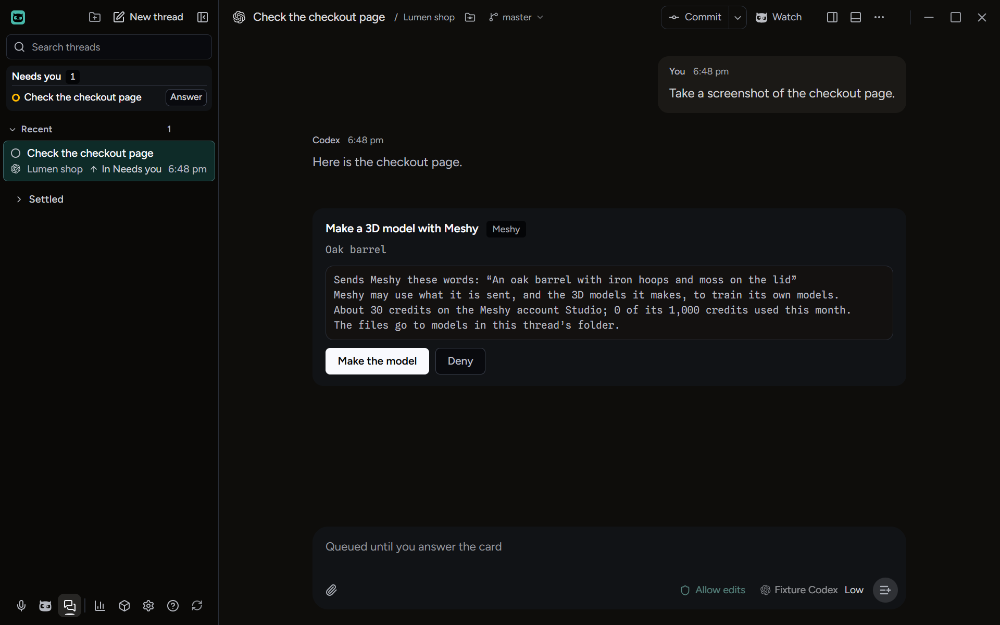

The Brass lantern's card, asked for once the barrel was made, counted the barrel: "30 of its 1,000 credits used this
month". It was checked in light, under the barrel's closed line.

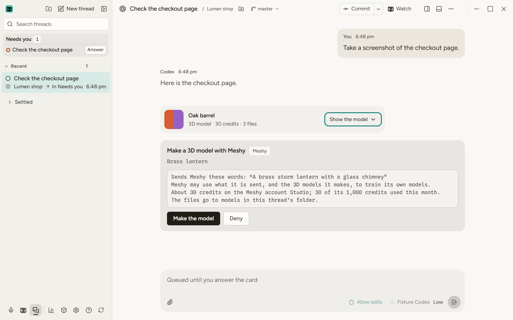

After the barrel (30 credits) and the lantern whose texture failed (20 counted), the Studio account on Settings › Plugins
read "Credits this month: 50 of 1,000." under its limit. Its Recent use said "Made a 3D model" and "Asked to make a 3D
model … You allowed it, and it failed.", each with the thread's name.

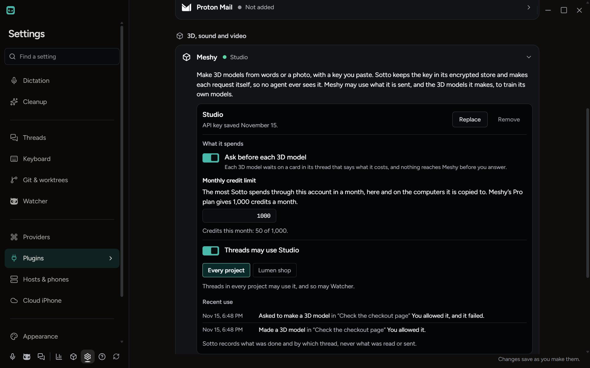

The run passed in 26 seconds, and the window raised no error.

## What else covers it

- `tests/unit/main/plugins/pluginMeshyTool.test.ts`: the card's words, nothing made on Deny, a 3D model past the limit
  refused before the card and again after the yes, no card with asking off, and a photo redrawn or refused.
- `tests/e2e/plugins-meshy.spec.ts`: the account, its switch and its limit in the built app, and "Credits this month: 0
  of 1,000." before anything is spent (`docs/verification/plugins-meshy.md`).

# A paired host's 3D models and the iPhone

Tickets 6 and 7 were checked by their tests and CI, not in a running app, because both need a second device: a
paired computer with a Meshy account copy, and an iPhone. No screenshots were taken of either.

## What covers it

- **One limit across computers.** `tests/unit/main/plugins/meshySpending.test.ts`,
  `tests/integration/socketMeshySpending.test.ts` and `tests/unit/host/pluginsMeshy.test.ts`: a host's threads make 3D
  models with the account copy, asking as its switch says, and the month's credits are one figure the desktop and its
  hosts share.
- **A host's 3D models on the desktop.** `tests/unit/main/hostModels3d.test.ts`, `tests/integration/socketMeshyModels.test.ts`,
  the host's lines in `tests/unit/renderer/agents/modelLine.test.tsx`, and the "a paired host's 3D models on the page" part of `tests/unit/renderer/features/models3d/modelsPage.test.tsx`:
  - the list and the views over `plugin-meshy-models`;
  - the bytes in 8 MiB parts, up to 64 MiB;
  - "on forge" in the kind line;
  - the line while the host is away;
  - Remove from 3D models removing the host's record only.
- **The phone's reads.** `tests/integration/socketMeshyModels.test.ts`'s phone part:
  - `plugin-meshy-phone` is served only to a phone;
  - the phone reads one thread's 3D models, and only one it is shown;
  - news of a thread it isn't shown is dropped;
  - the USDZ is checked before it is handed over, and never to a desktop.
- **The iPhone app.** `apps/ios/Tests/SottoCoreTests/Models3dTests.swift` in the macOS iOS job:
  - the line read from a message's `3d-model` visual;
  - the view, a thread's list and the news frame;
  - the requests, and the cache's names;
  - a USDZ kept only when its parts make the file the computer named.

  The app compiled in that job's journeys on both iPhones, at #2626's head `7a105e2`.

## Not checked here

- A paired host's 3D models in the running desktop, and the iPhone's line and sheet on a phone. Both wait for Zach's
  hand test with a paid Meshy key. On the iPhone:
  - make one from a laptop thread and watch its line while it is made;
  - open it, turn it, close it and open it again, which should be instant;
  - stop Sotto on the laptop and see the line say the computer isn't connected.
- The native iOS journeys place no 3D model in a thread, so they take no picture of the line or the sheet.
