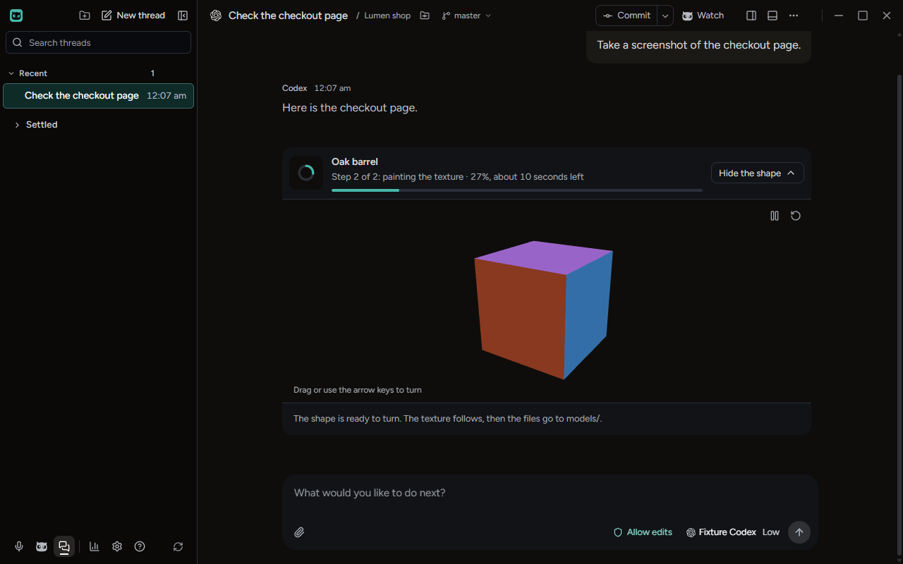
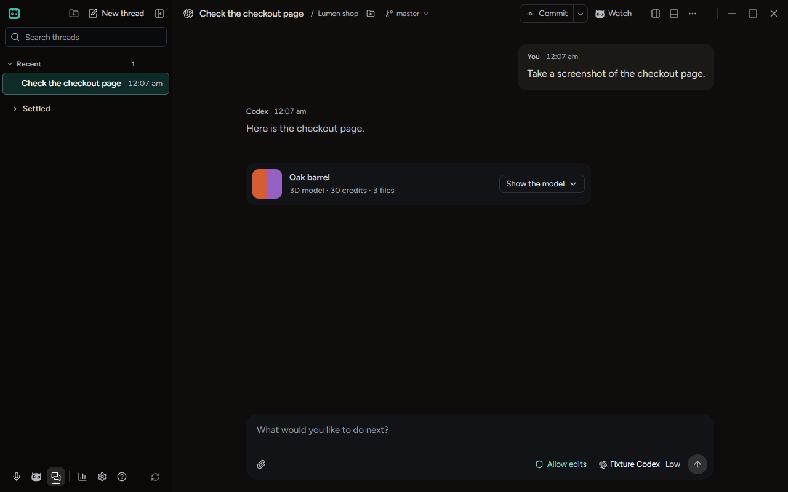
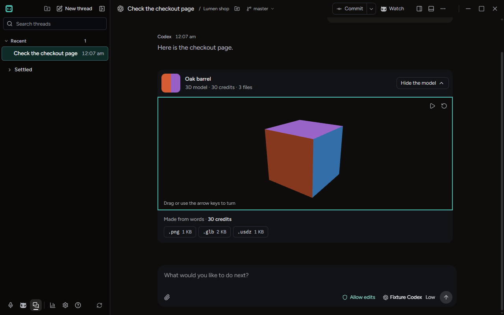
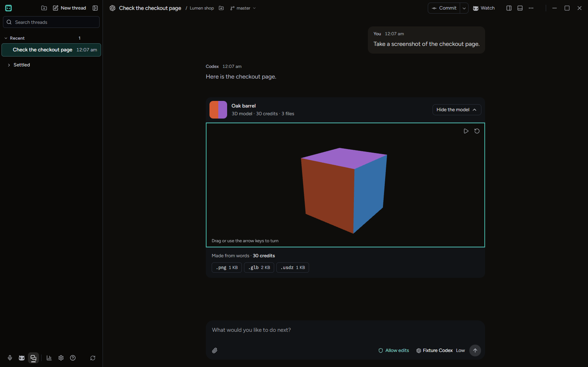
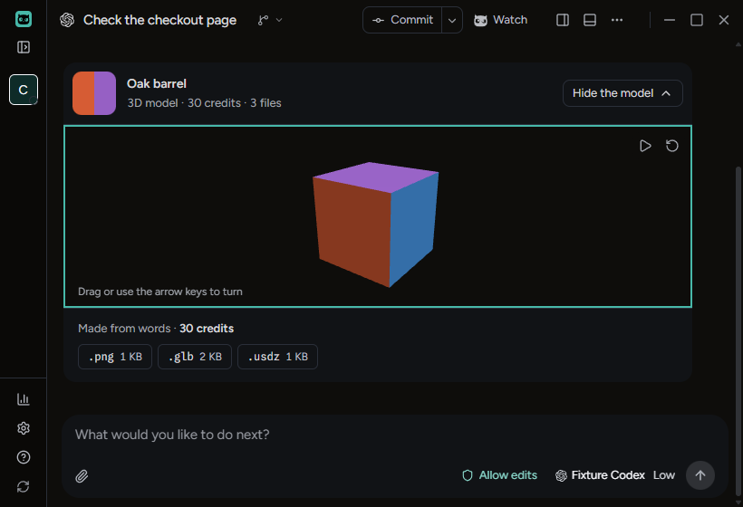
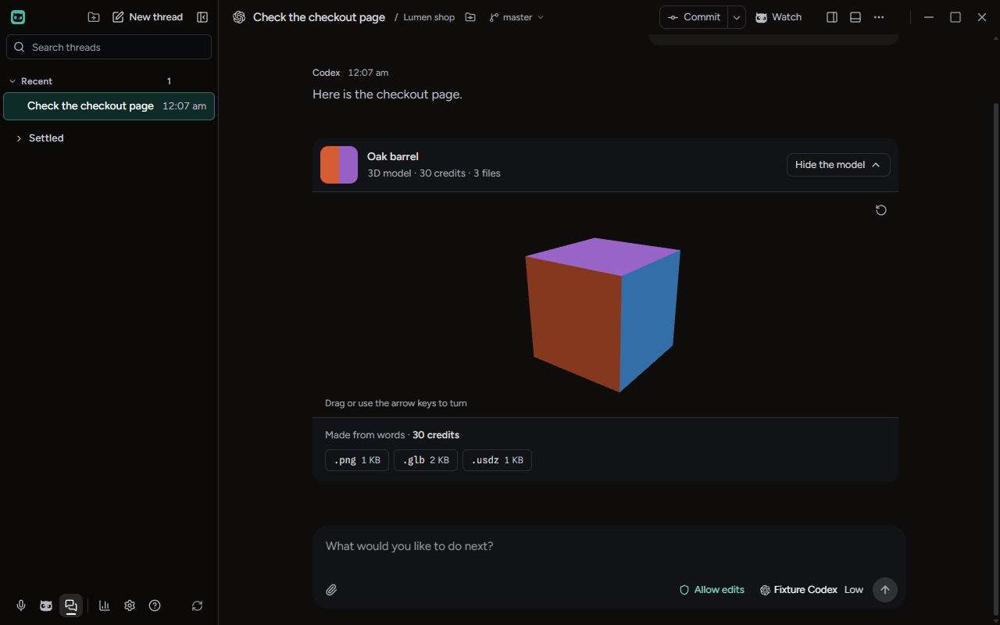
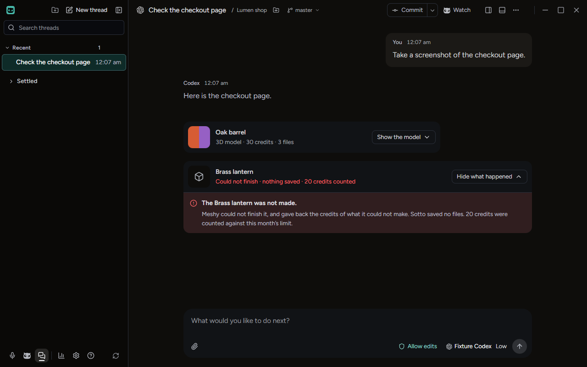

# A 3D model Meshy made, drawn in its thread

Checked on Windows on November 15, 2026, in the built app, for #2497: ticket 4 of `docs/plans/2026-10-22-meshy-3d-models.md`.
A 3D model a thread makes with `make_3d_model` is drawn in that thread as Zach's variant A (ADR-0141), the prototype kept
as the tag `prototype/meshy-inline`, with his picks on #2497: Meshy's percent and the time left while it works, closed
until pressed once done, and no Try again.

Meshy was the stand-in in `tests/fixtures/fakeMeshy.ts`, on one address on this computer that answered the balance read,
the API and the files, as main reaches it through `SOTTO_E2E_MESHY_API_URL`, which a packaged build never reads. Its
tasks were read every second and held in progress until the run let each step go. It served a real GLB, a cube whose
six faces are painted from one picture inside the file (`texturedCubeGlb` in `tests/fixtures/glb.ts`), and a real PNG as
the still picture. The run is `tests/e2e/plugins-meshy-model.spec.ts`, with the Owl feature turned on by
`SOTTO_OWL_FEATURES=plugins=1`. Nothing reached Meshy, and the key was made up.

## What was done

A Meshy account named Studio was added on Settings › Plugins, its key checked with the stand-in's balance read. In the
thread, its agent called `make_3d_model` with the name Oak barrel and words. The card asked, and **Make the model** was
pressed.

The line came in under the agent's last message. While Meshy made the shape it read "Step 1 of 2: making the shape ·
18%, about 10 seconds left", with a bar filled to the percent and a ring in place of the picture. It offered nothing to
open.

While Meshy painted the texture it read "Step 2 of 2: painting the texture · 18%, about 10 seconds left" and offered
**Show the shape**. Beside the button the words wrap rather than lose the time left.

**Show the shape** opened the view in place on the shape Meshy had made, which Sotto fetched into memory when the button
was pressed. The view took focus and turned slowly by itself, over "The shape is ready to turn. The texture follows, then
the files go to models/." Escape closed it and gave focus back to **Show the shape**.

Once done, the line was closed: the still picture, Oak barrel, and "3D model · 30 credits · 3 files", with **Show the
model**. The agent was told "The 3D model "Oak barrel" is made, for 30 credits."

**Show the model** opened the view on the GLB from the thread's `models/` folder. It took focus and turned by itself: two
captures of the drawing 0.8 seconds apart differed. Under it were "Made from words · 30 credits" and a chip for each
file, ".png 1 KB", ".glb 2 KB" and ".usdz 1 KB". Every face of the cube had its own colour, so the picture inside the GLB
was drawn from the GLB's own bytes, under the main window's content policy as it stands.

From the keyboard, Home faced it to the front, a three-quarter view from a little above, and stopped its turning: the
view said "Facing the front". The right arrow turned it 15 degrees ("Turned 15 degrees from the front"), and the drawing
then held still. A second right arrow made 30. Home brought back exactly the first front drawing. Escape closed the view
and gave focus back to the button, named **Show the model** again.

Open, the line was checked in dark and light at 1600x1000, 1280x800 and the 820x560 minimum. Nothing in it reached past
the thread's pane, and nothing in it scrolled sideways.

With Reduce motion on, the view opened without turning by itself, with no **Stop turning** button, and two captures 0.8
seconds apart were the same.

A second 3D model, Brass lantern, was asked for and allowed, and Meshy failed its texture. Its line read "Could not
finish · nothing saved · 20 credits counted", with a box in place of a picture, and **Show what happened** opened "The
Brass lantern was not made." and "Meshy could not finish it, and gave back the credits of what it could not make. Sotto
saved no files. 20 credits were counted against this month's limit." There was no Try again. Escape closed it and gave
focus back to the button. It was checked in dark and light at 1280x800 and at the 820x560 minimum.

The stand-in was asked only for its API and its files, and the window raised no error.

## Fixed from what the running app showed

- At the front, the model faced the camera square on and read as a flat tile. The front is now the prototype's
  three-quarter view from a little above.
- The model touched the bottom of the view at 1600x1000. The camera now stands back far enough for the model to fit the
  narrower way with room around it.
- Beside **Show the shape**, the line under the name cut the time left off ("about 10 secon…"). It now wraps.

## What else covers it

- `tests/unit/renderer/agents/modelLine.test.tsx`: the line in each state, the photo's one step, Saving the files,
  Escape from the view and from what happened, the still picture where WebGL cannot draw, and nothing at all with the
  Owl feature off.
- `tests/unit/main/tools/meshy/meshyView.test.ts` and `meshyGlb.test.ts`: the bytes by a 3D model's ID alone, a folder or
  a file swapped for a link outside the thread's folder, and a GLB that names any `uri`.
- `tests/unit/main/tools/meshy/meshyModels.test.ts`: Meshy's percent and the time left held in memory, and the shape
  fetched into memory only when asked for.
- `tests/unit/main/plugins/pluginMeshyTool.test.ts`: the line placed once Meshy has the request, and never when the card
  is denied or the limit refuses it.

## Not checked here

- A real Meshy account and one of Meshy's own models: its sizes, its materials, and a shape without a texture, which the
  stand-in gives the same textured cube. That waits for Zach's key on a paid plan.
- A 3D model from a photo in the running app; the unit test holds its one step.
- A window that cannot draw WebGL; the unit test holds the still picture that takes the view's place.
- A host's thread and the iPhone, which are tickets 6 and 7.
