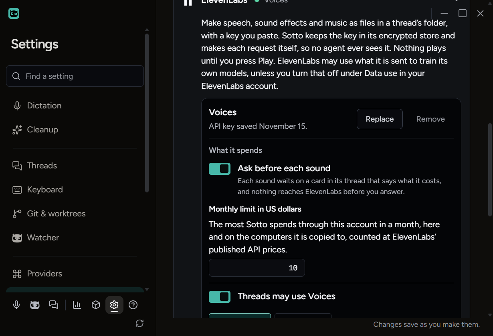
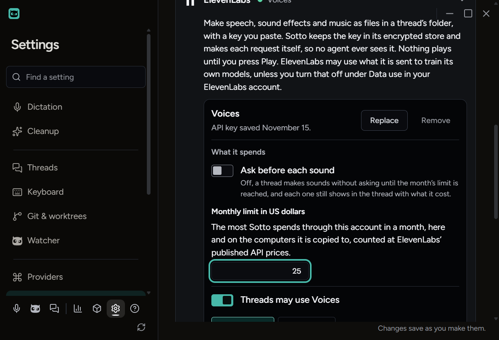
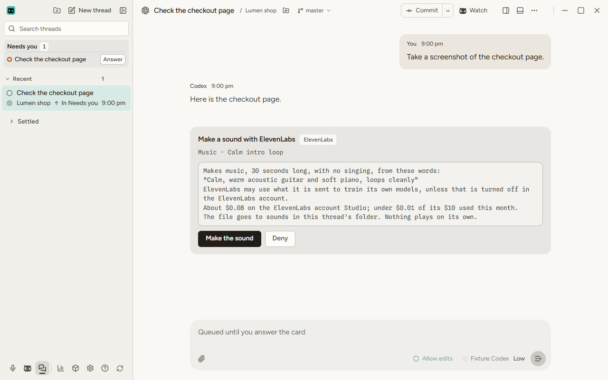
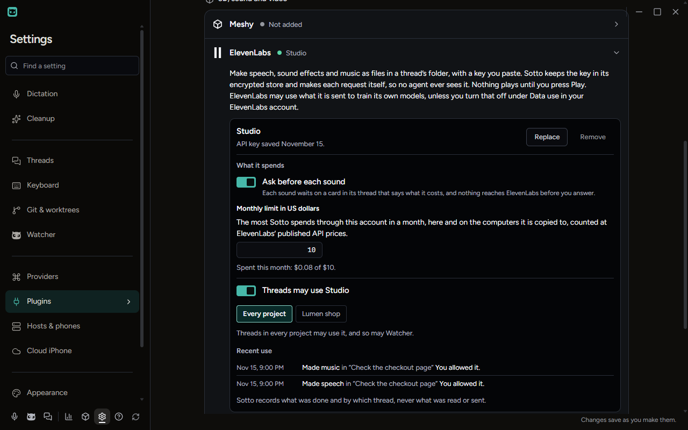

# An ElevenLabs account on the Plugins page

Checked on Windows on November 15, 2026, in the built app, for #2498, the first part of slice 12 of
`docs/plans/2026-11-11-plugins.md`. Zach picked on November 15, 2026, from the prototype kept as the tag
`prototype/elevenlabs`:
- ElevenLabs makes speech, sound effects and music as files in a thread's folder.
- A finished sound is a quiet line in its thread, as a 3D model's is.
- The monthly limit starts at $10, at ElevenLabs' published API prices.
- The agent picks a voice by name.
- Images and video stay with Higgsfield.

This part is the account alone. Threads cannot make a sound with it yet.

ElevenLabs was a stand-in: a small server on this computer that answers `GET /v1/user/subscription` for one made-up key
and 401 for anything else. The run is `tests/e2e/plugins-elevenlabs.spec.ts`, with `SOTTO_OWL_FEATURES=plugins=1`, and
the stand-in's address given by `SOTTO_E2E_ELEVENLABS_API_URL`, which a packaged build never reads. Nothing reached
ElevenLabs.

## What was done

ElevenLabs' row sits under Meshy in **3D, sound and video**, with its two bars for a mark, and reads "Not added".
Opened, the row says:
- that ElevenLabs makes speech, sound effects and music as files in a thread's folder;
- that Sotto keeps the key and makes each request itself;
- that nothing plays until you press Play;
- that ElevenLabs may use what it is sent to train its own models, unless that is turned off under Data use in the
  ElevenLabs account.

**Add an ElevenLabs account** asked for a name and an API key, made at elevenlabs.io/app/settings/api-keys. A key the
stand-in refuses got "ElevenLabs did not accept this key. Nothing was saved. Check the key at
elevenlabs.io/app/settings/api-keys. A restricted key must be allowed to read your account."

The good key was kept: the account read "API key saved November 15." and the folded row "ElevenLabs, Voices". The
stand-in was asked only `GET /v1/user/subscription`, once for each key, and that read makes nothing. Afterwards the key
was not in the page, and neither key was in any file in Sotto's data folder.

Under **What it spends**, **Ask before each sound** was on and **Monthly limit in US dollars** read 10. No count of the
month's spending is shown yet, since nothing spends through the account until threads make sounds. The open row was
checked in dark and light at 1600x1000, 1280x800 and the 820x560 minimum, and nothing was wider than its room.

Turning the switch off and setting the limit to 25 with Enter saved both: the account read back as asking off, $25.

Meshy's account journey (`plugins-meshy.spec.ts`) still passes with the new row beside it.

## What else covers it

- `tests/unit/main/plugins/elevenLabsAccount.test.ts`:
  - the key is checked by reading the subscription, in the `xi-api-key` header, with no redirect followed;
  - 401 and 403 are refused, 429 is busy, and anything else could not be checked;
  - a key with a line end is sent nowhere;
  - the account starts at asking on and $10, Meshy's stays 1,000 credits, and the record is version 6, which builds
    from before ElevenLabs refuse;
  - its switch and limit change.
- `tests/unit/main/plugins/copySync.test.ts`, `accountCopies.test.ts` and `tests/integration/pluginAccountCopies.test.ts`:
  - a host from before ElevenLabs is sent no copy, and the page says it is too old;
  - a current host lists `plugin-elevenlabs-copies` only to the desktop the launch script recorded, keeps the copy, and
    lists its switch and limit back.
- `tests/unit/renderer/features/settings/pluginsSettings.test.tsx`:
  - the row, its words and the add form;
  - the switch, and the limit in whole dollars;
  - no credits read for the account.

## Part 2: making a sound

Built on November 15, 2026, for the second part of slice 12: the tool `make_sound`, the card that asks, the monthly
limit in dollars, the record of sounds and the MP3 in the thread's folder. In every test ElevenLabs is a stand-in
with a made-up key, and nothing reached ElevenLabs.

### In the built app

The run is `tests/e2e/plugins-elevenlabs-sound.spec.ts`, against a stand-in on this computer that answers the
subscription, the voices and the three ways to make a sound with a small MP3. An ElevenLabs account named Studio was
added on Settings › Plugins, and the thread asked for speech with `make_sound`.

The card read **Make a sound with ElevenLabs**, "Speech · Opening narration", "Speaks these words in the voice Rachel
(118 characters):" and the words, the line on ElevenLabs' training, "Under $0.01 on the ElevenLabs account Studio; $0.00
of its $10 used this month." and "The file goes to sounds in this thread's folder. Nothing plays on its own.", over
**Make the sound** and **Deny**. Nothing had been sent to ElevenLabs. After **Make the sound**, the agent was told
where the MP3 is, and `sounds/Opening narration.mp3` held the stand-in's bytes.

Music was asked for next, in light: "Makes music, 30 seconds long, with no singing, from these words:" and "About $0.08
on the ElevenLabs account Studio; under $0.01 of its $10 used this month.", the speech now counted. Once it was made,
nothing in the window was playing.

The account then read "Spent this month: $0.08 of $10.", and its Recent use "Made music" and "Made speech", each in the
thread, with "You allowed it." The stand-in was sent one request for each sound and nothing else, and the window raised
no error. The account journey, `plugins-elevenlabs.spec.ts`, still passes.

### What else covers it

- `tests/unit/main/plugins/pluginSoundTool.test.ts`, the tool's flow, the way `make_3d_model` asks, counts and
  refuses:
  - the card shows everything that goes to ElevenLabs, the voice, the cost and the month's spending; after the yes the
    MP3 is in `sounds/`, the answer gives its path in the thread's folder and what it cost, and the cost is counted;
  - a no, or a card nobody answers, sends nothing, saves nothing and counts nothing;
  - a sound that would pass the limit is refused before the card, and again after the yes when the limit was lowered
    while the card waited;
  - of two sounds asked for at once, only one fits under the limit;
  - with asking off, no card is shown; when asking is turned back on while the call is looked at, the card is shown;
  - a voice is found by its name in any case, the account's first is used when none is named, and an unknown one is
    refused with up to 20 of the account's voices named and nothing sent;
  - ElevenLabs' refusals (no credits, rejected, busy, unreachable) are said plainly, save nothing and count nothing;
  - each kind takes only what it can (a voice for speech, seconds for an effect or music, no singing for music), and a
    folder outside the thread's is refused;
  - a computer whose threads cannot make sounds says so;
  - the card's words for speech, an effect with and without a length, and music with and without singing, in dollars.
- `tests/unit/main/tools/elevenlabs/soundRecords.test.ts`, the record of sounds:
  - the month counts from the 1st by this computer's clock, sounds made and being made, and no failed one;
  - the words follow Keep local history, in memory and in the file, across a restart;
  - forgetting a thread removes its records and keeps what they cost, by account and when alone;
  - a sound cut off when Sotto stopped is settled as stopped with its cost still counted.
- `tests/unit/main/plugins/changeWordsPlain.test.ts`: a host words each sound's card as the desktop does.
- `tests/unit/main/plugins/pluginsIpc.test.ts`: the month's spending is read by the main window only, and never below
  nothing.
- `tests/unit/renderer/features/settings/pluginsSettings.test.tsx`: **What it spends** says "Spent this month: $1.20
  of $10.", "under $0.01" below a cent, and reads it again when a sound is made; Recent use says "Made speech", "Made a
  sound effect" and "Made music", or what was only asked for.

## Not checked here

- A real ElevenLabs key. The check was run against the stand-in only.
- A sound effect in the built app; the unit tests hold its card with and without a length.
- The line in the thread with Play (part 3), and a host's threads making sounds with the copy (part 4).
