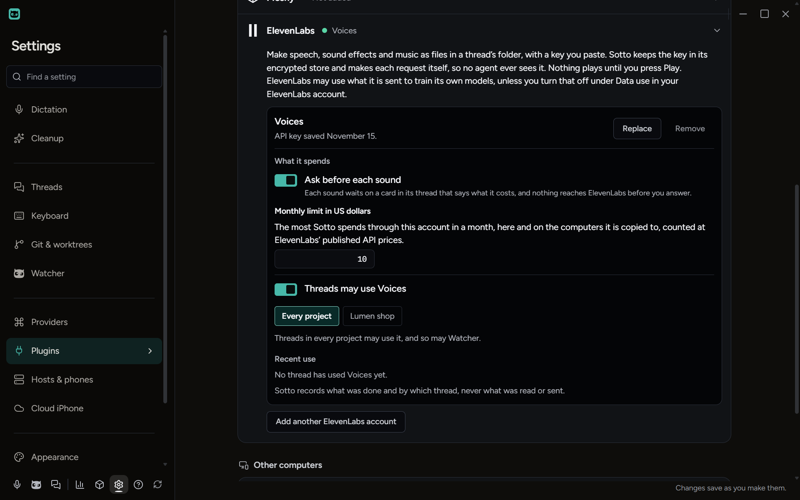
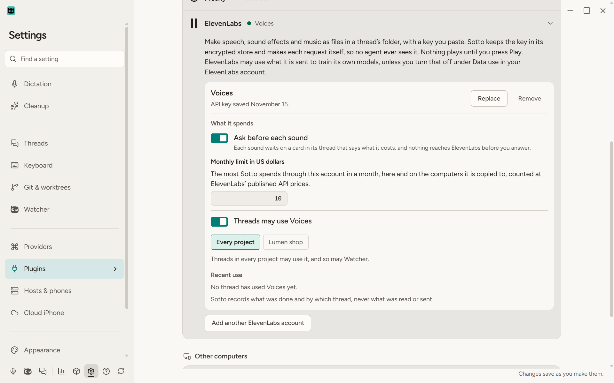
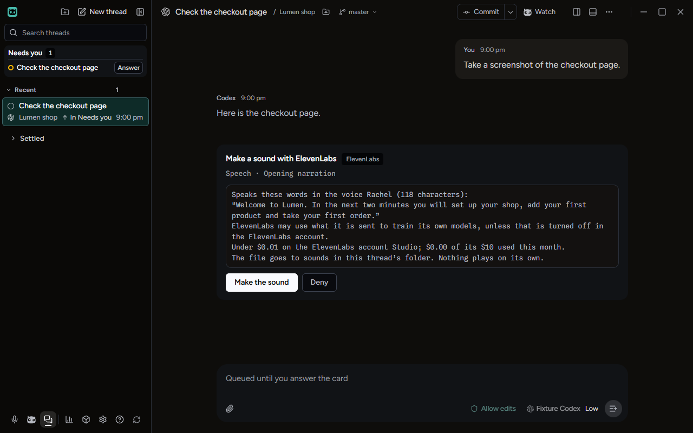
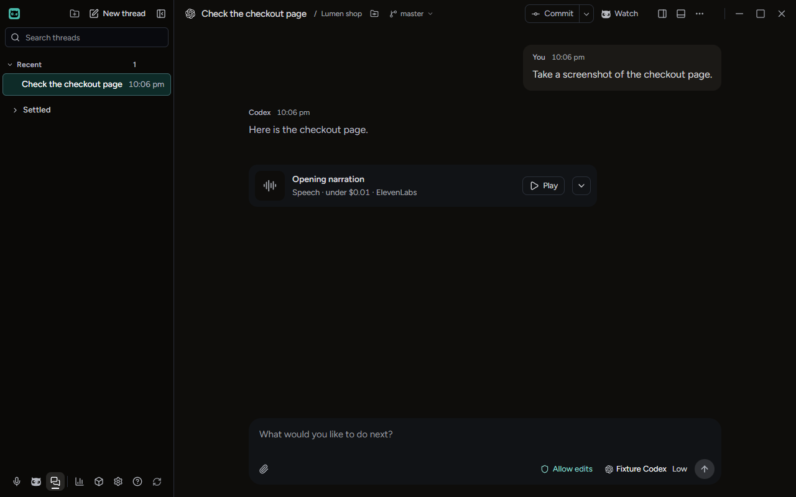
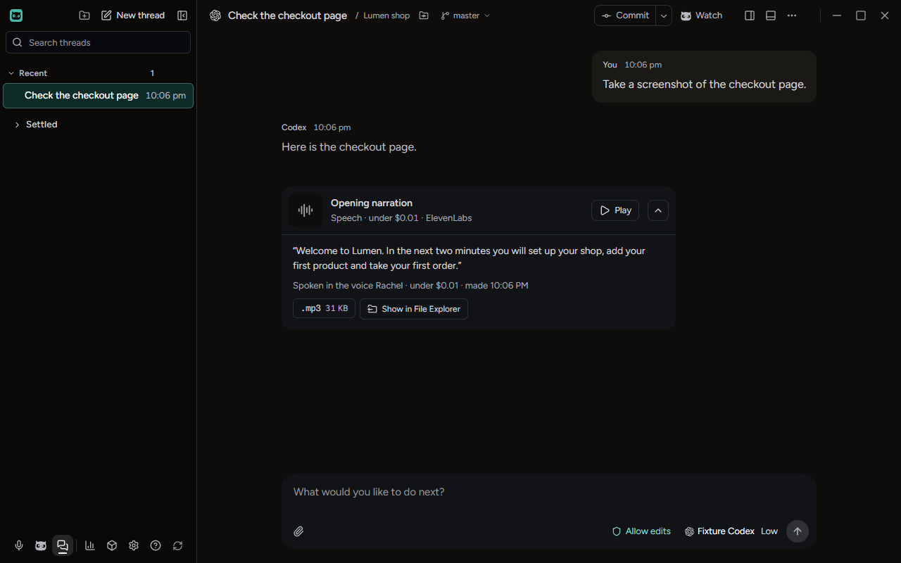
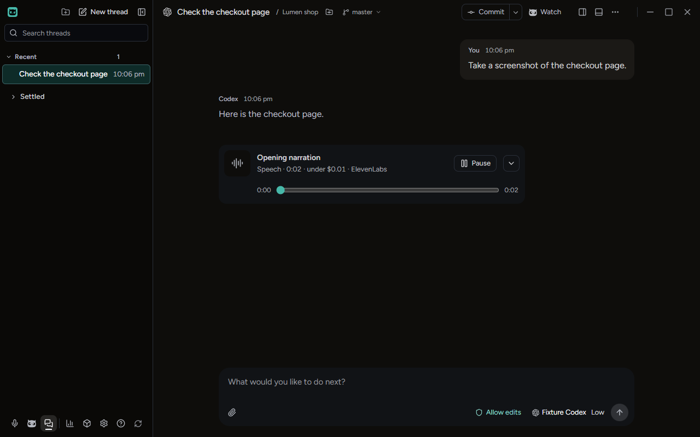
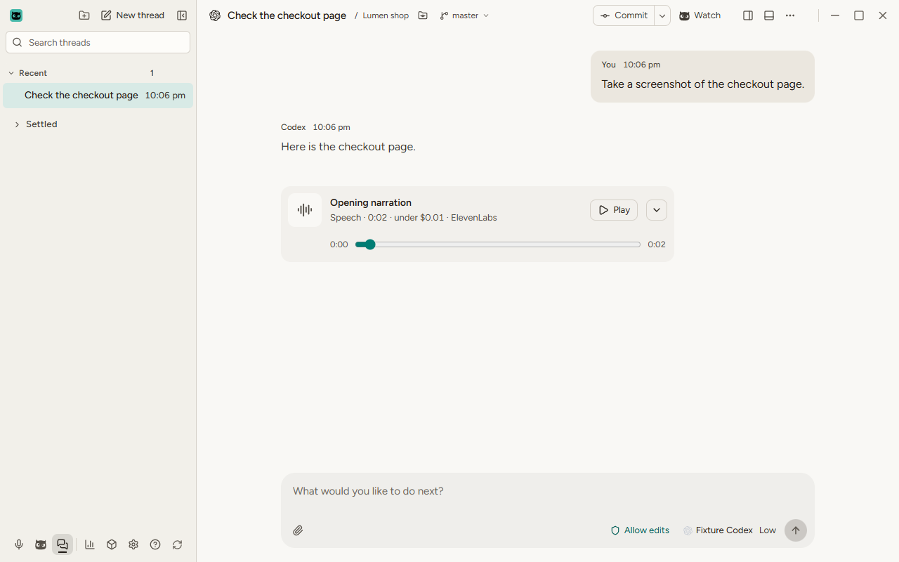
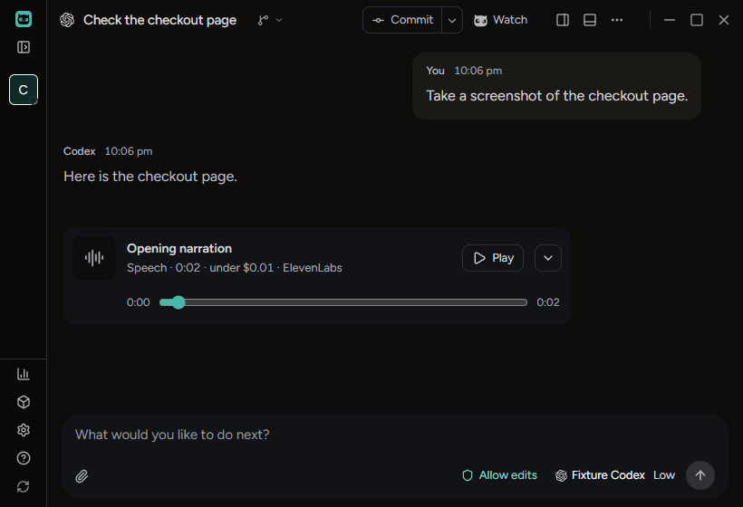

# An ElevenLabs account on the Plugins page

Checked on Windows on November 15, 2026, in the built app, for #2498, the first part of slice 12 of
`docs/plans/2026-11-11-plugins.md`. Zach picked on November 15, 2026, from the prototype kept as the tag
`prototype/elevenlabs`:
- ElevenLabs makes speech, sound effects and music as files in a thread's folder.
- A finished sound is a quiet line in its thread, as a 3D model's is.
- The monthly limit starts at $10, at ElevenLabs' published API prices.
- The agent picks a voice by name.
- Images and video stay with Higgsfield.

This part is the account alone. Threads cannot make a sound with it yet.

ElevenLabs was a stand-in: a small server on this computer that answers `GET /v1/user/subscription` for one made-up key
and 401 for anything else. The run is `tests/e2e/plugins-elevenlabs.spec.ts`, with `SOTTO_OWL_FEATURES=plugins=1`, and
the stand-in's address given by `SOTTO_E2E_ELEVENLABS_API_URL`, which a packaged build never reads. Nothing reached
ElevenLabs.

## What was done

ElevenLabs' row sits under Meshy in **3D, sound and video**, with its two bars for a mark, and reads "Not added".
Opened, the row says:
- that ElevenLabs makes speech, sound effects and music as files in a thread's folder;
- that Sotto keeps the key and makes each request itself;
- that nothing plays until you press Play;
- that ElevenLabs may use what it is sent to train its own models, unless that is turned off under Data use in the
  ElevenLabs account.

**Add an ElevenLabs account** asked for a name and an API key, made at elevenlabs.io/app/settings/api-keys. A key the
stand-in refuses got "ElevenLabs did not accept this key. Nothing was saved. Check the key at
elevenlabs.io/app/settings/api-keys. A restricted key must be allowed to read your account."

The good key was kept: the account read "API key saved November 15." and the folded row "ElevenLabs, Voices". The
stand-in was asked only `GET /v1/user/subscription`, once for each key, and that read makes nothing. Afterwards the key
was not in the page, and neither key was in any file in Sotto's data folder.

Under **What it spends**, **Ask before each sound** was on and **Monthly limit in US dollars** read 10. No count of the
month's spending is shown yet, since nothing spends through the account until threads make sounds. The open row was
checked in dark and light at 1600x1000, 1280x800 and the 820x560 minimum, and nothing was wider than its room.

Turning the switch off and setting the limit to 25 with Enter saved both: the account read back as asking off, $25.

Meshy's account journey (`plugins-meshy.spec.ts`) still passes with the new row beside it.

## What else covers it

- `tests/unit/main/plugins/elevenLabsAccount.test.ts`:
  - the key is checked by reading the subscription, in the `xi-api-key` header, with no redirect followed;
  - 401 and 403 are refused, 429 is busy, and anything else could not be checked;
  - a key with a line end is sent nowhere;
  - the account starts at asking on and $10, Meshy's stays 1,000 credits, and the record is version 6, which builds
    from before ElevenLabs refuse;
  - its switch and limit change.
- `tests/unit/main/plugins/copySync.test.ts`, `accountCopies.test.ts` and `tests/integration/pluginAccountCopies.test.ts`:
  - a host from before ElevenLabs is sent no copy, and the page says it is too old;
  - a current host lists `plugin-elevenlabs-copies` only to the desktop the launch script recorded, keeps the copy, and
    lists its switch and limit back.
- `tests/unit/renderer/features/settings/pluginsSettings.test.tsx`:
  - the row, its words and the add form;
  - the switch, and the limit in whole dollars;
  - no credits read for the account.

## Part 2: making a sound

Built on November 15, 2026, for the second part of slice 12: the tool `make_sound`, the card that asks, the monthly
limit in dollars, the record of sounds and the MP3 in the thread's folder. In every test ElevenLabs is a stand-in
with a made-up key, and nothing reached ElevenLabs.

### In the built app

The run is `tests/e2e/plugins-elevenlabs-sound.spec.ts`, against a stand-in on this computer that answers the
subscription, the voices and the three ways to make a sound with a small MP3. An ElevenLabs account named Studio was
added on Settings › Plugins, and the thread asked for speech with `make_sound`.

The card read **Make a sound with ElevenLabs**, "Speech · Opening narration", "Speaks these words in the voice Rachel
(118 characters):" and the words, the line on ElevenLabs' training, "Under $0.01 on the ElevenLabs account Studio; $0.00
of its $10 used this month." and "The file goes to sounds in this thread's folder. Nothing plays on its own.", over
**Make the sound** and **Deny**. Nothing had been sent to ElevenLabs. After **Make the sound**, the agent was told
where the MP3 is, and `sounds/Opening narration.mp3` held the stand-in's bytes.

Music was asked for next, in light: "Makes music, 30 seconds long, with no singing, from these words:" and "About $0.08
on the ElevenLabs account Studio; under $0.01 of its $10 used this month.", the speech now counted. Once it was made,
nothing in the window was playing.

The account then read "Spent this month: $0.08 of $10.", and its Recent use "Made music" and "Made speech", each in the
thread, with "You allowed it." The stand-in was sent one request for each sound and nothing else, and the window raised
no error. The account journey, `plugins-elevenlabs.spec.ts`, still passes.

### What else covers it

- `tests/unit/main/plugins/pluginSoundTool.test.ts`, the tool's flow, the way `make_3d_model` asks, counts and
  refuses:
  - the card shows everything that goes to ElevenLabs, the voice, the cost and the month's spending; after the yes the
    MP3 is in `sounds/`, the answer gives its path in the thread's folder and what it cost, and the cost is counted;
  - a no, or a card nobody answers, sends nothing, saves nothing and counts nothing;
  - a sound that would pass the limit is refused before the card, and again after the yes when the limit was lowered
    while the card waited;
  - of two sounds asked for at once, only one fits under the limit;
  - with asking off, no card is shown; when asking is turned back on while the call is looked at, the card is shown;
  - a voice is found by its name in any case, the account's first is used when none is named, and an unknown one is
    refused with up to 20 of the account's voices named and nothing sent;
  - ElevenLabs' refusals (no credits, rejected, busy, unreachable) are said plainly, save nothing and count nothing;
  - each kind takes only what it can (a voice for speech, seconds for an effect or music, no singing for music), and a
    folder outside the thread's is refused;
  - a computer whose threads cannot make sounds says so;
  - the card's words for speech, an effect with and without a length, and music with and without singing, in dollars.
- `tests/unit/main/tools/elevenlabs/soundRecords.test.ts`, the record of sounds:
  - the month counts from the 1st by this computer's clock, sounds made and being made, and no failed one;
  - the words follow Keep local history, in memory and in the file, across a restart;
  - forgetting a thread removes its records and keeps what they cost, by account and when alone;
  - a sound cut off when Sotto stopped is settled as stopped with its cost still counted.
- `tests/unit/main/plugins/changeWordsPlain.test.ts`: a host words each sound's card as the desktop does.
- `tests/unit/main/plugins/pluginsIpc.test.ts`: the month's spending is read by the main window only, and never below
  nothing.
- `tests/unit/renderer/features/settings/pluginsSettings.test.tsx`: **What it spends** says "Spent this month: $1.20
  of $10.", "under $0.01" below a cent, and reads it again when a sound is made; Recent use says "Made speech", "Made a
  sound effect" and "Made music", or what was only asked for.

## Part 3: the line in the thread

Built on November 15, 2026, for the third part of slice 12: the sound's line in its thread, Zach's variant A on #2498
(the tag `prototype/elevenlabs`), placed and drawn as a 3D model's line is.

### In the built app

`tests/e2e/plugins-elevenlabs-sound.spec.ts` goes on from part 2's journey. Its stand-in now answers with a real MP3:
two seconds of silence as 77 MPEG-1 Layer III frames, which the window can play.

Once **Make the sound** was pressed, the line came in under the agent's reply. It showed the wave tile, "Opening
narration", "Speech · under $0.01 · ElevenLabs" and **Play**. Nothing in the window was playing.

The chevron opened the words in quotes, "Spoken in the voice Rachel · under $0.01 · made …", a chip ".mp3 31 KB" and
**Show in File Explorer**. Escape closed it and gave focus back to the chevron.

**Play** fetched the MP3 and played it. The button turned to **Pause**, the length "0:02" joined the line, and the
place slider under the row read "of 0:02". **Pause** stopped it and gave **Play** back.

It was checked in light at 1280x800 and in dark at the 820x560 minimum, and nothing in it reached past the thread's
pane. The music's line came in the same way. Meshy's journey, `plugins-meshy-model.spec.ts`, still passes beside it.

### What covers it

- `tests/unit/main/tools/elevenlabs/soundView.test.ts`, main's side, each by a sound's ID alone:
  - the view names the sound, its kind, voice, cost, the words while Keep local history keeps them, its file by name
    and size and when it was saved, and never a path; a sound being made or failed has no file;
  - the MP3 is handed over only for a made sound, from its record's own file: not for an ID that is not a sound's or a
    path, not once its file is gone, not through a folder swapped for a link outside the thread's folder or a file
    that is a link outside, not past the cap, and not for a file that does not start with an MPEG Layer III frame,
    after an ID3 tag or without one: AAC, another layer, a tag with no frame after it and a frame cut short are refused;
  - a record holds no working folder, so a build from before the line reads it whole and keeps counting its cost; its
    folder is checked against the thread's working folder as it is now;
  - Show in File Explorer is given the record's own real path, and nothing once the file is gone or outside;
  - each change to a sound reaches the window as its view, in order, and none once its record went.
- `tests/unit/main/plugins/pluginsIpc.test.ts`: the view, the MP3 and Show in File Explorer answer the main window
  only, ask main nothing for a request with a path or anything the schema does not name, and send back nothing beyond
  the schema; the window hears each change as a view and nothing else.
- `tests/unit/main/plugins/pluginSoundTool.test.ts`: `make_sound` places the line, by the sound's ID and name, once
  its record is kept and while it is still being made, and none when it is denied or refused; when the line cannot go
  in, the sound is made all the same and the agent is told.
- `tests/unit/main/workspaceVisuals.test.ts` and `tests/unit/shared/visuals.test.ts`: a sound's line meets neither of
  the limits on what agents draw, an agent cannot send one, and a phone reads it as its words.
- `tests/unit/renderer/agents/soundLine.test.tsx`, the line:
  - while it is made, "Making the speech with ElevenLabs…" and a bar with no percent, which holds still with motion
    reduced, and nothing to press; it moves to made when main says so;
  - nothing is fetched, no audio element is made and nothing plays before Play is pressed, and the length is left out
    until the audio says it;
  - the first press fetches the MP3 once, plays it from an address of its own, and shows the length and the place in
    it; Pause pauses, Space and Enter press Play and Pause as any button, and the address is let go when the line goes;
  - the chevron opens the words, the voice, the cost and when it was made, and Show in File Explorer by the sound's
    ID; Escape closes it and gives focus back to the chevron;
  - an effect says what it was made from;
  - a file that is gone says "File gone" with Play off, and one that went after the line was drawn is found on a press;
  - a failure says "Could not make it · nothing saved · nothing spent" and what happened, and a charged one "Could not
    save it · nothing saved · about $0.02 counted" and that its cost was counted;
  - with the `plugins` Owl feature off the line is not there and asks main nothing.

## Part 4a: a paired computer's threads

Built on November 15, 2026, for the first half of slice 12's part 4: a paired host's threads make sounds with the
ElevenLabs copy its desktop sent, and the desktop and each host share what they spent this month under one limit, as
`plugin-elevenlabs-spending`. It mirrors Meshy's host 3D models (#2612), on the same spending code, which now serves
both plugins: Meshy's feature, messages, file and words are as they were. Counts cross the wire as whole cents, each
side's own sum of dollars rounded up to the cent. This was proved by tests alone; the desktop does not show a host's
sounds yet (part 4b), so there is nothing new to see in the built app but the Settings line. In every test ElevenLabs
is a stand-in with a made-up key, and nothing reached ElevenLabs.

### What covers it

- `tests/unit/host/pluginsElevenLabs.test.ts`, a host's plugins over a stand-in for ElevenLabs:
  - with **Ask before each sound** on, the card asks; the MP3 goes into the host thread's own folder, made with the
    copy's key, and its line goes into the thread; once the desktop sends the copy again with asking off, the next
    sound asks nothing;
  - a no on the card sends nothing;
  - a copy whose desktop has not yet said what the account spent makes nothing, with Meshy's words, even when the
    report came before the copy; what Meshy's report says counts for nothing here;
  - a report that cannot be written down is not taken, and nothing is made while it cannot;
  - a sound that would pass the limit, counting the desktop's cents, is refused before any card;
  - each desktop is told, in cents rounded up, what the host's threads spent of its own copies alone, and nothing it
    says of another desktop's copy is kept;
  - with Keep local history off no record keeps the words, and starting with it off takes out those kept; a forgotten
    thread's records go, its MP3 stays, and what it cost is still reported.
- `tests/unit/main/plugins/elevenLabsSpending.test.ts`, the desktop's side: cents round up without a hair of
  floating-point error counting as a cent; a host is told in cents what was spent here, its answer and pushes are
  counted and kept in their own file; a host that lists only Meshy's spending is told nothing of ElevenLabs.
- `tests/integration/socketElevenLabsSpending.test.ts`, over the host's real listener: a recorded desktop is offered
  `plugin-elevenlabs-spending` beside `plugin-elevenlabs-copies`, told the host's own count in answer and pushed it on
  change, and an older desktop is pushed nothing; it is not offered to a client the launch script did not record, nor
  on a host without copies, nor on one that counts none of its own. Against a real headless host, the desktop's count
  is kept once its copy is there, and a stable host is told nothing.
- `tests/unit/main/plugins/meshySpending.test.ts`, `tests/unit/host/pluginsMeshy.test.ts` and
  `tests/integration/socketMeshySpending.test.ts` still pass on the shared code.
- `tests/unit/renderer/features/settings/pluginsSettings.test.tsx`: the account's line reads "Spent this month: $3.45
  of $10, across this computer and forge." once a host has reported, and has no "across" before.
- `tests/unit/host/remoteCommands.test.ts`: `plugin-elevenlabs-spending` is on the host's list of requests.

## Part 4b: a paired computer's sounds on this computer

Built on November 16, 2026, for the second half of slice 12's part 4: this computer shows a paired host's sounds in
their threads, over `plugin-elevenlabs-sounds`, mirroring Meshy's ticket 6, part 2 (#2617), with the looks Zach picked
for a host's 3D models on #2497. This was proved by tests alone. In every test the host's sounds are made-up MP3 bytes
in a temporary folder, and nothing reached ElevenLabs.

### What covers it

- `tests/unit/main/tools/elevenlabs/soundHostViews.test.ts`, the host's side: a sound's view by the host's ID with no
  path, and none for an unknown ID; its MP3 in 8 MiB parts cut from the one file it checked, so a file that changes
  between parts is not mixed, and a later part with nothing held reads the file again and is refused unless the file is
  still the one its digest names; nothing for an unknown ID, a folder outside
  the thread's, a file that is not an MP3 or one past 32 MiB; and news of each change as the record is now, with its
  thread, in order, and none once its thread is forgotten.
- `tests/unit/main/hostSounds.test.ts`, the desktop's side: a host's sound is named by a key that names the host, and
  this computer's by its own ID; the last view heard is kept while the host is away and read again once it is back; the
  MP3 is put together from its parts and refused when a part is of another file or short, the digest is wrong, it is
  past the cap or it is not an MP3; and a host the router lets go is no longer heard.
- `tests/integration/socketElevenLabsSounds.test.ts`, over the host's real listener: the feature is offered beside
  `plugin-elevenlabs-copies` to a recorded desktop alone, never to a phone or on a host that keeps no sounds; a desktop
  that accepted it keeps the sound's line, and one that accepted 3D models too keeps both, while an older desktop and a
  phone keep neither; a desktop taken off the record is sent no more lines, whole or in a delta; one recorded after its
  hello is sent its held threads again, with their lines, after its first view; a view and the MP3 by ID only, with
  nothing a path could be; news to the desktops that accepted it alone. Over the desktop's real connection, the MP3
  crosses in two parts and is whole, and a change reaches the window by its key. A real Owl headless host offers it,
  also to a desktop recorded after its hello, and an older host does not.
- `tests/unit/renderer/agents/soundLine.test.tsx`: a host thread's line reads its sound by the key, says "Speech · about
  $0.02 · ElevenLabs · on forge", fetches the MP3 by that key on the first press of Play only, and says "on forge" in
  its details with no Show in File Explorer; while the host is away it says "about $0.02 · forge isn’t connected" with
  Play off, or only that when nothing was heard, and reads the sound again once the host is back.
- `tests/unit/main/plugins/pluginsIpc.test.ts`: a host's sound's view and MP3 cross the bridge by its key, for the main
  window only.
- `tests/unit/host/remoteCommands.test.ts`: `plugin-elevenlabs-sound` and `plugin-elevenlabs-sound-bytes` are on the
  host's list of requests.

## Not checked here

- A real ElevenLabs key. The check was run against the stand-in only.
- A sound effect in the built app; the unit tests hold its card with and without a length.
- The line with motion reduced, in the built app: the unit test holds the bar still.
- A spoken MP3 from ElevenLabs, as against the stand-in's silence: that waits for Zach's key.
- A host's sound in the built app, with forge connected and then away: the tests hold both.
- A host's threads making a sound with a real key, and Settings' shared count, on forge: that waits for Zach's key.
- The desktop showing a host's sounds (part 4b).
