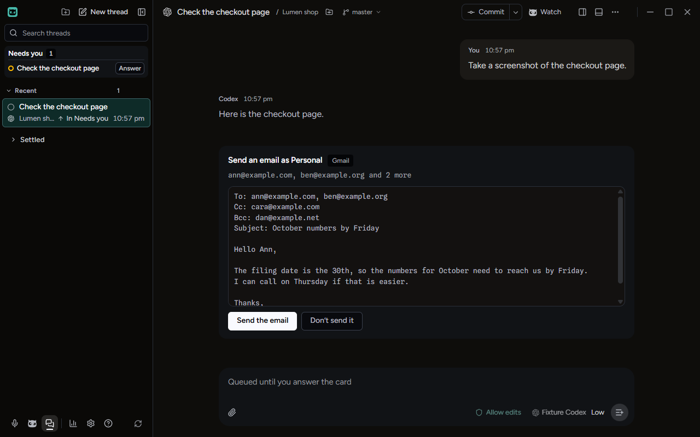
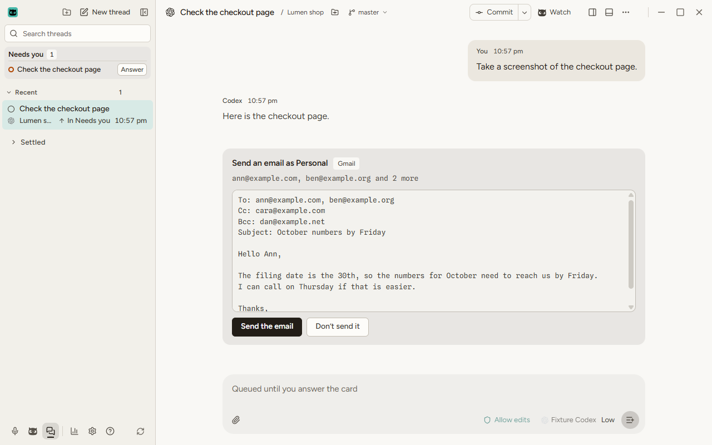
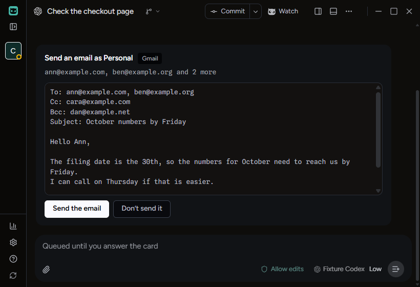
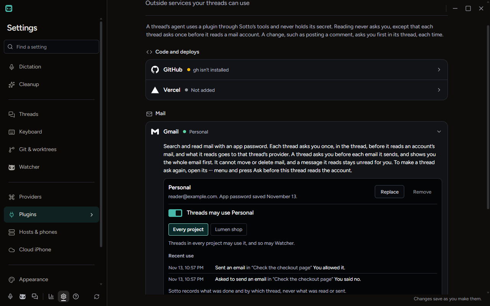

# A thread sending an email from a Gmail account

Checked on Windows on November 14, 2026, in the built app, for #2494: the second part of slice 9 of
`docs/plans/2026-11-11-plugins.md`. A thread's agent sends through `mail_send`, a named change, and every email waits on
a card in the thread until the user answers it. ADR-0205 records the decision, under "a thread asks before each email",
with Zach's picks from the mock-up kept as the tag `prototype/plugin-mail-send`.

Gmail was two stand-ins on this computer: a mail server that reads (`tests/fixtures/fakeImapServer.ts`), to add the
account, and one that sends (`tests/fixtures/fakeSmtpServer.ts`), each taking one made-up address and app password. The
run is `tests/e2e/plugins-gmail-send.spec.ts`, with the Owl feature turned on by `SOTTO_OWL_FEATURES=plugins=1` and the
stand-ins' ports given by `SOTTO_E2E_MAIL_PORT` and `SOTTO_E2E_SMTP_PORT`, which a packaged build never reads. Nothing
reached Gmail, and every address, password and word of the email was made up.

## What was done

Gmail's row was opened. It read "A thread asks you before each email it sends, and shows you the whole email first. It
cannot move or delete mail, and a message it reads stays unread for you." An account named Personal was added with the
address reader@example.com. Adding it signed in to the reading stand-in; the sending stand-in was asked nothing.

Back in the thread, its agent asked to send an email to two people, with one copied and one in Bcc. The call waited, and
the thread showed a card: **Send an email as Personal**, tagged Gmail, with "ann@example.com, ben@example.org and 2 more"
under it, then To, Cc, Bcc, the subject and the whole text in the box that scrolls, and **Send the email** and **Don't
send it**. The account's own address was nowhere on it. The thread counted in **Needs you**. The sending stand-in had
still been asked nothing.

The card was checked in dark and light at 1280x800, and in dark at 1600x1000 and the 820x560 minimum. It stayed inside
the thread's pane at each, and at the minimum the text wrapped and the box scrolled.

**Don't send it** was pressed. The card went, and the agent was told "The user said no. Nothing was sent. Do not ask
again unless they tell you to." The sending stand-in had been asked nothing at all.

The agent asked again. The new card was answered from the keyboard: **Send the email** focused and Enter pressed. The
agent was told "The user allowed it. Sent from the Gmail account "Personal" to 4 addresses." The stand-in took one
email, from reader@example.com, for all four people. Its From line was the account's address, its To line the two
people it was to, and its text the text the card showed. The Bcc address was in no line of it.

On Settings › Plugins, Gmail's Recent use listed, newest first, "Sent an email in "Check the checkout page" You allowed
it." and "Asked to send an email in "Check the checkout page" You said no." Neither the subject nor any address was on
the page. The record of use on disk named nobody, and the app password was in no file in Sotto's data folder.

## What else covers it

- `tests/unit/main/plugins/pluginMailSendTool.test.ts`: every email asks, even from a thread that may read the account;
  nothing is sent on no, a lapse or a stopped card; Watcher is not offered the tool and sends nothing; an email Sotto
  cannot send, such as 101 people or a subject with a line end, is refused before anyone is asked; a locked credential
  store is said before anyone is asked; an account switched off or removed while the card waited sends nothing; an
  email whose answer never came is never called unsent.
- `tests/unit/main/plugins/changeWordsPlain.test.ts`: the card's words, and a host's English for them, sentence for
  sentence.
- `tests/unit/renderer/features/settings/pluginsSettings.test.tsx`: Recent use for an email sent, said no to, unsure
  and failed.
- `tests/e2e/plugins-gmail.spec.ts`: the read card's new third line.

## Not checked here

- A real Gmail account. Sending is checked only against the stand-in until Zach adds his own account and sends one email
  to an address of his.
- A thread on a paired host sending. It goes through the same tool and the same card words in the host's English, which
  the unit tests hold together; no run here pairs a host.
