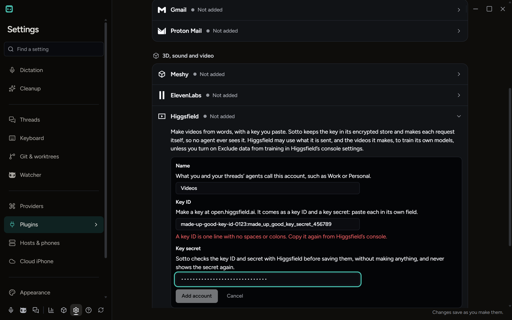
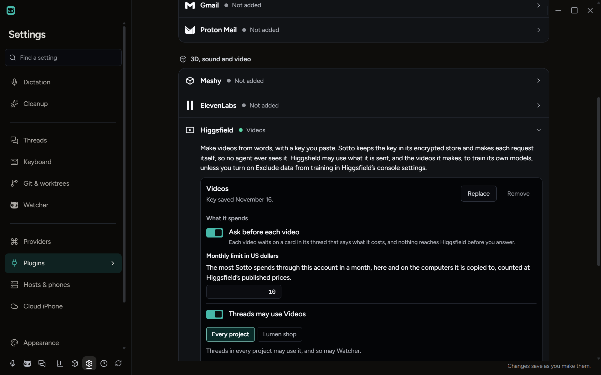
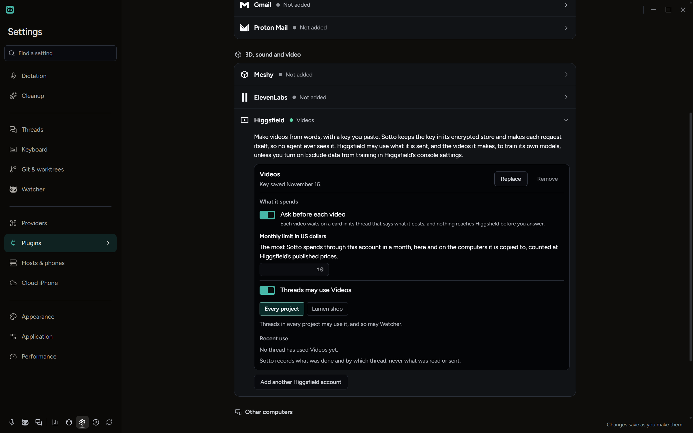
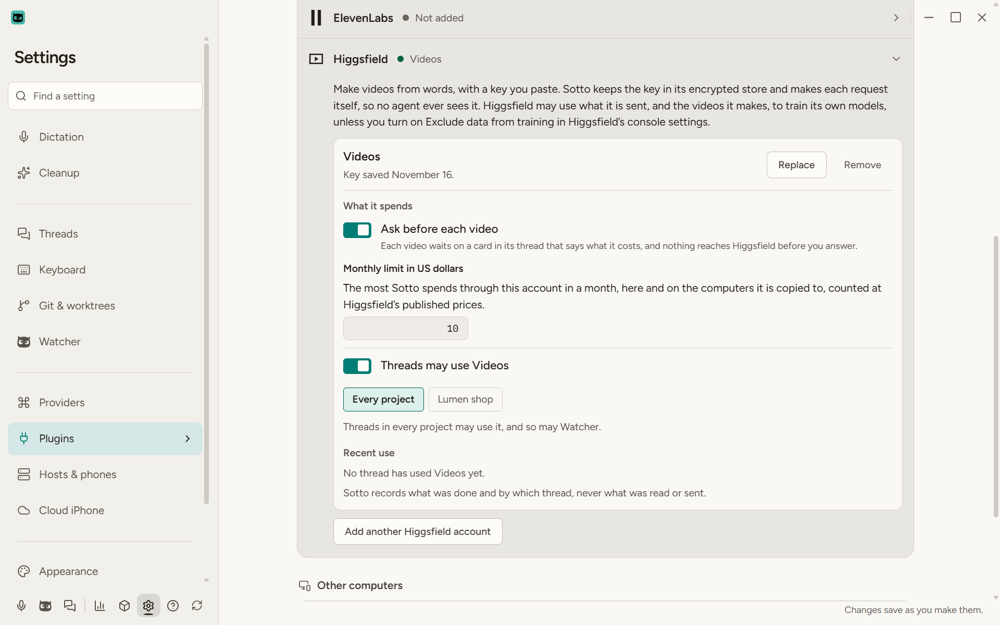
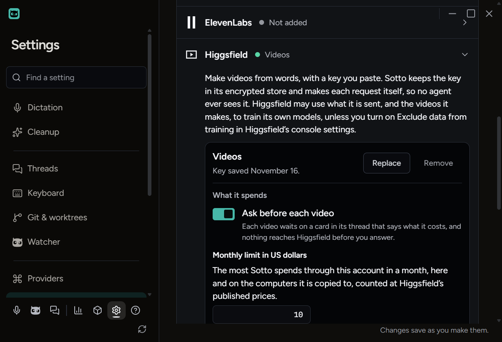
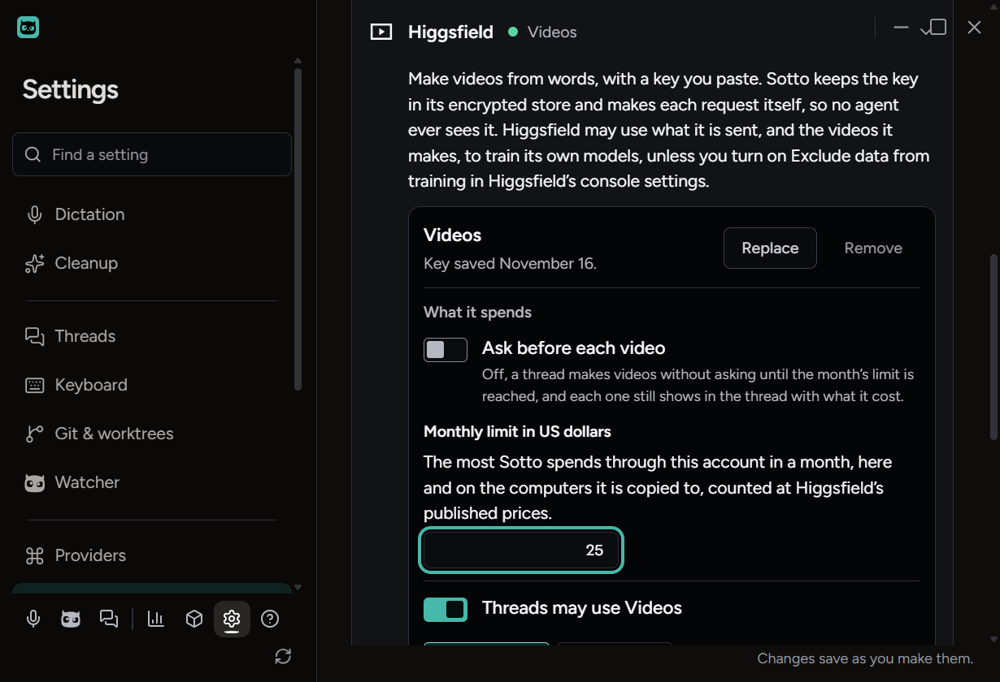

# A Higgsfield account on the Plugins page

Checked on Windows on November 16, 2026, in the built app, for #2499, the first part of slice 13 of
`docs/plans/2026-11-11-plugins.md`. Zach picked on November 16, 2026, on #2499:
- video first, pictures later;
- a monthly limit of $10, counted at Higgsfield's published prices;
- the agent picks a video model from a short list Sotto knows, and the card shows the model and its price.

This part is the account alone. Threads cannot make a video with it yet; that, and pictures after it, come in later
parts.

Higgsfield was a stand-in: a small server on this computer that answers `GET /models/usage` for one made-up key ID and
key secret, sent as `Authorization: Key <KEY_ID>:<KEY_SECRET>`, and 401 with `{"detail":"Invalid credentials"}` for
anything else. The run is `tests/e2e/plugins-higgsfield.spec.ts`, with `SOTTO_OWL_FEATURES=plugins=1`, and the
stand-in's address given by `SOTTO_E2E_HIGGSFIELD_API_URL`, which a packaged build never reads. Nothing reached
Higgsfield.

## What was done

Higgsfield's row sits after ElevenLabs in **3D, sound and video**, with a plain frame and play triangle for a mark,
since Simple Icons has no Higgsfield mark, and reads "Not added". Opened, the row says:
- that it makes videos from words, with a key you paste;
- that Sotto keeps the key and makes each request itself;
- that Higgsfield may use what it is sent, and the videos it makes, to train its own models, unless Exclude data from
  training is turned on in Higgsfield's console settings.

**Add a Higgsfield account** asked for a name, a **Key ID** and a **Key secret**, each with its own description and
placeholder; the key is made at open.higgsfield.ai. A key ID with a colon in it got "A key ID is one line with no spaces
or colons. Copy it again from Higgsfield's console." under its field, **Add account** stayed off, and the stand-in was
asked nothing.

A key ID and secret the stand-in refuses got "Higgsfield did not accept this key ID and secret. Nothing was saved.
Check both in Higgsfield's console at open.higgsfield.ai."

The good pair was kept: the account read "Key saved November 16." and the folded row "Higgsfield, Videos". The stand-in
was asked only `GET /models/usage`, once for each pair, and that read makes nothing. Afterwards the secret was not in
the page, and neither secret was in any file in Sotto's data folder.

Under **What it spends**, **Ask before each video** was on and **Monthly limit in US dollars** read 10, described as
counted at Higgsfield's published prices. No count of the month's spending is shown, since nothing spends through the
account until threads make videos. The open row was checked in dark and light at 1600x1000, 1280x800 and the 820x560
minimum, and nothing was wider than its room.

Turning the switch off and setting the limit to 25 with Enter saved both: the account read back as asking off, $25.

ElevenLabs' account journey (`plugins-elevenlabs.spec.ts`) still passes with the new row after it.

## What else covers it

- `tests/unit/main/plugins/higgsfieldAccount.test.ts`:
  - the pair is checked by reading `/models/usage`, in a `Key` header, with no redirect followed, or at the stand-in
    an end-to-end run names;
  - 401 and 403 are refused, 429 is busy, and anything else could not be checked;
  - a key ID or secret with a colon, a line end, a space or a letter a header cannot carry is sent nowhere;
  - the add and Replace schemas take a key ID for Higgsfield alone, each part trimmed;
  - the key ID and secret are trimmed and kept together in one slot, the account starts at asking on and $10, and the
    record is version 7, which builds from before Higgsfield refuse, and 6 again once it is removed;
  - a key with no key ID, or a part with a colon, is refused before anything is checked;
  - Replace takes a new key ID beside its new secret, and the switch and limit change.
- `tests/unit/main/plugins/copySync.test.ts`, `accountCopies.test.ts` and `tests/integration/pluginAccountCopies.test.ts`:
  - a host from before Higgsfield is sent no copy, and the page says it is too old;
  - a current host lists `plugin-higgsfield-copies` only to the desktop the launch script recorded, keeps the pair as
    the desktop sent it, and lists its switch and limit back.
- `tests/unit/renderer/features/settings/pluginsSettings.test.tsx`:
  - the row after ElevenLabs, its words, and the add form with its two fields, each one trimmed and each saying when
    what is in it is not one part;
  - Replace with a new key ID and secret, and the words when Higgsfield refuses them;
  - the switch, and the limit in whole dollars;
  - no credits or dollars read for the account.

## Not checked here

- A real Higgsfield key. The check was run against the stand-in only.
