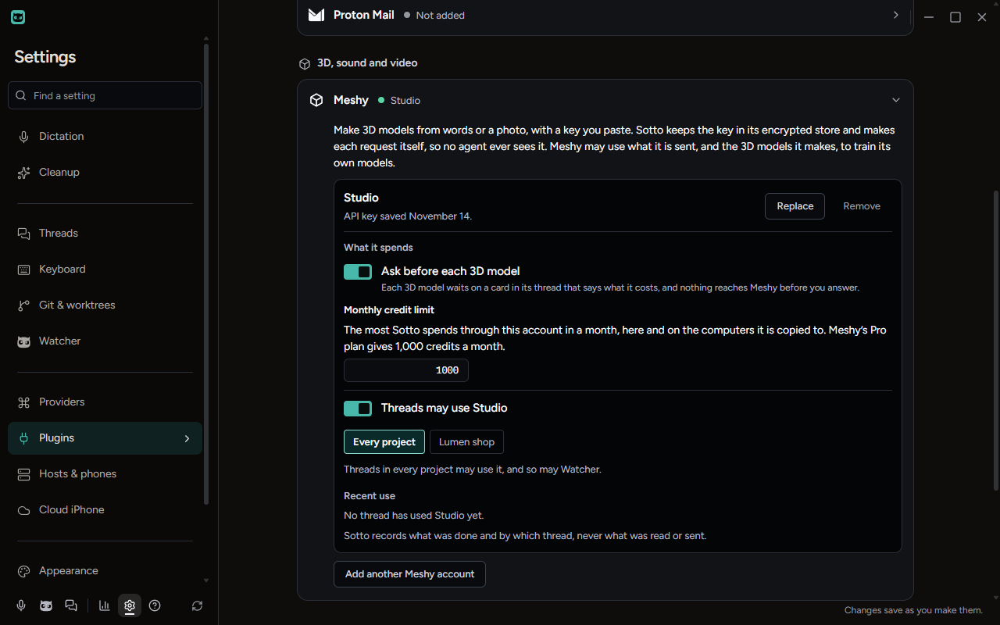
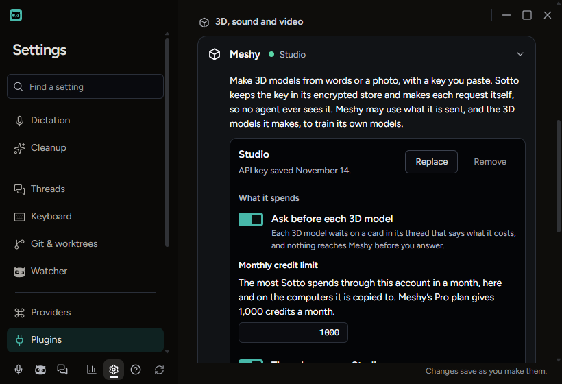
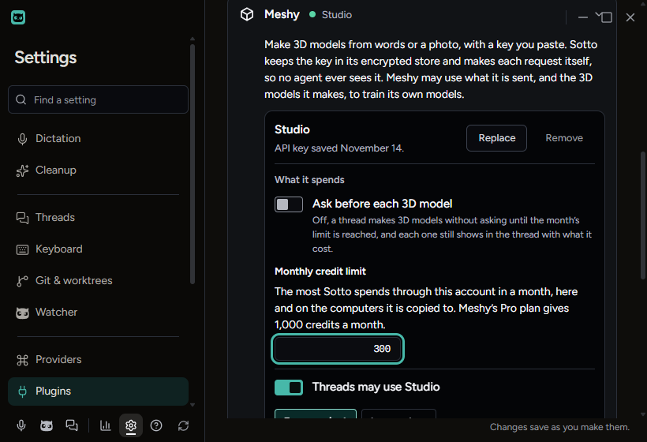

# A Meshy account on the Plugins page

Checked on Windows on November 15, 2026, in the built app, for #2497, the first part of slice 11 of
`docs/plans/2026-11-11-plugins.md`: ticket 1 of `docs/plans/2026-10-22-meshy-3d-models.md` as rewritten that day. Meshy's
key is a Meshy account on Settings › Plugins. Zach picked on November 15, 2026, from the mock-up kept as the tag
`prototype/plugin-meshy`: everything about spending the key lives on the account, 3D models ride on the `plugins` Owl
feature, and the row's group is **3D, sound and video**. ADR-0141's opening note records it.

Meshy was a stand-in: a small server on this computer that answers `GET /openapi/v1/balance` for one made-up key and
401 for anything else. The run is `tests/e2e/plugins-meshy.spec.ts`, with `SOTTO_OWL_FEATURES=plugins=1`, and the
stand-in's address given by `SOTTO_E2E_MESHY_API_URL`, which a packaged build never reads. Nothing reached Meshy.

## What was done

Settings › Plugins has a new group, **3D, sound and video**, under Mail. Meshy's row in it reads "Not added", with a
plain cube for its mark, since Meshy publishes none under an open licence. Opened, the row says what Meshy does, that
Sotto keeps the key and makes each request itself, and that Meshy may use what it is sent, and the 3D models it makes,
to train its own models.

**Add a Meshy account** asked for a name and an API key, made at meshy.ai/developers/keys on a paid plan. A key the
stand-in refuses got "Meshy did not accept this key. Nothing was saved. Make a key at meshy.ai/developers/keys: Meshy's
API needs a paid plan." The good key was kept: the account read "API key saved November 14." and the folded row "Meshy,
Studio". The stand-in was asked only `GET /openapi/v1/balance`, once for each key; that read is free. The key was not in
the page afterwards, and neither key was in any file in Sotto's data folder.

Under **What it spends**, **Ask before each 3D model** was on and the **Monthly credit limit** read 1,000. The open row
was checked in dark and light at 1600x1000, 1280x800 and the 820x560 minimum, and nothing was wider than its room.

Turning the switch off and setting the limit to 300 with Enter saved both: the account read back as asking off, 300
credits.

The Plugins page journey (`plugins-settings.spec.ts`) and the Vercel one (`plugins-vercel.spec.ts`) still pass with the
new group on the page.

## What else covers it

- `tests/unit/main/plugins/meshyAccount.test.ts`:
  - the key check reads the balance, with the key as a bearer token and no redirect followed;
  - 401 and 402 are refused, 429 is busy, and anything else could not be checked;
  - a new account asks first, within 1,000 credits, in a record older builds refuse (version 5);
  - the switch and the limit change only on an account that spends.
- `tests/unit/renderer/features/settings/pluginsSettings.test.tsx`: the group, the form, the switch, and the limit
  saved on Enter or refused when it is not a number.

## Ticket 3, November 15, 2026

- `tests/e2e/plugins-meshy.spec.ts` now also finds **Credits this month: 0 of 1,000.** under the limit in the built
  app, with nothing overflowing at 1600x1000, 1280x800 and 820x560 in dark and light. The screenshots above were not
  taken again.
- `tests/unit/main/plugins/pluginMeshyTool.test.ts`: `make_3d_model` asks on the card, makes nothing on a no, refuses
  one past the limit before asking and again after the yes, skips the card with asking off, sends a photo redrawn and
  refuses one outside the thread's folder, of another kind or changed since, and answers with the files' paths.

## Not yet

- Drawing a 3D model in the thread, the 3D models page, a host's threads and one limit shared across computers come
  with the plan's tickets 4 to 7. A copy on a paired computer carries the switch and the limit as they were when it
  was copied.
- A real Meshy key. The check was run against the stand-in only.
