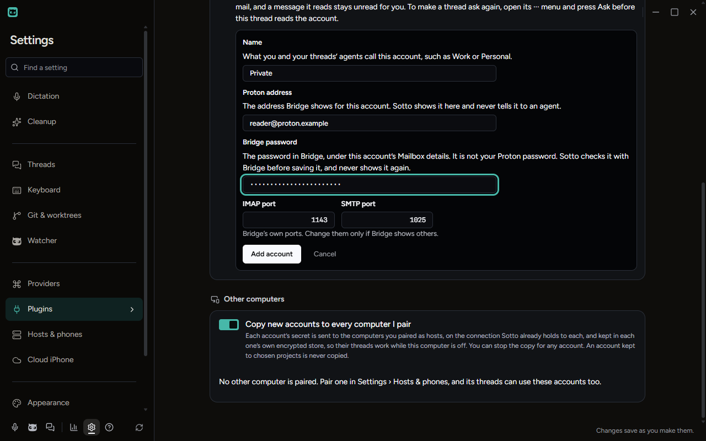
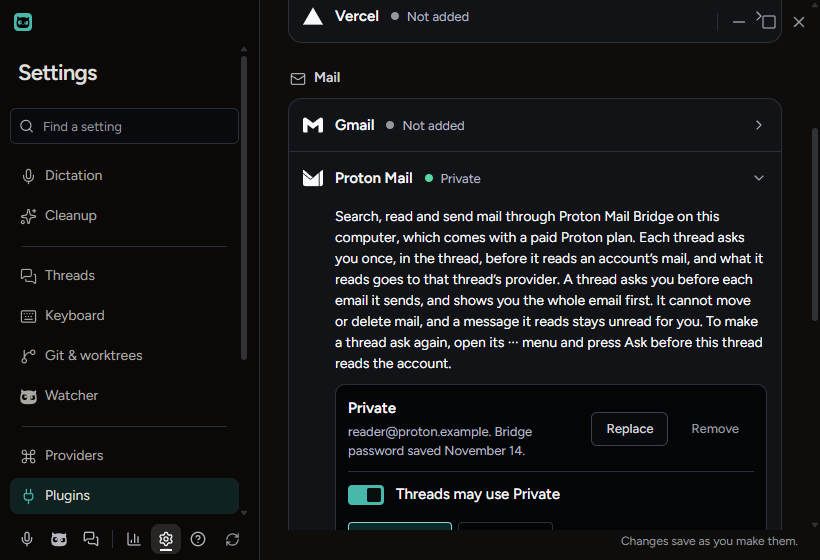
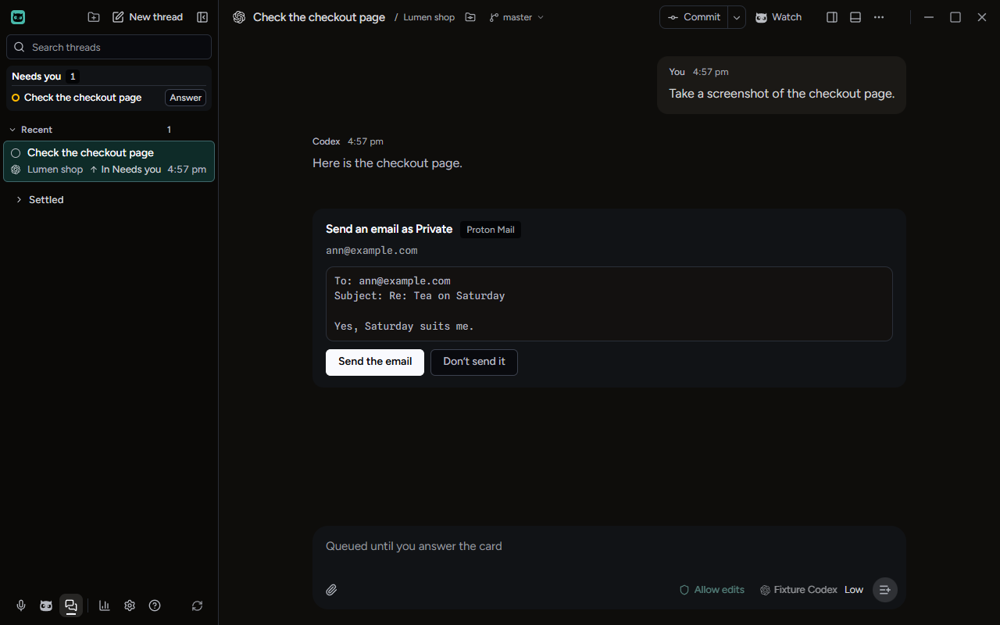
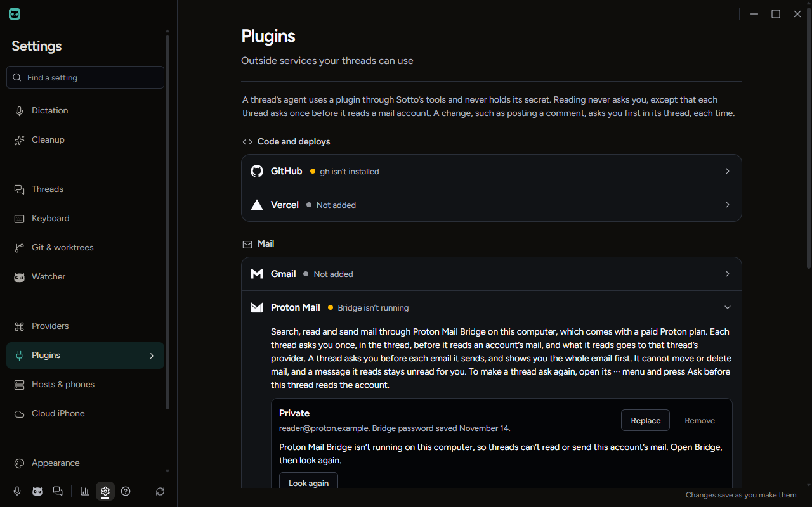

# A Proton Mail account on the Plugins page, read and sent from through Bridge

Checked on Windows on November 15, 2026, in the built app, for #2495: the third part of slice 10 of
`docs/plans/2026-11-11-plugins.md`. Proton Mail's row on Settings › Plugins adds an account through Proton Mail Bridge on
this computer, with the four answers Zach picked on November 14, 2026 from the mock-up kept as the tag
`prototype/plugin-proton-mail`: Bridge's ports as two fields filled in with its defaults, Bridge's certificate remembered
when the account is added, the row saying when Bridge isn't running, and the account kept on this computer. ADR-0205
records them under "Proton Mail through Bridge".

Bridge was a stand-in: made-up IMAP and SMTP servers on 127.0.0.1 (`tests/fixtures/fakeImapServer.ts`,
`fakeSmtpServer.ts`). Like Bridge, they begin each connection in the clear, offer STARTTLS, and show a certificate made
for 127.0.0.1 that no computer trusts (`tests/fixtures/bridgeCertificates.ts`). The run is
`tests/e2e/plugins-proton-mail.spec.ts`, with the Owl feature turned on by `SOTTO_OWL_FEATURES=plugins=1`. Bridge is on
this computer, so the ports typed into the form were the stand-ins' own. Nothing reached Proton, and every address,
password and message was made up.

## What was done

Under **Mail**, Proton Mail's row sat below Gmail's and read "Not added". **Add a Proton Mail account** opened a form
with Name, Proton address, Bridge password, and **IMAP port** and **SMTP port** filled in with 1143 and 1025, under
"Bridge's own ports. Change them only if Bridge shows others."

With the stand-ins' ports typed in, **Add account** checked the Bridge password with the stand-in. It began with
`CAPABILITY`, `STARTTLS`, `CAPABILITY` and only then `LOGIN`, so the password went over TLS. Sotto kept the certificate
the stand-in showed. The account showed "reader@proton.example. Bridge password saved November 14." and the folded row
read "Proton Mail, Private". The Bridge password was not in the page afterwards.

The open row was checked in dark and light at 1600x1000, 1280x800 and the 820x560 minimum. Nothing was wider than the
room it sits in.

In a thread, its agent asked to search the account. The card read **Read Proton Mail mail**, and once allowed, the
search returned the stand-in's message. The agent then asked to send a reply. The card read **Send an email as
Private**, and once **Send the email** was pressed, the stand-in took one email from the account. It saw `EHLO`,
`STARTTLS`, `EHLO` and only then `AUTH PLAIN`.

Then the IMAP stand-in was closed, as Bridge is when it is not running. A read was told "Proton Mail Bridge isn't
running on this computer, or isn't answering. Ask the user to open Bridge, then try again. Nothing was read." On
Settings › Plugins the folded row read "Bridge isn't running" with the warning dot. The account read "Proton Mail
Bridge isn't running on this computer, so threads can't read or send this account's mail. Open Bridge, then look
again.", with **Look again**.

The Bridge password was in no file in Sotto's data folder.

## What else covers it

- `tests/unit/renderer/features/settings/pluginsSettings.test.tsx`:
  - the add form sends the ports, and refuses a port outside 1 to 65535;
  - "Bridge isn't running", and **Look again**;
  - a changed certificate, and **Trust Bridge's new certificate**, including Bridge refusing the saved password;
  - the line that says the account is not copied to a paired computer.
- `tests/unit/main/plugins/pluginsIpc.test.ts`: the trust and Bridge-state channels, for the main window only.
- From parts 1 and 2 (#2584, #2586): STARTTLS and the remembered certificate, trusting a new certificate, Bridge's
  state read without signing in, accounts never copied, and the words agents are told.

## Not checked here

- A real Proton Mail Bridge. Its certificate, its ports and the names it gives mailboxes come from Bridge's source, read
  on November 14, 2026. They are checked against the stand-in only until Zach adds his own account.
- A changed certificate in the built app. The stand-in cannot be restarted on the same port with another certificate,
  so that path is covered by the unit tests above.
