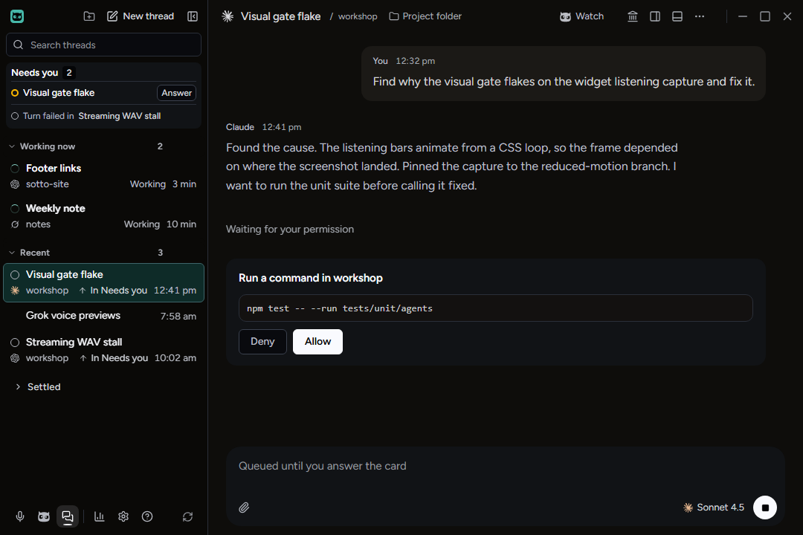
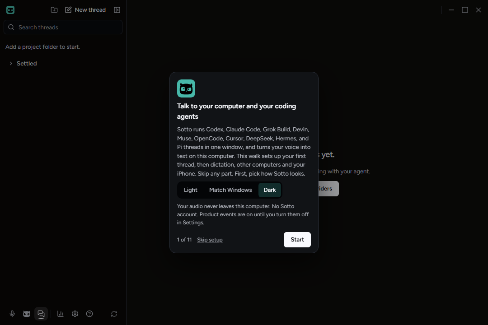

# Every held Owl feature on stable

Checked on Windows on November 17, 2026, in the built app, after Zach sent every Owl feature still held to stable
(ADR-0072, November 17 amendment). The e2e and design runs launch from the source manifest, which is a stable version,
so with every entry in `src/shared/owlFeatures.ts` sent they show what the next stable release after 0.1.42 shows.

## What was run

- The desktop journeys CI runs (`scripts/desktop-smoke.mjs` and `test:recovery`'s Playwright specs): command receipts,
  Council's Climb, the daily workspace, dictation recovery, a host's client updates, queued steering, Find a setting,
  the terminal's search, links and zoom, and Update all. All passed but one step of the daily workspace, below.
- The journeys whose held half changed: Teams, the click effect, Dynamic threads, the Markdown side panel, Watcher's
  gate and Settings beside a wide sidebar. Each held half now launches with its feature held through
  `SOTTO_OWL_FEATURES=<id>=0`, the way a build whose version still held it runs, and shows none of it. The Owl half of
  Watcher's gate fails on its own: an Owl run reads no part of the list, so it failed before this change too.
- `npm run design:capture`, then `scripts/verify-design-captures.mjs`: 144 tuples verified.

## What stable now shows

The design baselines are the record. 70 changed visibly and were regenerated; seven more differed by a few pixels of
noise and were kept as they were. What changed, in the captures:

- A thread's header has the Council button, and Settings' sidebar adds Council, Plugins and 3D models.
- Setup's welcome and agents step name Cursor, DeepSeek, Hermes and Pi with the other providers, and Settings ›
  Providers lists their rows.
- The floating widget shows its living owl.
- Settings has fifteen pages, Glass is among the themes, and the sent features' rows are in their groups.

## Not checked here

The daily workspace journey stops on this laptop at its Changes step, where a document's edited line should settle into
one row. It stops there with every one of the 47 held as well, so the cause is this computer, not the change; CI's
Windows runner runs it. The packaged stable feature check (`scripts/verify-owl-features-package.mjs`) runs when the
next stable is packaged, and with every entry sent it requires every feature on.
