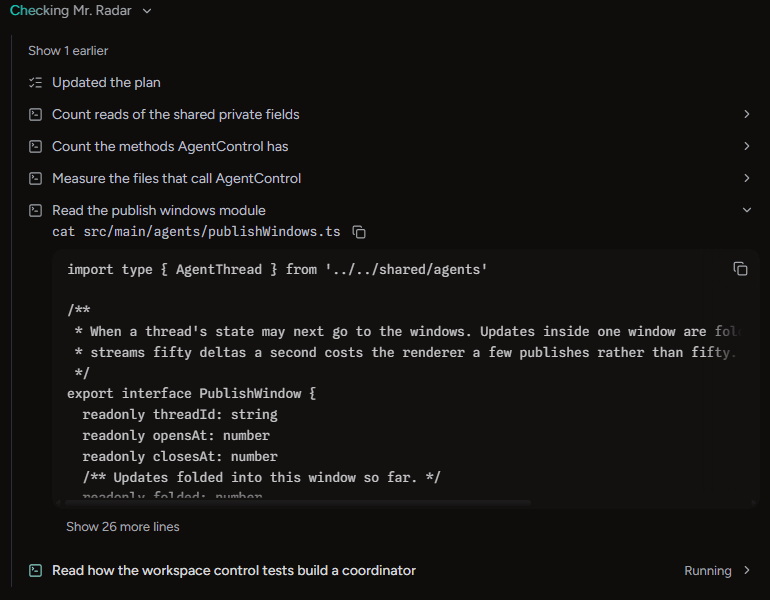
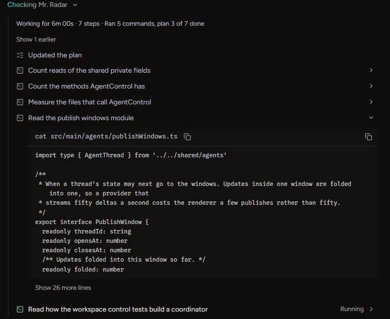
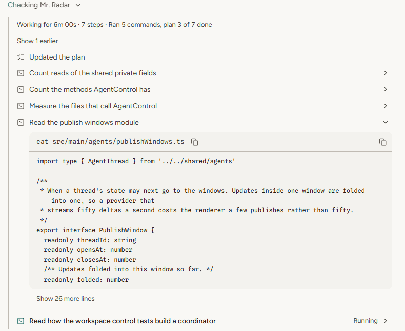
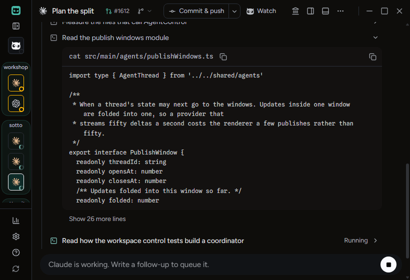
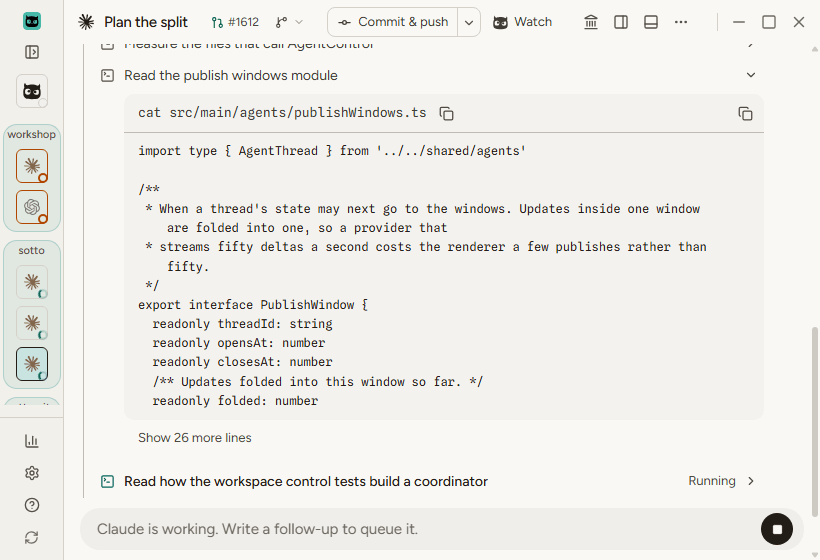
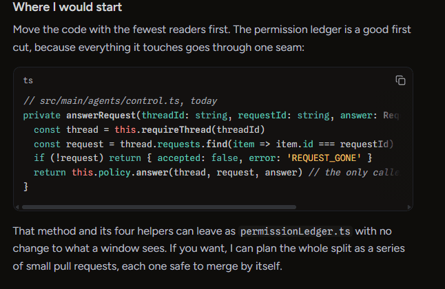
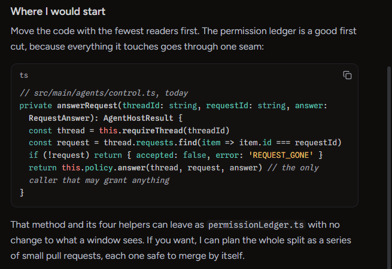
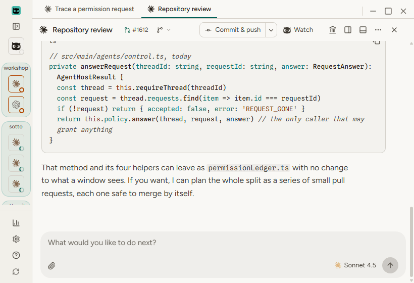
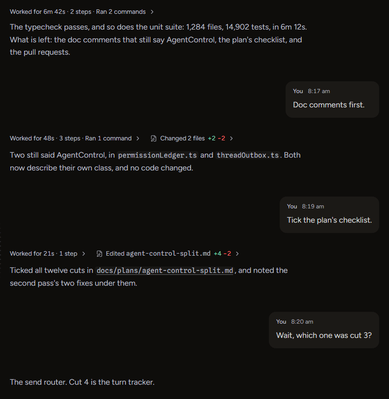
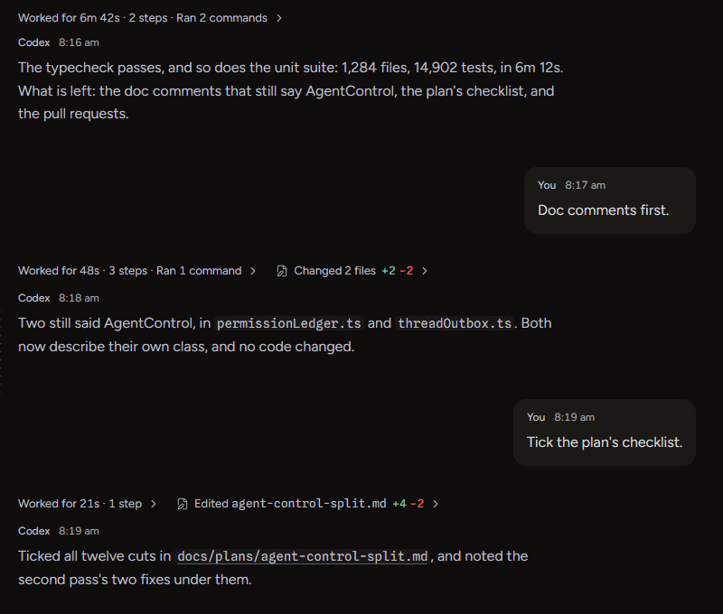

# Steps and replies: Zach's B picks

Zach picked B for all four items of `sotto-council/prototypes/followups/steps.html` (kept outside the repository) on November 6, 2026. This note shows each in the built app, from `tests/e2e/review-evidence-capture.spec.ts` (states `steps`, `thread-long`, `reading`, `split-panes` and `streaming`) on November 7, 2026, in dark and light at 1600×1000, 1280×800 and 820×560. Every image was looked at. The "before" images are the prototype's own crops of the final review round's captures.

## 1. An opened step's output is one well

The row says only what the step was for. Under it, `cat src/main/agents/publishWindows.ts` heads the output in the same fill, over a hairline. Beside the command is its own Copy, named "Copy the command", which Zach kept on November 7, 2026. Copy in the well's corner is named "Copy the output". Both are the same size and ink, and at 820 the command's Copy stays clear of the corner's. Nothing runs off the right at any size, and there is no sideways scroll bar. The twelve lines are whole lines: the two that wrap at 820 still count as one each. **Show 26 more lines** sits under the well.

## 2. Code in replies wraps

No fade and no scroll bar, in a split pane at 1600, and at 820 where the pane is narrowest. A block still being written wraps the same way, with its caret on its last line (`streaming-3`, `split-panes`, left pane). Watcher's conversation was not changed.

## 3. The working line and the opened fold's first line

The closed working line is unchanged: "Checking Mr. Radar" and its chevron, no clock (`steps-collapsed`, every size and both modes). Opened, the first line inside the steps' rule reads "Working for 6m 00s · 7 steps · Ran 5 commands, plan 3 of 7 done" (the first image under item 1). The capture holds the clock still. The unit test `threadActivity.test.tsx` checks that it counts up once a second.

## 4. Every reply is headed with its name and time

Every reply in `thread-long` is headed "Codex" and its time at every size, as every sent message is headed "You". The copy control under a later reply no longer has the name beside it (`reading-reply-copy`).
