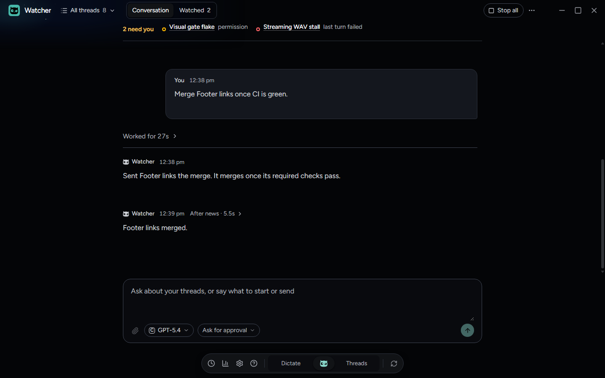
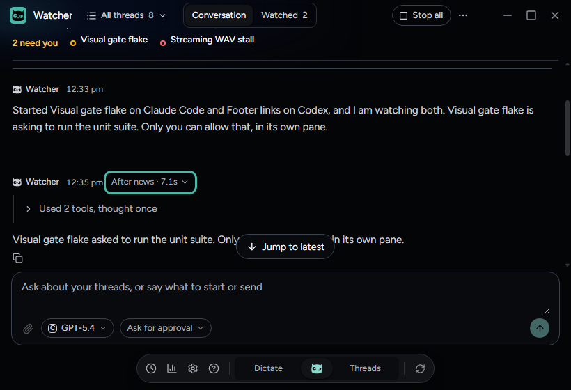
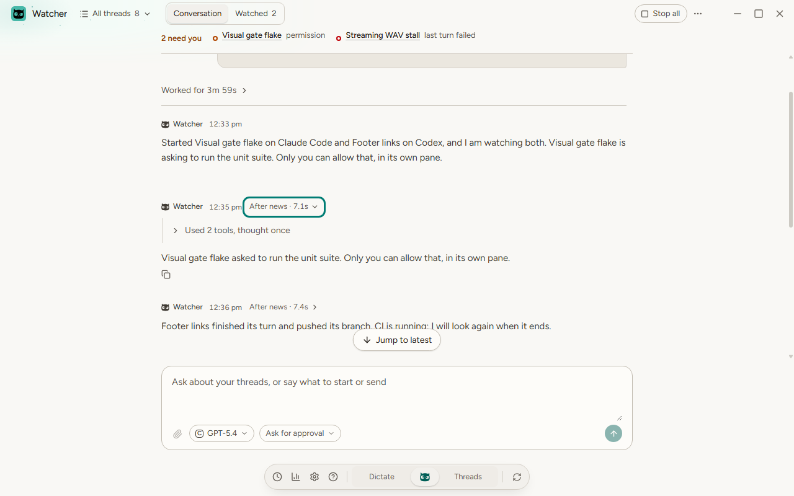

# Watcher's replies to news sit in place

Checked on Windows in this thread's worktree on October 19, 2026, after Zach sent a screenshot of Watcher's
Conversation: a stack of "Worked for 4.4s · Used 1 tool, thought once" rows below Watcher's newest reply. "These should
not be below the answers from the model. Also these are triggering far too much." ADR-0073's October 19 section records
what changed and Zach's pick, variant b of `docs/prototypes/watcher-news-turns-prototype.html`.

## Why the rows stacked

Main leaves each news wake-up out of Watcher's conversation (`watcherWakeUpsAsShown`). It keeps the turn's reply and its
work, and the work still names the left-out message. `placeActivities` could not place work like that and treated any
such turn begun after the oldest shown turn as the newest work, so every news turn's work drew after the last message,
one row per turn. The news reply joined the user's turn above it, which then folded the user's own answer under its
"Worked for" line and showed the news reply as that turn's answer.

## Zach's own Watcher thread

The placement was run, outside the app, over the IDs and times of Zach's Watcher thread in `threads.sqlite` (135
messages, 44 of them news wake-ups; no text was read beyond telling the wake-up line apart):

| | Rows after the last reply | News turns with their reply |
| --- | --- | --- |
| Before | 25 | 0 |
| After | 0 | 44 |

25 news turns still had their work in the records, matched by the reply that names the turn (`turnMessageId`). The other
19 had lost it to trimming and still open their own turn from that name, so none folds the user's answer away.

## In the built app

`tests/e2e/watcher.spec.ts` › "Watcher's replies to news sit in place…" seeds Watcher's history as main hands it to the
window, replies without their wake-ups and work that names them, and checks the room on the built app:

- Every turn reads in time order, each turn's work before its reply, and the newest reply is the last thing drawn. No
  activity row is drawn on its own.
- Each news reply's header says **After news · 7.1s**. Enter opens the work under the header, Escape folds it back and
  focus stays on the button.
- The news turn that wrote no reply draws nothing; the user's two turns keep their "Worked for" lines.
- Nothing overflows at 1600x1000, 1280x800 or 820x560, and text keeps 4.5:1 in dark and light.

`tests/unit/renderer/watcherNewsTurns.test.tsx` and the "placing the work of an unshown turn" cases in
`tests/unit/renderer/threadActivityView.test.ts` fail on the parent commit and pass here. They cover a failed news turn
with no reply, which keeps its line in place, and other threads, where such a turn keeps the usual "Worked for" line
above its reply.

## Not covered

The e2e harness's Watcher is not a Watcher-kind thread, so main does not hide wake-ups there. The seeded history is the
already-hidden form, and main's hiding is covered by `tests/unit/main/watcherWakeUp.test.ts`. A live Claude Watcher
receiving real news was not run, because it would act on real threads. Codex and Grok Build replies carry no
`turnMessageId`, so their news turns are placed by time alone and need their work in the records.
