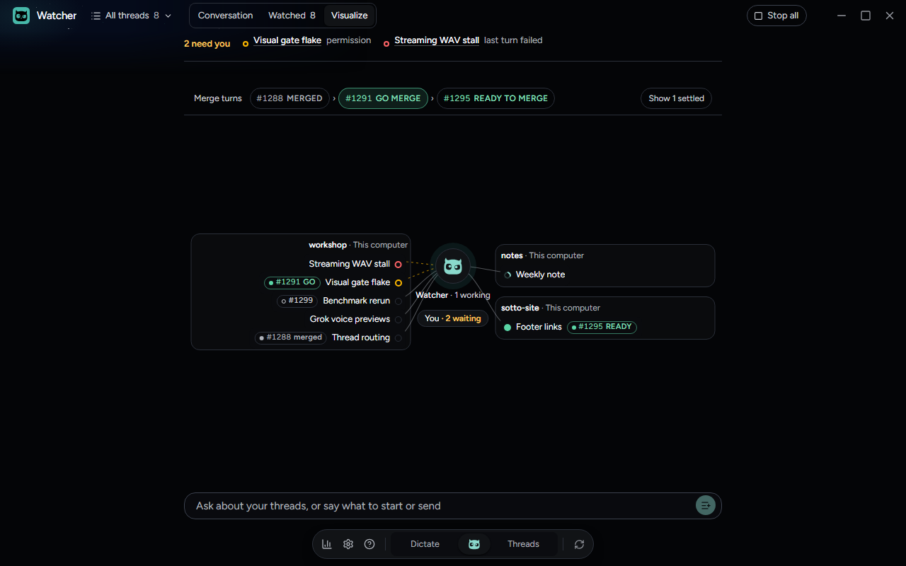
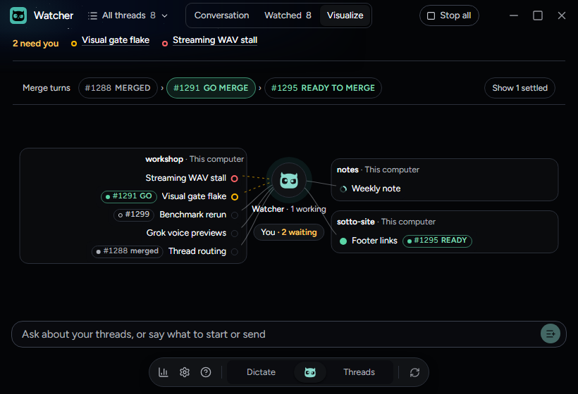
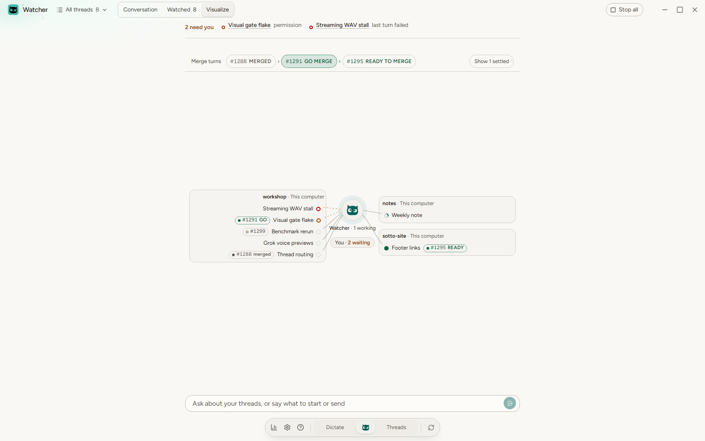
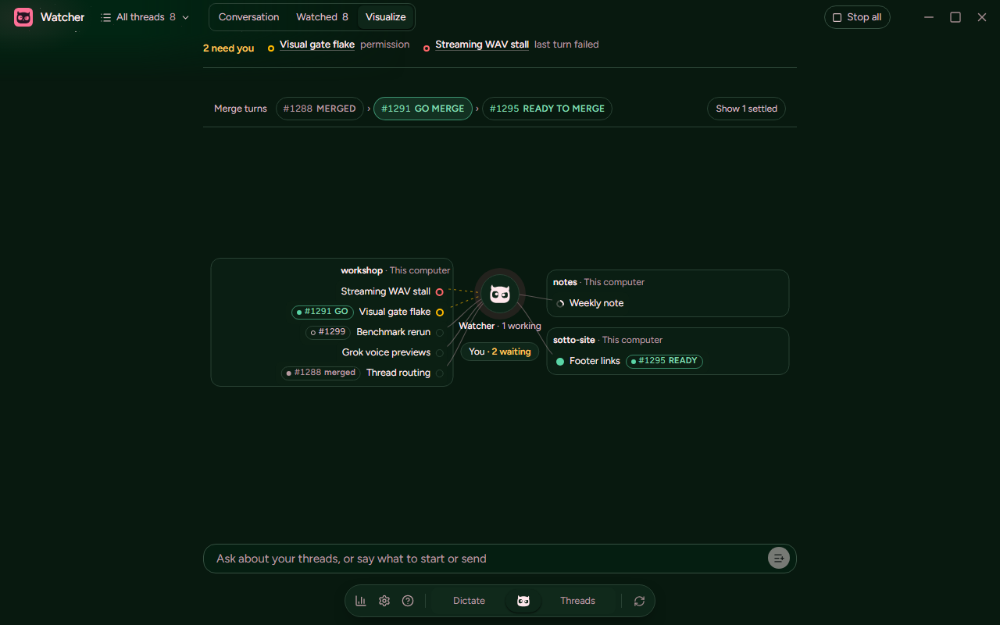
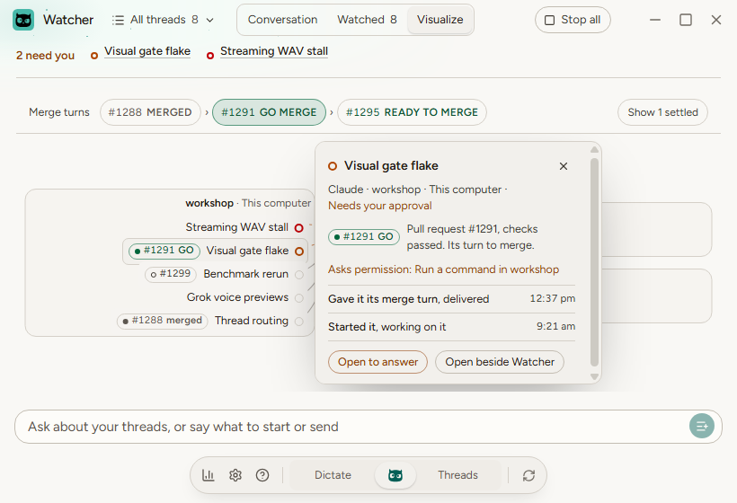
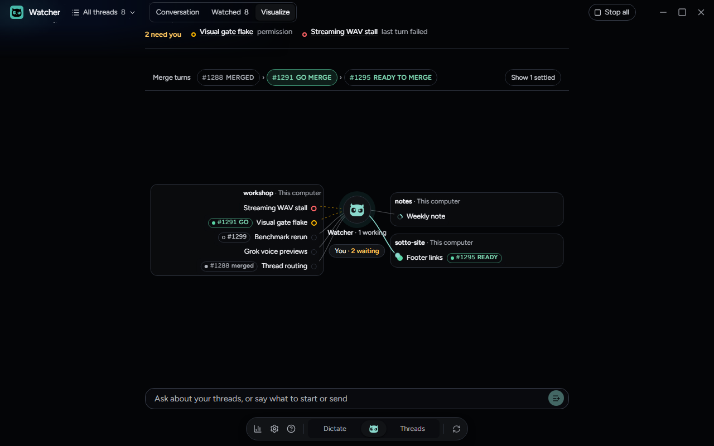
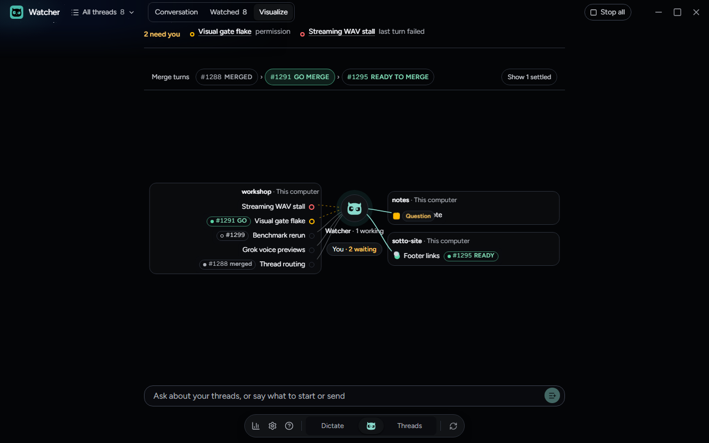
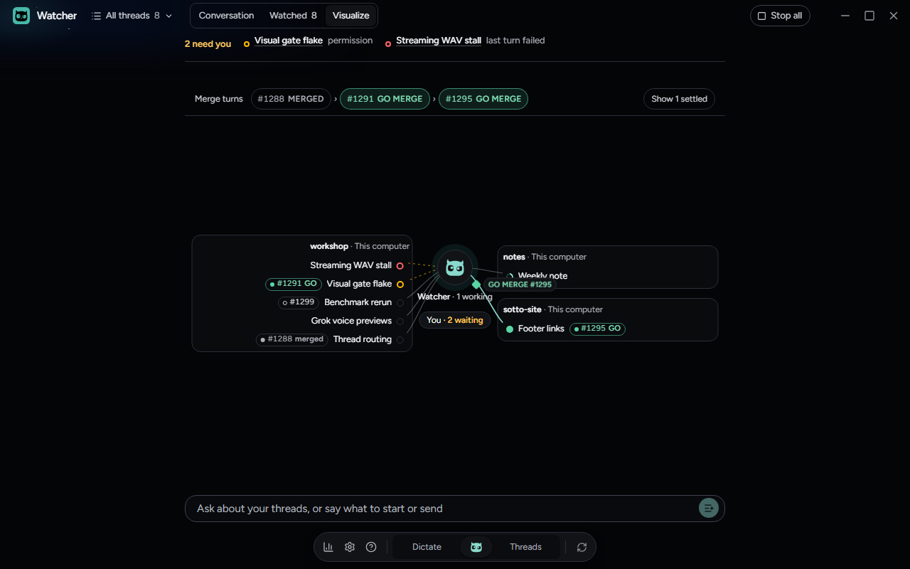
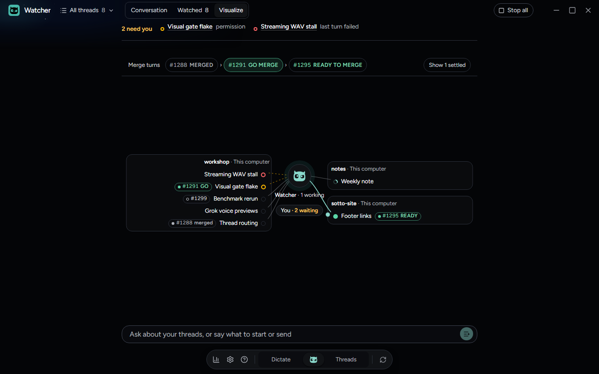

# Watcher's picture, in the built app

Checked on Windows from branch `feat/watcher-visualize` for #1339, on October 22, 2026, in the built app on the Sotto Owl
track. `tests/e2e/watcher-picture.spec.ts` drives it. Main's Watcher side is stood in for by a seeded projection that
then moves on a script. Watcher watches eight threads across three projects, one of them settled: #1288 merged, #1291
has its merge turn, #1295 waits in the merge queue, and #1299's checks are running. The script delivers a check-in to
Footer links, has it answer, has Weekly note ask the user a question, and gives #1295 its turn. The captures are in
`artifacts/watcher-picture/`.

## The picture at every size

- **The tab.** Visualize is the third tab, after Watched. The arrow keys move through Conversation, Watched and
  Visualize and wrap.
- **A narrow header.** Watcher's header was fitted to the pixel for two tabs, so the third had to fit as well. Below 640
  pixels of pane, 680 while Stop all shows, Visualize keeps only its constellation mark, still named Visualize. While
  Stop all shows, the tabs tighten from 570.
  - `tests/e2e/watcher.spec.ts`'s header journey drags the divider through every pane width from 400 pixels, light and
    dark, with and without Stop all, with seeded and three-digit counts. Every control stays whole, apart and inside
    one row, and the name shows where it did before.
  - That journey also expected More Watcher actions, which went with the Threads in flight limit on October 19
    (18b29e763) and which `src` on `origin/main` no longer has, so it failed on `main` too. It now checks Visualize
    instead.
- **Every size, every theme.** At 1600x1000, 1280x800 and 820x560, in Sotto dark and light and in Tropic dark:
  - every watched thread that is not settled is on screen, each on one line;
  - nothing overflows (`pageBoundProblems`);
  - every word in the picture and its card reads at 4.5:1 or better against what it sits on.
- **The merge turns.** They read `#1288 MERGED › #1291 GO MERGE › #1295 READY TO MERGE`.

## A thread's card

Pressing Visual gate flake opens its card. It shows:

- where it stands, in All threads' words, and that it asks permission;
- its pull request #1291 with its checks, and that it is its turn to merge;
- what Watcher last did with it: it gave it its merge turn, and earlier started it;
- **Open to answer** and **Open beside Watcher**.

From the keyboard, Enter on a thread opens its card with focus on Close details, and Escape closes it and gives focus
back to the thread.

## Messages moving

These captures are taken mid-flight:

- **The check-in.** Delivered to Footer links, it travels out from Watcher as a filled dot.
- **The question.** Weekly note's question travels on to You, tagged Question.
- **The merge turn.** #1295's GO MERGE travels out as a diamond with its tag, and the merge turns update to show its
  turn.

With reduced motion on, nothing travels. A still mark stands beside Footer links' dot, on Watcher's side, and its line
lights. The spec checks that the mark's box and the thread's title do not overlap.

## The composer and settled threads

- **The composer.** While the picture shows, Watcher's composer is one line: under 56 pixels, with Send at its end.
  Focusing it brings back its options and grows it.
- **Settled threads.** **Show 1 settled** brings back Notes cleanup, marked settled.

## What was not checked here

- **Main's Watcher in the built app.** Main's side was stood in for. `tests/integration/watcherTools.test.ts` and
  `tests/integration/watcherPairedHosts.test.ts` check it over the fake providers: a send marked `mergeTurn` goes out
  exactly as an unmarked one, the saved record keeps its shape, a retry without the mark reads the same receipt,
  `readMergeTurns` gives the turn, and the packet a paired host is sent carries no trace of it.
- **macOS and Linux.** Not run.
